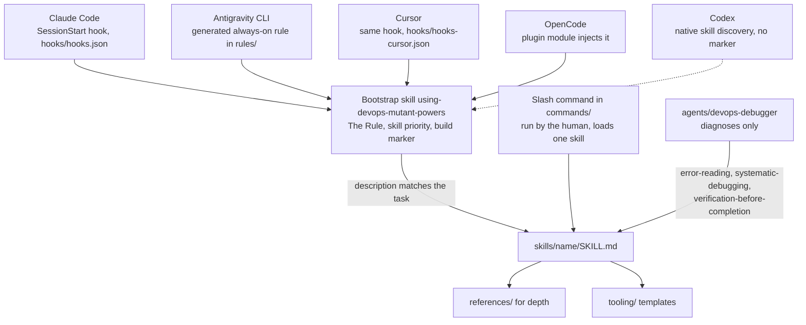
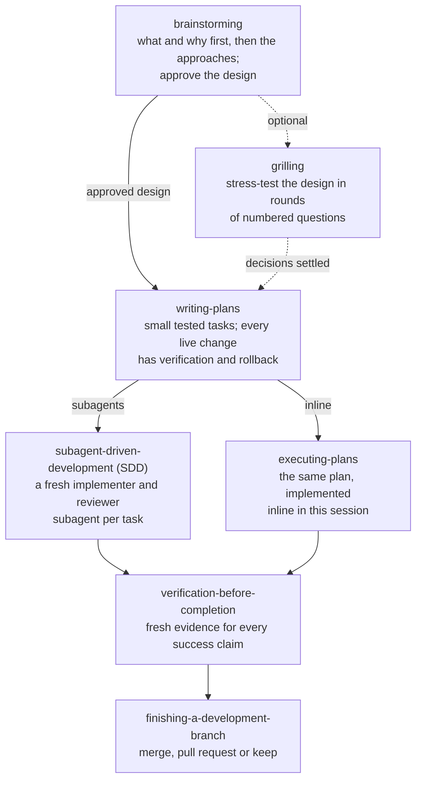

<picture>
  <source media="(prefers-color-scheme: dark)" srcset="https://raw.githubusercontent.com/nikospavlopoulos/assets/main/devops-mutant-powers/hero-dark.svg">
  <source media="(prefers-color-scheme: light)" srcset="https://raw.githubusercontent.com/nikospavlopoulos/assets/main/devops-mutant-powers/hero-light.svg">
  
</picture>

DevOps Mutant Powers is a plugin for AI (artificial intelligence) coding agents. It gives the agent 45 skills: a
workflow for designing, planning, building and finishing changes, and DevOps skills for Kubernetes, GitOps with Flux
and Argo CD, IaC (infrastructure as code), CI/CD (continuous integration and delivery), PostgreSQL, networking, TLS
(Transport Layer Security) certificates, identity, cloud, observability and incident response. Copy-ready templates
under `tooling/` back the skills. It supports Claude Code, Antigravity, Codex, Cursor and OpenCode.

## Why operational discipline

A capable model can write a Deployment or a Terraform module. What a generic assistant tends to skip is the
discipline around the change, and on infrastructure that is where the damage happens. With the plugin loaded, the
agent works to a set of operating principles:

- **Cause before fix.** For a bug or failure, one read-only command that shows the exact symptom comes first, then two
  to five ranked hypotheses, each with the result that would confirm or rule it out.
- **Owner before change.** Find what manages a resource (GitOps, an operator, IaC or a person) before changing it.
- **Name the target.** Every command carries its cluster context, namespace, host or account.
- **Approval before live changes.** Read-only checks run freely. An apply, restart, delete, rotation or destroy, or a
  push to a branch something deploys from, waits for an explicit yes.
- **Green is a claim.** Prove the effect through the user's real path, not a status light.
- **Never print secrets.** Compare by hash or length; redact logs before sharing.
- **Plain language.** Acronyms, error codes and tool terms are expanded at first use.

The skills hold the depth behind those rules: the failure modes, the commands that prove each one, and where one
skill hands over to another.

## How it works

The bootstrap skill, [using-devops-mutant-powers](skills/using-devops-mutant-powers/SKILL.md), is loaded at session
start. It carries The Rule (check for a matching skill before any response or action), the skill priority (for
example, a live outage goes to `incident-response` first) and the operating principles above. Every harness lists each
skill's name and description to the model, and the description says when the skill applies, so the model loads the
skill that matches the task. Each harness delivers the bootstrap its own way, and the delivered text carries a build
marker, `You have devops-mutant-powers v<version>`. Codex is the exception: there the model loads the bootstrap
through Codex's own skill discovery, and no marker appears. Details:
[docs/session-activation.md](docs/session-activation.md).



*How a session reaches a skill: each harness delivers the bootstrap its own way; the agent loads the skill whose
description matches the task, and that skill points to references and templates.*

Work that builds or changes something follows the workflow skills:



*A dotted line is optional. Both executors run the same plan, and every change ends with fresh evidence and a branch
decision.*

SDD (subagent-driven development) makes the main agent a controller: a fresh implementer subagent per task, a
reviewer subagent after each task, one review of the whole branch at the end. Both executors keep a ledger on disk and
stop before any command that changes live state. Vocabulary (spec, plan, ledger, ruling, render gate):
[docs/concepts.md](docs/concepts.md).

## The powers

45 skills in ten families. Each skill is `skills/<name>/SKILL.md`, with depth in its `references/`. Triggers, rules
and boundaries for every skill: [docs/skills-reference.md](docs/skills-reference.md).

### <picture><source media="(prefers-color-scheme: dark)" srcset="https://raw.githubusercontent.com/nikospavlopoulos/assets/main/devops-mutant-powers/badges/workflow-on-dark.svg"></picture>Workflow

12 skills.

| Skill | Use it for |
|---|---|
| [brainstorming](skills/brainstorming/SKILL.md) | Find out what is wanted and why, size the work (quick task, small change, or a written design), and get approval before building |
| [writing-plans](skills/writing-plans/SKILL.md) | Turn an approved design into small tested tasks, with verification and rollback for every live change |
| [executing-plans](skills/executing-plans/SKILL.md) | Run a plan inline in this session, with a ledger and one final branch review |
| [subagent-driven-development](skills/subagent-driven-development/SKILL.md) | Run a plan with a fresh implementer and a reviewer subagent per task |
| [dispatching-parallel-agents](skills/dispatching-parallel-agents/SKILL.md) | One agent per independent problem when nothing is shared between them |
| [test-driven-development](skills/test-driven-development/SKILL.md) | Failing test first for IaC, manifests, pipelines, scripts and alert rules |
| [verification-before-completion](skills/verification-before-completion/SKILL.md) | No completion claim without fresh evidence; what each green signal really proves |
| [finishing-a-development-branch](skills/finishing-a-development-branch/SKILL.md) | Check the tests, then offer merge, pull request or keep; a GitOps merge is a deploy |
| [using-git-worktrees](skills/using-git-worktrees/SKILL.md) | Ensure an isolated workspace: existing isolation, the harness's own tool, then a git worktree |
| [requesting-code-review](skills/requesting-code-review/SKILL.md) | Dispatch a reviewer subagent with a precise brief before merging |
| [receiving-code-review](skills/receiving-code-review/SKILL.md) | Check review feedback against the codebase before implementing it |
| [grilling](skills/grilling/SKILL.md) | Stress-test a plan, design or decision in rounds of numbered questions, each with options and a recommended answer |

### <picture><source media="(prefers-color-scheme: dark)" srcset="https://raw.githubusercontent.com/nikospavlopoulos/assets/main/devops-mutant-powers/badges/debugging-and-incidents-on-dark.svg"></picture>Debugging and incidents

3 skills.

| Skill | Use it for |
|---|---|
| [systematic-debugging](skills/systematic-debugging/SKILL.md) | Root cause before any fix: a read-only command that shows the symptom, ranked hypotheses, then a lasting check |
| [error-reading](skills/error-reading/SKILL.md) | Read pasted errors and logs: the innermost cause, the layer that produced it, the skill that owns it |
| [incident-response](skills/incident-response/SKILL.md) | Live outage: preserve evidence, stabilise reversibly, verify recovery, write the postmortem |

### <picture><source media="(prefers-color-scheme: dark)" srcset="https://raw.githubusercontent.com/nikospavlopoulos/assets/main/devops-mutant-powers/badges/platform-on-dark.svg"></picture>Platform

6 skills.

| Skill | Use it for |
|---|---|
| [kubernetes](skills/kubernetes/SKILL.md) | Manifests and Helm charts: probes, immutable fields, scheduling, admission and policy denials |
| [kubernetes-storage](skills/kubernetes-storage/SKILL.md) | Volume claims Pending or deleted, Multi-Attach, mount and resize failures, Longhorn, Velero |
| [platform-lifecycle](skills/platform-lifecycle/SKILL.md) | Cluster migration and decommission, node drains, kubelet rollouts, k3s and Talos node operations |
| [container-operations](skills/container-operations/SKILL.md) | Dockerfiles and the image runtime contract: numeric user, read-only root, entrypoint, tags |
| [app-runtime](skills/app-runtime/SKILL.md) | OOMKilled (out-of-memory kill), CPU (processor) throttling, worker sizing, Celery and Redis behaviour, ignored config |
| [batch-data-jobs](skills/batch-data-jobs/SKILL.md) | Copy and migration Jobs, CronJobs and cron scripts that fail loudly and verify the destination |

### <picture><source media="(prefers-color-scheme: dark)" srcset="https://raw.githubusercontent.com/nikospavlopoulos/assets/main/devops-mutant-powers/badges/delivery-on-dark.svg"></picture>Delivery

5 skills.

| Skill | Use it for |
|---|---|
| [gitops-flux](skills/gitops-flux/SKILL.md) | Flux stalls and drift, HelmRelease recovery, image automation, a render gate before every push |
| [argo](skills/argo/SKILL.md) | Argo CD sync and health, ApplicationSets, AppProject denials; Argo Rollouts, Workflows, Events, Kargo |
| [ci-cd-pipeline](skills/ci-cd-pipeline/SKILL.md) | Failing or stuck GitLab CI, GitHub Actions and Jenkins pipelines; runner hosts |
| [infrastructure-provisioning](skills/infrastructure-provisioning/SKILL.md) | Terraform/OpenTofu and Pulumi: saved plans, a destroy gate, state locks, drift, refactors without re-creation |
| [configuration-management](skills/configuration-management/SKILL.md) | Ansible, Puppet, Chef, Salt: check and noop runs, canary then batches, proven idempotency |

### <picture><source media="(prefers-color-scheme: dark)" srcset="https://raw.githubusercontent.com/nikospavlopoulos/assets/main/devops-mutant-powers/badges/network-and-edge-on-dark.svg"></picture>Network and edge

5 skills.

| Skill | Use it for |
|---|---|
| [network-operations](skills/network-operations/SKILL.md) | Refused versus timed out, packet-size stalls, egress blocks, firewalls, VPN (virtual private network) tunnels |
| [dns-and-domains](skills/dns-and-domains/SKILL.md) | DNS (Domain Name System) resolution by layer, cluster DNS, domain cutovers, mail authentication |
| [reverse-proxy](skills/reverse-proxy/SKILL.md) | 5xx errors, CORS (cross-origin resource sharing), redirects and the client IP (Internet Protocol) address through proxies, gateways, CDNs (content delivery networks) and meshes |
| [load-balancing](skills/load-balancing/SKILL.md) | Nginx upstream algorithms, passive health checks, uneven traffic distribution |
| [tls-certificates](skills/tls-certificates/SKILL.md) | Expired, mismatched or non-renewing certificates; prove the served certificate at every hop |

### <picture><source media="(prefers-color-scheme: dark)" srcset="https://raw.githubusercontent.com/nikospavlopoulos/assets/main/devops-mutant-powers/badges/data-on-dark.svg"></picture>Data

2 skills.

| Skill | Use it for |
|---|---|
| [postgres-operations](skills/postgres-operations/SKILL.md) | PostgreSQL and CNPG (CloudNativePG): privileges, ownership, pooling, dump and restore, backups, replication, locks |
| [data-services](skills/data-services/SKILL.md) | Kafka on Strimzi, MongoDB, MySQL: operator-owned changes, auth and TLS, replication, backups |

### <picture><source media="(prefers-color-scheme: dark)" srcset="https://raw.githubusercontent.com/nikospavlopoulos/assets/main/devops-mutant-powers/badges/security-and-identity-on-dark.svg"></picture>Security and identity

3 skills.

| Skill | Use it for |
|---|---|
| [secrets-management](skills/secrets-management/SKILL.md) | Leaked secrets, SOPS (Secrets OPerationS) with age, External Secrets sync, rotation in lockstep, token ownership |
| [identity-oidc](skills/identity-oidc/SKILL.md) | OIDC (OpenID Connect) login loops, token endpoint errors, missing claims, identity provider moves, Keycloak |
| [access-management](skills/access-management/SKILL.md) | Grant, prove and revoke human access: Kubernetes RBAC (role-based access control), Tailscale policy, bastions |

### <picture><source media="(prefers-color-scheme: dark)" srcset="https://raw.githubusercontent.com/nikospavlopoulos/assets/main/devops-mutant-powers/badges/cloud-and-observability-on-dark.svg"></picture>Cloud and observability

2 skills.

| Skill | Use it for |
|---|---|
| [cloud-operations](skills/cloud-operations/SKILL.md) | AWS (Amazon Web Services), Azure, Google Cloud: pin identity and scope, access denials, cost spikes, orphaned disks and addresses |
| [monitoring-and-alerting](skills/monitoring-and-alerting/SKILL.md) | Missing targets, silent or flapping alerts, Grafana "No data", bounded log queries, alert rule design |

### <picture><source media="(prefers-color-scheme: dark)" srcset="https://raw.githubusercontent.com/nikospavlopoulos/assets/main/devops-mutant-powers/badges/code-quality-on-dark.svg"></picture>Code quality

2 skills.

| Skill | Use it for |
|---|---|
| [code-audit](skills/code-audit/SKILL.md) | DevOps readiness review: secrets, containers, Kubernetes, CI/CD, IaC, observability; findings rated CRITICAL, WARNING or INFO |
| [code-optimization](skills/code-optimization/SKILL.md) | Performance and waste review: leaks, N+1 queries (one query per row), blocking calls, container waste; findings rated HIGH, MEDIUM or LOW |

Both work on the files in the working directory or on pasted code, and both only report: each finding names the
place, why it matters and the fix, and applying a fix is a separate change.

### <picture><source media="(prefers-color-scheme: dark)" srcset="https://raw.githubusercontent.com/nikospavlopoulos/assets/main/devops-mutant-powers/badges/meta-on-dark.svg"></picture>Meta

5 skills.

| Skill | Use it for |
|---|---|
| [using-devops-mutant-powers](skills/using-devops-mutant-powers/SKILL.md) | The bootstrap: The Rule, the skill priority and the operating principles, loaded at session start |
| [writing-skills](skills/writing-skills/SKILL.md) | Create or edit skills test-first, with pressure scenarios and a description that carries every trigger |
| [diagnosing-superpowers](skills/diagnosing-superpowers/SKILL.md) | An evidence-backed report on a session that went wrong, drafted as a local issue |
| [unattended-runs](skills/unattended-runs/SKILL.md) | Runs of hours or days that survive usage limits: plan, ledger, heartbeat, progress messages |
| [visual](skills/visual/SKILL.md) | Offer a diagram only when a path, topology or branching flow is central to the answer, and draw it on yes |

## Install

### Claude Code

In Claude Code:

```text
/plugin marketplace add nikospavlopoulos/devops-mutant-powers
/plugin install devops-mutant-powers@devops-mutant-powers
```

Or from a shell:

```bash
claude plugin marketplace add nikospavlopoulos/devops-mutant-powers
claude plugin install devops-mutant-powers@devops-mutant-powers
```

Start a new session afterwards. The install follows the `main` branch, which changes only when a release is
published. To upgrade:

```bash
claude plugin marketplace update devops-mutant-powers
claude plugin update devops-mutant-powers@devops-mutant-powers
```

To stay on one release, add the marketplace with a tag instead:
`claude plugin marketplace add "nikospavlopoulos/devops-mutant-powers#v<x.y.z>"`. Moving a pin, rolling back and
checking an install: [docs/maintenance/review-gate.md](docs/maintenance/review-gate.md#updating-an-installed-copy).
To try a local clone for one session without changing the install: `claude --plugin-dir <clone>`.

On a model with a context window of about 200k tokens, raise Claude Code's skill-listing budget so every skill keeps
its description, which is how skills get chosen: `skillListingBudgetFraction` (for example `0.02`) in your settings
([details](docs/session-activation.md#skill-listing-budget)). Claude Code's plugin docs:
[discover and install plugins](https://code.claude.com/docs/en/discover-plugins).

### Antigravity

Antigravity CLI (command-line interface, `agy`) installs the plugin from a clone and stages a copy of it:

```bash
git clone https://github.com/nikospavlopoulos/devops-mutant-powers.git <clone>
agy plugin install <clone>      # run it again after every git pull
agy plugin list                 # the plugin must be listed and enabled
```

The bootstrap arrives as an always-on rule packaged in the plugin. Antigravity's docs:
[plugins](https://antigravity.google/docs/plugins?tab=cli) and [rules](https://antigravity.google/docs/rules).

### Codex

The repository is its own Codex marketplace. From a clone:

```bash
git clone https://github.com/nikospavlopoulos/devops-mutant-powers.git <clone>
codex plugin marketplace add <clone>
codex plugin add devops-mutant-powers@devops-mutant-powers
```

Instead of the last command, you can open `/plugins` in the Codex CLI (**Plugins** in the app) and install
`devops-mutant-powers` there. Restart Codex after installing. Steps, subagent setup and checks:
[.codex/INSTALL.md](.codex/INSTALL.md). Codex's docs: [plugins](https://developers.openai.com/plugins/build/plugins).

### Cursor

DevOps Mutant Powers is not listed in Cursor's plugin marketplace, so it installs from Cursor's local plugin folder:

```bash
git clone https://github.com/nikospavlopoulos/devops-mutant-powers.git ~/.cursor/plugins/local/devops-mutant-powers
```

Clone into that folder itself: Cursor skips a symlink that points outside `~/.cursor/plugins/local`. Then restart
Cursor or run **Developer: Reload Window**, open **Customize** and check that the plugin's skills, commands and rules
are listed. On Teams and Enterprise plans an admin must first allow local plugins: Dashboard → Settings → Security &
Identity → Marketplace and Plugins → **Allow Local Plugin Imports**. To update:

```bash
git -C ~/.cursor/plugins/local/devops-mutant-powers pull     # then reload the window
```

The plugin's manifest, `.cursor-plugin/plugin.json`, points Cursor at the skills and at a `sessionStart` hook that
injects the bootstrap. Cursor's docs: [plugins](https://cursor.com/docs/plugins), section "Test plugins locally". How
the hook works and how to check it: [docs/session-activation.md](docs/session-activation.md#cursor).

### OpenCode

OpenCode installs the plugin from the `plugin` list in `opencode.json`:

```json
{
  "plugin": ["devops-mutant-powers@git+https://github.com/nikospavlopoulos/devops-mutant-powers.git"]
}
```

OpenCode V2 (2.0.4 or later) reads the same entry from a `plugins` list. Restart OpenCode. Pinning, updates and
troubleshooting: [.opencode/INSTALL.md](.opencode/INSTALL.md). OpenCode's docs:
[plugins](https://opencode.ai/docs/plugins/).

### Check that it loaded

In a new session, ask the agent to quote the line of its context that begins with `You have devops-mutant-powers`.
It names the installed version. Codex has no such line; there, `Let's make a react todo list` must start
`brainstorming`. Per-harness checks and troubleshooting:
[docs/session-activation.md](docs/session-activation.md#verify-activation).

## Commands, agent and templates

**Slash commands.** In Claude Code a plugin command runs as `/devops-mutant-powers:<name>`. Each file in `commands/`
loads one skill, and only you can run it. Every skill can also be started directly, for example
`/devops-mutant-powers:kubernetes`, so commands exist only where a shorter name helps.

| Command | Loads | Purpose |
|---|---|---|
| `brainstorm` | `brainstorming` | Design a change before touching infrastructure or code |
| `grill` | `grilling` | Stress-test a plan, design or decision in rounds of questions with recommended answers |
| `write-plan` | `writing-plans` | Write a step-by-step implementation plan |
| `execute-plan` | `executing-plans` | Execute an existing plan inline |
| `debug` | `systematic-debugging` | Root-cause investigation before any fix |
| `audit` | `code-audit` | DevOps readiness and security audit of a codebase or pasted code |
| `optimize` | `code-optimization` | Performance, leak and resource-waste analysis |
| `flux` | `gitops-flux` | Stuck Kustomization or HelmRelease, drift, image automation, shipping through Git |
| `postgres` | `postgres-operations` | Roles, grants, ownership, dump and restore, pooling, backups, replication |
| `incident` | `incident-response` | Live outage or firing alert, or the postmortem afterwards |
| `unattended-run` | `unattended-runs` | Set up, resume or audit a long autonomous run that survives usage limits |

**Debugger agent.** [agents/devops-debugger.md](agents/devops-debugger.md) is a subagent for a failure whose diagnosis
needs many file reads or commands. Give it an error, a log or a broken config; it works through `error-reading`,
`systematic-debugging` and `verification-before-completion` and returns the root cause and a proposed fix. It edits no
files and changes no live system.

**Templates.** `tooling/` holds generic, copy-ready templates that the skills point to. Every value to edit carries a
`# CHANGE:` marker.

| Path | Contents |
|---|---|
| `tooling/containers/` | Multi-stage Dockerfiles per runtime, Kubernetes base manifests, a Helm chart |
| `tooling/kubernetes/` | Batch transfer Jobs and a developer RBAC tier with proof-of-denial steps |
| `tooling/gitops/flux/` | Layered Kustomizations, a HelmRelease with remediation and drift detection, image automation |
| `tooling/gateway/envoy-gateway/` | A client IP policy and a per-route IP allowlist |
| `tooling/network/nginx/` | Reverse proxy, TLS termination, load balancer, static site and WebSocket configs |
| `tooling/postgres/cnpg/` | A CNPG Cluster with managed roles, object store, pooler, scheduled backups, dump and restore Jobs |
| `tooling/monitoring/victoriametrics/` | Scrape and alert rules: monitor-the-monitor, workload, storage and certificate alerts |
| `tooling/iac/terraform/` | `plan-gate.sh` over `terraform show -json`, with fixtures and an offline self-test |
| `tooling/ci/` | GitHub Actions workflows (test, image build, deploy by digest, Terraform plan and apply) and a GitLab CI pipeline |
| `tooling/security/scanning/` | gitleaks and Trivy configs plus a GitLab CI scan include |
| `tooling/cloud/aws/` | IAM (Identity and Access Management) policy, ECS (Elastic Container Service), Lambda and S3 (Simple Storage Service) bucket templates |
| `tooling/scripts/` | A phased, resumable transfer script and a human-in-the-loop debugging script |
| `tooling/automation/unattended-runs/` | Ledger template, prompts, start check and `notify.sh` progress messages for unattended runs |
| `tooling/visual/` | `mermaid-view`, which renders Mermaid diagrams, and preview templates for dashboards, alerts and options |

Several template READMEs, among them the Dockerfiles, Kubernetes manifests, nginx, scanning and CI templates, have
a **Checks** section: the commands that lint, build or validate the template before you use it.

## Evals: what the plugin changes

The plugin's effect is measured, not claimed. 16 cases were written blind from a behaviour brief: the writer never saw
the skill text, and no prompt names a skill or the plugin. Each case ran 3 times with the plugin and 3 times without
it, through `claude plugin eval` (model `claude-opus-5-5`, judge `claude-sonnet-5-5`, plugin 2.0.0). A score is the
share of scored graders passed, averaged over the 3 runs; Δ (delta) is the score with the plugin minus the score
without it.

**Suite mean Δ: +0.17.**

| Result | Cases |
|---|---|
| Better with the plugin | 11 of 16; the largest Δ is +0.44 |
| No change | 3 |
| Worse with the plugin | 2: −0.11 on a deleted-volume case, and −0.17 on the guard case, where a trivial question should start no skill and one did in 1 of 3 runs |

With 3 runs and 3 or 4 scored graders per behaviour case, one grader flipping in one run moves a case by 0.08 to 0.11,
so treat |Δ| ≤ 0.11 as within noise.

Six cases scored above 0.70 without the plugin on the first run; their case text was rewritten once and they were run
again. Fifteen graders passed in no run of either arm. Per-case scores, run facts, and where the plugin helps and
where it does not: [evals/RESULTS.md](evals/RESULTS.md). The cases: [evals/README.md](evals/README.md).

## How it's built

The plugin is plain files: Markdown skills, JSON (JavaScript Object Notation) manifests, Bash and Python. One set of
skills serves every harness; only the bootstrap delivery differs. Local git hooks block secrets, internal names and
structural breakage on every commit, and offline self-tests cover the hooks, the scanner and the scripts.
[How it's built](docs/how-its-built.md) covers the architecture, the eval method, the upstream sync, the privacy gate,
subagent orchestration, unattended runs and how a release reaches this repository. Running the checks:
[docs/testing.md](docs/testing.md). Changes per release: [CHANGELOG.md](CHANGELOG.md).

## Lineage and credits

The DevOps judgement in the skills comes largely from the author's own work: about 300 journal entries (incident
notes, post-mortems and learning notes) from running Kubernetes, GitOps, PostgreSQL, identity and observability in
production. Each lesson was rewritten as generic guidance, checked against the official documentation, and stripped of
client, employer, host and person names before it entered a skill.

DevOps Mutant Powers is an adapted derivative of two MIT-licensed projects and adapts parts of a third. Versions,
commits and every sync: [UPSTREAM.md](UPSTREAM.md).

| Project | What it contributed | Version taken |
|---|---|---|
| [obra/superpowers](https://github.com/obra/superpowers) by Jesse Vincent | The workflow skills, the session-start hook, the multi-harness architecture | v7.0.1 (forked at v6.4.2) |
| [tspry/superpowers-devops](https://github.com/tspry/superpowers-devops) | The DevOps layer: the first turn of the superpowers workflow toward DevOps | v1.2.0 |
| [mattpocock/skills](https://github.com/mattpocock/skills) by Matt Pocock | `grilling`; the red command and ranked hypotheses in `systematic-debugging`; the human-in-the-loop script template | commit `5beb35b` |

Content sources. Repositories were read as data and learned from, then rewritten (nothing copied), and each fact
cites the official documentation it rests on:

- [KubeShark](https://github.com/LukasNiessen/kubernetes-skill) (MIT): the workflow shape and mistakes checklist of
  `kubernetes`.
- [TerraShark](https://github.com/LukasNiessen/terrashark) (MIT): refactor playbooks, state safety and the mistakes
  list of `infrastructure-provisioning`.
- [HashiCorp agent-skills](https://github.com/hashicorp/agent-skills) (MPL-2.0): ideas only, no text or code, for
  `infrastructure-provisioning`.
- Microsoft's `azure` Claude Code plugin (MIT): role propagation, live role checks and tenant and subscription pinning
  in `cloud-operations`.
- [awslabs/agent-plugins](https://github.com/awslabs/agent-plugins) (Apache-2.0): identity pinning in the AWS reference
  of `cloud-operations`.
- [grafana/skills](https://github.com/grafana/skills) (Apache-2.0): the OpenTelemetry, Loki, Tempo and k6 references of
  `monitoring-and-alerting`.
- Official project documentation for Argo, Kargo, Strimzi, MongoDB, MySQL, Keycloak, Ansible, Puppet, Chef, Salt,
  Talos Linux and others, cited where each fact is used.

## Contributing and security

Contributions are made through issues: a bug, a skill that let the agent misbehave, or an idea. Pull requests are not
accepted. See [CONTRIBUTING.md](CONTRIBUTING.md). Report vulnerabilities privately, never in an issue:
[SECURITY.md](SECURITY.md).

If DevOps Mutant Powers makes your agent's work more careful, a star helps other engineers find it, and so does
passing it on to a teammate.

## License

MIT. [LICENSE](LICENSE) keeps the notices of obra/superpowers, tspry/superpowers-devops and mattpocock/skills. The
brand files (the hero image, the power-family badges, `icon.png` and `icon-small.png`) are © Nikos Pavlopoulos under
CC BY-ND 4.0, not MIT: see [NOTICE](NOTICE) and
[nikospavlopoulos/assets](https://github.com/nikospavlopoulos/assets).
