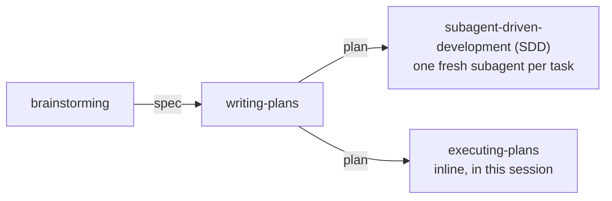
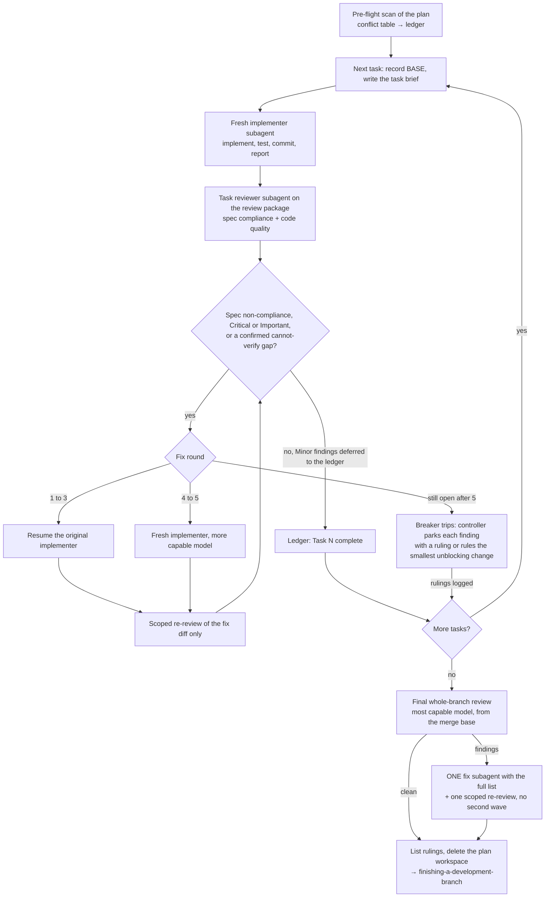

# Concepts and vocabulary

A plain-language glossary of the words the skills in this plugin use. Each entry says what the thing is, where it
lives, and which skill owns it. When this page and a skill disagree, the skill wins: skills are the behaviour, this
page only explains it.

<!-- toc -->

## Contents

- [The workflow pipeline](#the-workflow-pipeline)
  - [Which executor to pick](#which-executor-to-pick)
- [Workflow artifacts](#workflow-artifacts)
- [Execution modes](#execution-modes)
  - [SDD (subagent-driven development)](#sdd-subagent-driven-development)
  - [Inline execution (`executing-plans`, the "Native" choice)](#inline-execution-executing-plans-the-native-choice)
- [When an executor stops](#when-an-executor-stops)
- [DevOps vocabulary](#devops-vocabulary)
- [Plugin mechanics](#plugin-mechanics)
- [References](#references)

<!-- /toc -->

## The workflow pipeline

Most non-trivial work flows through four skills (SDD below stands for subagent-driven development):

*The spec from brainstorming becomes a plan, and the plan runs through one of the two executors.*

1. **`brainstorming`** finds out what is wanted and why before anything is built (rebuilt on
   obra/superpowers v7.0.0). It reads the repository first, asks one open question at a time about the goal, plays back
   what it understood with its guesses marked, and offers options with a recommendation for decisions about how it
   gets made. Then it sizes the work, by what a wrong guess would break:
   - **Quick task**: reversible, confined to the working tree, not production. Done directly; any commit, push or
     apply still waits for a yes.
   - **Small change**: anything that touches shared or production systems, such as one HelmRelease value or one alert
     rule. The full description is a short note in chat; implementation starts after an explicit yes.
   - **Project**: migrations, cutovers, decommissions, new subsystems, changed interfaces. A written design, read
     first by a builder check (a fresh subagent that lists what it would still need to ask), approved by the human,
     then `writing-plans`.

   When in doubt the skill sizes up, and work that grows mid-task steps up a size. Skipping the questions never skips
   the approval of a live change.
2. **`writing-plans`** turns an approved spec into a plan of small tasks and ends with a handoff that asks the human
   to review the plan and pick an execution method: **Subagent-driven** or **Native**.
3. **Subagent-driven** runs `subagent-driven-development`; **Native** runs `executing-plans`.

### Which executor to pick

| Situation | Pick |
|---|---|
| You want a review gate on every task, or the plan is long enough that later tasks would run on a compacted context | `subagent-driven-development` |
| You want the cheaper run, the plan is fully specified, and a mid-tier session model is enough | `executing-plans` |
| The harness has no subagent tool | `executing-plans` (never fake a dispatch) |
| Tasks are tightly coupled, or there is no plan | neither: execute by hand or go back to `brainstorming` |

Both executors share the same workspace, ledger format and stop rules, so a plan can switch executors mid-flight and
the new one resumes from the ledger.

## Workflow artifacts

**Spec (design document).** What to build and why, approved by the human. Written by `brainstorming` for a
project to `docs/specs/YYYY-MM-DD-<topic>-design.md` in the project being worked on, then committed. The
spec is the *binding authority*: when the plan and the spec conflict, the spec wins.

**Plan.** How to build it: exact files, names, tests, commands, and for infrastructure work the verification and
rollback of every live change. Written by `writing-plans` to `docs/plans/YYYY-MM-DD-<feature-name>.md` (a user
preference can override the location). Its header names the Goal, Architecture, Tech Stack, Rollback and the Spec
path, followed by *Global Constraints* (project-wide values copied verbatim from the spec), *Review Focus* (inputs
the tests do not exercise), and tasks headed `### Task N: <name>`. Each step that runs a command has an `Expected:`
line.

Both paths live in the repository you are working on, not in this plugin.

**Plan workspace.** A git-ignored directory per plan, `.superpowers/sdd/<plan-basename>/` at the repository root,
created by `skills/subagent-driven-development/scripts/sdd-workspace`. A self-ignoring `.gitignore` keeps it out of
`git status`. It holds the ledger, task briefs, implementer reports and review packages for that plan only; another
plan's directory is never read or written. It lives in the working tree rather than under `.git/` because Claude Code
denies agent writes inside `.git/`.

**Ledger (progress ledger).** `progress.md` inside the plan workspace. Its first line is its identity,
`# SDD ledger — plan: <plan file path>`. It records one line per finished task
(`Task <N>: complete (commits <base7>..<head7>, …)`), fix rounds, deferred minor findings and every ruling. After a
context compaction the executor trusts the ledger and `git log`, not its memory; a task with a `complete` line is
never redone.

**Ruling.** A decision the executor makes instead of stopping to ask: a conflict, ambiguity or plan defect, settled
with the spec as the authority. Every ruling is a ledger line
`Ruling: <what was decided> — <why> — <what it costs if wrong>`, and all of them are listed under
"Rulings I made" in the final message so the human can review and undo them.

**Task brief.** The full text of one task, cut from the plan by `skills/subagent-driven-development/scripts/task-brief`
into `task-<N>-brief.md` in the workspace. The implementer reads the brief instead of the whole plan; exact values
(numbers, signatures, test cases) appear only there.

**Review package.** One file the reviewer reads in a single call: commit list, `git diff --stat` and the full
`git diff -U10` for a range. Produced by `skills/subagent-driven-development/scripts/review-package PLAN BASE HEAD`
as `review-<base7>..<head7>.diff`. BASE is the commit recorded before the task started, never `HEAD~1`, so
multi-commit tasks stay whole; the script refuses (exit 3) an empty range or a BASE that is not an ancestor of HEAD.

## Execution modes

### SDD (subagent-driven development)

The main agent becomes a **controller**: it never implements. For each task it:

1. Records BASE (`git rev-parse HEAD`), writes the task brief, and dispatches a fresh **implementer** subagent with
   the brief path, a report-file path, interfaces from earlier tasks and its resolution of any ambiguity. The
   implementer implements, tests, commits, self-reviews, writes its report file and returns a short status
   (`DONE`, `DONE_WITH_CONCERNS`, `NEEDS_CONTEXT` or `BLOCKED`). Implementers never dispatch subagents of their own,
   and implementers never run in parallel.
2. Builds the review package and dispatches a **task reviewer** subagent with the brief, the report and the package
   plus the plan's Global Constraints. The reviewer returns two verdicts: *spec compliance* and *code quality*.
3. Runs the **fix loop** when the review reports spec non-compliance, a Critical or Important finding, or a
   "cannot verify from diff" item the controller confirms as a real gap. Minor findings go to the ledger as
   deferred and never enter the loop. A fix round is one fix dispatch plus one *scoped re-review* of the fix diff
   only. At most **5 rounds** per task: rounds 1–3 resume the original implementer; rounds 4–5 dispatch a fresh
   implementer on a more capable model. If findings are still open after round 5, the *breaker* trips and the
   controller adjudicates each one: park it with a ruling, or rule on the smallest change that unblocks dependent
   work.
4. Appends `Task <N>: complete (…)` to the ledger and moves on, without checking in with the human.

Before Task 1 the controller runs a *pre-flight scan* of the plan for conflicts and writes the table to the ledger.
After the last task, a **final whole-branch review** runs on the most capable model over a review package from the
merge base. If it returns findings, the controller dispatches ONE fix subagent with the complete list and one scoped
re-review; there is no second wave. When the final review is clean the controller lists its rulings, deletes the
plan workspace and hands over to `finishing-a-development-branch`.

*The SDD controller loop: one implementer and one reviewer per task, at most five fix rounds, then one final branch review.*

Model choice: the cheapest model that can do each role, always named explicitly in the dispatch (an omitted model
inherits the session's, usually the most expensive). Mid-tier is the floor for reviewers and for implementers
working from prose; the final review gets the most capable model.

Source: `skills/subagent-driven-development/` (SKILL.md, the three prompt templates, `scripts/`).

### Inline execution (`executing-plans`, the "Native" choice)

The same plan, executed by one session that implements every task itself. `writing-plans` offers it as **Native**;
the skill itself calls it *inline execution*. Per task it runs `skills/executing-plans/scripts/task-start` (brief +
BASE in one call), works the steps in RED-GREEN order under `test-driven-development`, commits, then runs
`skills/executing-plans/scripts/task-done PLAN N BASE -- <test command>`, which runs the tests and writes the
ledger line only if they pass. TDD is the per-task gate; there is no per-task reviewer.

At the end, one fresh reviewer subagent checks the whole branch on the most capable model (without a subagent tool
the session performs that review itself and records `Final review: self-review (no subagent tool)`). Critical and
Important findings are fixed in ONE pass, each proven by a test that failed first.

Cheaper than SDD (one context plus one reviewer); less isolated (no fresh context and no second reviewer per task).

## When an executor stops

Rulings replace questions, so a running plan stops for only four reasons: an irreversible or destructive operation,
a security-sensitive action, a side effect outside the worktree that norms say to ask about (a merge, a push to a
shared branch, a publish), or a plan so broken that every path forward is a guess.

**Infrastructure stop-list.** Both executors treat infrastructure as outside the worktree. Every command that
changes live state is a stop, even when it looks routine:

- `kubectl apply/patch/delete/scale/rollout`
- Flux `suspend` / `resume` / `reconcile` against a shared cluster
- `helm install/upgrade/uninstall`
- `terraform apply/destroy`
- cloud CLI (command-line interface) mutations
- DDL/DML (data definition / data manipulation language) against a non-local database
- secret creation or rotation
- pushes to deploy or protected branches
- DNS (Domain Name System), firewall or access-policy edits

Rulings cover working-tree code, docs, tests and rendered manifests; live state waits for the human.

## DevOps vocabulary

**Drift ledger.** A table of every imperative change made against live state during a break-glass fix or an
incident (object or target, change, time, whether Flux reverted it). It is closed only when every row ends either
as a commit SHA (Secure Hash Algorithm digest; here, a commit id) showing the change now lives in Git or IaC
(infrastructure as code), or as a ticket. Owned by `gitops-flux` (break-glass loop) and `incident-response`
(incident log and postmortem).

**Render gate.** The check `gitops-flux` requires before every push to a Flux-tracked branch, described in
`skills/gitops-flux/references/render-gate.md`: a clean `git archive` export of what will be pushed, an offline
`flux build`, `helm template` before/after diffs, schema validation with `kubeconform -strict`, a server-side dry-run
`flux diff kustomization` with zero errors, and a check that the set of objects to be deleted equals an independently
computed expected set. The push itself still needs human approval.

## Plugin mechanics

**Skill.** A `skills/<name>/SKILL.md` playbook with `name` and `description` frontmatter. The description is the
trigger: harnesses decide when to load a skill from it. Depth goes in `skills/<name>/references/`.

**Bootstrap skill.** `skills/using-devops-mutant-powers/SKILL.md`. It is injected into every session at start
and carries The Rule (invoke a matching skill before acting), the skill priority, the instruction priority and the
operating principles; each skill's own description says when it applies.
Without it the other skills are inert files. How it reaches each harness: [session-activation.md](session-activation.md).

**Slash command.** A thin file in `commands/` that loads one skill. In Claude Code a plugin command is invoked as
`/devops-mutant-powers:<file name>`; its frontmatter sets `disable-model-invocation: true`, so only the human
runs it.

**Tooling templates.** Copy-ready configs under `tooling/` that skills point to; every value to edit carries a
`# CHANGE:` marker.

**Marketplace.** Claude Code installs plugins from a marketplace, a catalog defined by
`.claude-plugin/marketplace.json`. This repository is its own marketplace, `devops-mutant-powers`,
with one plugin whose source is the repository root. How you add it decides the source type:

| You add | Source type | Behaviour |
|---|---|---|
| the GitHub repository, `nikospavlopoulos/devops-mutant-powers` (**the standard install**, see the [README](../README.md)), or any git URL (Uniform Resource Locator) of it without a tag: SSH (Secure Shell) form `user@host:path.git`, or an HTTPS (Hypertext Transfer Protocol Secure) URL ending in `.git` | `github` or `git` | Claude Code clones the default branch and copies the plugin into `~/.claude/plugins/cache/`; `marketplace update` plus `plugin update` follow the branch, and because the manifest pins `version`, a new copy arrives only after the version string changes |
| the same with a release tag, `nikospavlopoulos/devops-mutant-powers#v2.2.0` | as above, with `ref: v2.2.0` | Claude Code clones the repository at the tag; a tag never moves, so the install changes only when you move the pin (remove, add `#<new tag>`, install) |
| a local path to your clone (`claude plugin marketplace add <clone>`) | `directory` | Claude Code reads the directory in place; edits and branch switches in the clone apply at the next session or `/reload-plugins`. For development, `claude --plugin-dir <clone>` does the same for one session without changing the install |

**Release and pin.** A release is a version tag (`v2.2.0`) and a GitHub release on this repository, created when the
release pull request is merged ([how-its-built.md](how-its-built.md#how-a-release-reaches-this-repository)). Publishing
a release changes no machine: an install that follows the default branch moves when you update the marketplace and
the plugin, and a pinned install moves when you move its pin
([maintenance/review-gate.md](maintenance/review-gate.md#updating-an-installed-copy)).

Codex reads its own catalog, `.agents/plugins/marketplace.json`, under the same marketplace name; Antigravity and
OpenCode install without a marketplace ([session-activation.md](session-activation.md)).

**Supported harnesses.** The agent runtimes the plugin supports, each with the same skills:

| Harness | How the bootstrap arrives |
|---|---|
| Claude Code | SessionStart hook; the reference harness the skills are written for |
| Antigravity CLI (`agy`) | an always-on rule packaged inside the plugin |
| Codex | native skill discovery, through the repository's own Codex marketplace |
| Cursor | `sessionStart` hook, through the same script as Claude Code |
| OpenCode | an in-process plugin module |

Install steps for each are in the [README](../README.md); the mechanisms are in
[session-activation.md](session-activation.md). Not supported: Kimi, Pi and Copilot CLI (the hook keeps upstream's
Copilot output shape, but there is no Copilot manifest or install).
Gemini CLI is not supported either, even though Antigravity CLI keeps its own configuration under `~/.gemini/`.

**Upstream base.** The obra/superpowers tag the shared workflow skills correspond to, recorded in
[UPSTREAM.md](../UPSTREAM.md). See [maintenance/upstream-sync.md](maintenance/upstream-sync.md).

**Review gate.** The local git hooks that block commits and pushes carrying secrets, internal names or structural
errors. See [maintenance/review-gate.md](maintenance/review-gate.md).

## References

- <https://code.claude.com/docs/en/plugins/cli-reference> — `claude plugin marketplace add` source forms (`directory` for a local path, `git` for SSH and `.git` URLs)
- <https://code.claude.com/docs/en/plugins/loading> — relative-path plugins in a local-path marketplace load in place; other marketplace plugins are copied into `cache/<marketplace>/<plugin>/<version>/`; a pinned manifest `version` keeps users on the cached copy until it changes
- <https://code.claude.com/docs/en/discover-plugins> — `owner/repo` adds a GitHub repository as a marketplace; `#ref` on `marketplace add` pins a branch or tag
- <https://code.claude.com/docs/en/plugins/components> — `commands/<file>.md` becomes `/<plugin>:<file>`
- <https://code.claude.com/docs/en/skills> — `disable-model-invocation: true` stops Claude from loading a skill on its own; command files accept the same frontmatter except `name` and `paths`
