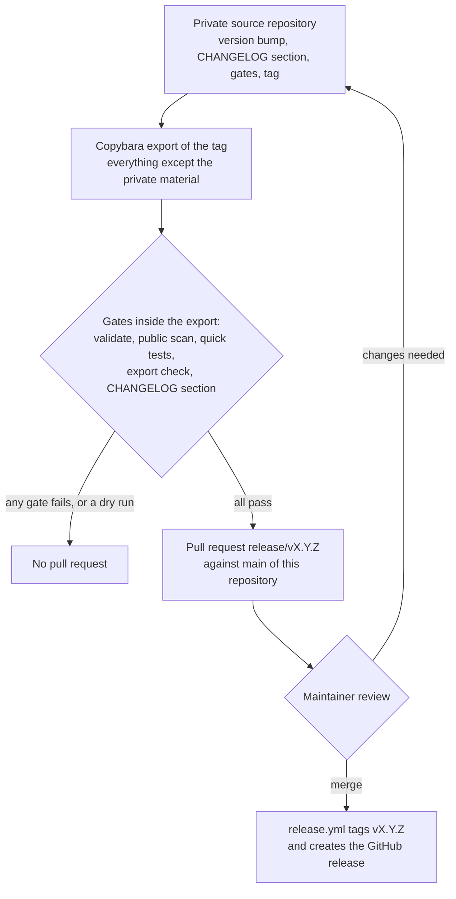

# How it's built

What DevOps Mutant Powers is made of and how it is maintained: the parts of the plugin, how each harness loads it,
how its effect is measured, how it stays in step with upstream, how private material is kept out, how multi-agent and
unattended work runs, and how a release reaches this repository. Each section links to the page with the detail.

<!-- toc -->

## Contents

- [Architecture](#architecture)
  - [Harness adapters](#harness-adapters)
- [Where the knowledge comes from](#where-the-knowledge-comes-from)
- [The eval method](#the-eval-method)
- [Upstream sync](#upstream-sync)
- [The privacy gate](#the-privacy-gate)
- [Subagent orchestration](#subagent-orchestration)
- [Unattended runs](#unattended-runs)
- [How a release reaches this repository](#how-a-release-reaches-this-repository)
- [References](#references)

<!-- /toc -->

## Architecture

The plugin is plain files: Markdown, JSON (JavaScript Object Notation) manifests, Bash and Python. Nothing is compiled
and nothing runs as a server.

| Part | Where | What it does |
|---|---|---|
| Skills | `skills/<name>/SKILL.md`, 45 skills | Markdown playbooks. The `description` frontmatter says when a skill applies; depth sits in the skill's `references/`, helper scripts in its `scripts/` |
| Bootstrap skill | `skills/using-devops-mutant-powers/` | The Rule (check for a matching skill before any response or action), the skill priority and the operating principles. Without it in context the other skills are inert files |
| Slash commands | `commands/`, 11 files | Thin wrappers a human runs to load one skill, as `/devops-mutant-powers:<name>` |
| Subagent | `agents/devops-debugger.md` | Diagnoses a failure in its own context and returns the root cause and a proposed fix without applying it |
| Hooks | `hooks/` | `session-start` builds the bootstrap with a build marker; `run-hook.cmd` is a Windows-batch and Bash wrapper; `hooks.json` (Claude Code) and `hooks-cursor.json` (Cursor) register it |
| Rules | `rules/devops-mutant-powers.md` | The bootstrap as an always-on Antigravity rule, generated by `scripts/build-antigravity-rule.sh` |
| Tooling | `tooling/`, 14 categories | Copy-ready templates the skills point to. Every value to edit carries a `# CHANGE:` marker; some templates ship an offline self-test |
| Harness adapters | `.claude-plugin/`, `plugin.json`, `.codex-plugin/`, `.agents/plugins/`, `.cursor-plugin/`, `package.json`, `.opencode/plugins/` | One manifest or module per harness, all carrying the same version |
| Gates | `.githooks/`, `tests/`, `scripts/` | Local git hooks, structural validation, offline self-tests and the privacy scanner |

Skills are written once for every harness. They name actions ("load a skill", "read a file", "dispatch a subagent")
and never a harness's tool; a tool mapping, in `skills/using-devops-mutant-powers/references/` or inline in the
OpenCode module, translates the actions into real tool names. A harness port adds a mapping and a way to deliver the
bootstrap, never an edit to a skill's body ([porting-to-a-new-harness.md](porting-to-a-new-harness.md)).

### Harness adapters

Every supported harness gets the same skills; only the bootstrap delivery differs.

| Harness | How the bootstrap arrives | Files |
|---|---|---|
| Claude Code | SessionStart hook, injected as a system reminder before the first prompt | `.claude-plugin/plugin.json`, `.claude-plugin/marketplace.json`, `hooks/hooks.json` |
| Antigravity CLI (command-line interface) | an always-on rule packaged inside the plugin | root `plugin.json`, `rules/` |
| Codex | native skill discovery: the bootstrap's own description makes the model load it | `.codex-plugin/plugin.json`, `.agents/plugins/marketplace.json` |
| Cursor | `sessionStart` hook, through the same script as Claude Code | `.cursor-plugin/plugin.json`, `hooks/hooks-cursor.json` |
| OpenCode | an in-process plugin that puts the bootstrap into the first user message | `package.json` `main`, `.opencode/plugins/devops-mutant-powers.js` |

Install steps for every harness are in the [README](../README.md); Codex and OpenCode have their own notes in
[.codex/INSTALL.md](../.codex/INSTALL.md) and [.opencode/INSTALL.md](../.opencode/INSTALL.md). How each mechanism
works and how to check it: [session-activation.md](session-activation.md).

One version runs through all of them. `.claude-plugin/plugin.json` is the reference; `tests/validate.py` fails when
another manifest disagrees, and the generated Antigravity rule, which embeds the version, must match a fresh build.

## Where the knowledge comes from

The skills draw on four sources:

| Source | What it gave |
|---|---|
| [obra/superpowers](https://github.com/obra/superpowers) | The workflow skills, the session-start hook and the multi-harness architecture |
| [tspry/superpowers-devops](https://github.com/tspry/superpowers-devops) | The DevOps layer: the first turn of the superpowers workflow toward DevOps |
| The author's field notes | About 300 journal entries (incident notes, post-mortems and learning notes) from running Kubernetes, GitOps, PostgreSQL, identity and observability in production: most of the DevOps judgement in the skills |
| Official documentation | The facts: every claim about a tool's behaviour cites the official documentation it rests on |

Each lesson from the field notes was rewritten as generic guidance and checked against the official documentation, and
client, employer, host and person names were removed before it entered a skill. [The privacy gate](#the-privacy-gate)
then blocks private host and domain names and client, project and person names that slip through. Other projects that
shaped individual skills are credited in the README's [Lineage and credits](../README.md#lineage-and-credits).

## The eval method

The offline checks prove that the files hold together. The evals measure whether the plugin changes what an agent
does. The suite lives in `evals/` and runs with `claude plugin eval`.

- **One file per case.** Each case is a directory holding one `case.yaml`: a realistic request with its context
  (logs, manifests, plans) pasted into the prompt, turn and time limits, the tools the agent may use, and the
  graders. Cases run in chat, with no cluster, cloud or network.
- **Graders.** Each behaviour case has three or four `llm` graders, each with PASS and FAIL criteria that a separate
  judge model applies to the final reply; exactly one of them is a must-not item. A `tool_used` grader names the
  skill that should fire; in a two-arm run it is reported as an indicator and not scored. The one guard case checks
  proportion instead, with one `llm` grader (a short, correct answer without process ceremony) and one `tool_used`
  grader that passes only when no skill fires, in both arms.
- **Written blind.** The cases were written from a behaviour brief (what a careful senior DevOps engineer does under
  pressure, and which behaviours a generic assistant tends to skip) and the official eval format. Their writer never
  read the plugin's skills, commands or rules, and no prompt names a skill or the plugin, so the cases measure
  behaviour instead of echoing the plugin's wording.
- **Two arms.** Every case runs with the plugin loaded and with no plugin at all (the baseline), three runs per arm.
  A with-plugin run is an isolated session with only this plugin loaded: no user settings, memory or other plugins.
- **Δ (delta).** The number that matters is Δ = with − without, per case and as the suite mean. A case that a capable
  model already passes without the plugin measures nothing, so a case whose without arm scored above 0.70 got one
  rewrite of its case text and was run again. The guard case's grader was fixed once, so that formatting no longer
  decides its verdict.
- **Measure, do not tune.** The evals do not change the skills. Scores are recorded as measured, including the
  cases where the plugin adds nothing or loses ground.

The scores per case, the suite mean, the run facts (model, judge, Claude Code version, runs per arm) and where the
plugin helps and where it does not are in [evals/RESULTS.md](../evals/RESULTS.md). The case list is in
[evals/README.md](../evals/README.md); how to run the suite is in [testing.md](testing.md#plugin-evals).

## Upstream sync

The workflow skills come from [obra/superpowers](https://github.com/obra/superpowers), by way of
[tspry/superpowers-devops](https://github.com/tspry/superpowers-devops) v1.2.0, which first turned them toward DevOps.
Parts of [mattpocock/skills](https://github.com/mattpocock/skills) are adapted too. The licence notices are in
[LICENSE](../LICENSE); the versions, commits, current upstream base and every sync so far are in
[UPSTREAM.md](../UPSTREAM.md).

- **Shared skills.** 15 skills exist in both projects: the workflow skills and the bootstrap. A new upstream release
  comes in as a 3-way merge per file: the last synced upstream tag is the base, this repository is "ours", the new
  tag is "theirs".
- **Rename map.** `scripts/upstream-drift.sh` applies the renames (`superpowers:` to `devops-mutant-powers:`,
  `using-superpowers` to `using-devops-mutant-powers`) to both upstream trees before comparing, so a rename never
  shows up as a change. It prints a state per file and, with `--merge`, writes `git merge-file` results to a folder
  outside the repository. Every result reaches the repository by hand, through the gates.
- **DevOps depth in separate files.** A shared skill keeps its `SKILL.md` close to upstream and carries its DevOps
  depth in `references/devops-*.md`, behind a one-line pointer, so upstream edits merge mechanically.
- **Recorded divergences.** Where this plugin deliberately differs from upstream, UPSTREAM.md says so, and every
  sync resolves those lines toward ours.

The procedure: [maintenance/upstream-sync.md](maintenance/upstream-sync.md).

## The privacy gate

Every commit and push in the source repository passes local git hooks that run offline and never call a model.
Missing tools fail closed. The privacy part has three layers:

- **gitleaks** with its default rules plus this repository's own in `.gitleaks.toml`: chat incoming-webhook URLs
  (Uniform Resource Locators), bare private or CGNAT (carrier-grade network address translation) host addresses, and
  literal credential assignments. It always runs with `--redact`, so a secret never reaches the terminal or a report.
- **The hostname rule** in `scripts/lib/check_hostnames.py`: a hostname in one of the checked top-level domains must
  be a reserved name (`example.com`, `*.test`, `cluster.local` and the like) or a public documentation domain listed
  in `scripts/scan-allowed-domains.txt`. An internal, client or employer host cannot pass as an ordinary link.
- **A private term list** kept outside the repository, in `~/.config/devops-mutant-powers/denylist.txt` (keep it
  mode 600): internal host and domain names, client, project and person names. Each scan turns it into one more
  gitleaks rule in a temporary config, so the list itself never enters the repository. A missing or empty list fails
  closed.

The same hooks validate the exact snapshot being committed or pushed with `tests/validate.py`, run the offline
self-tests before a push, and refuse commit messages with AI (artificial intelligence) attribution.

**Public scan mode.** With `SCAN_PUBLIC=1`, `scripts/scan-sensitive.sh` runs the generic gitleaks rules, this
repository's rules and the hostname rule, and needs no private list. It is the mode for a release export and for CI
(continuous integration), where the private list does not exist.

Details, modes and exit codes: [maintenance/review-gate.md](maintenance/review-gate.md).

## Subagent orchestration

Two kinds of work are split across subagents.

- **Executing a plan.** `subagent-driven-development` turns the main session into a controller that never implements.
  Per task, a fresh implementer subagent works from a brief cut from the plan, then a reviewer subagent checks spec
  compliance and code quality on a one-file review package, with at most five fix rounds. One final review covers the
  whole branch. A ledger on disk records every finished task and every ruling (a decision taken instead of a question),
  so a compacted or restarted session resumes from it. See [concepts.md](concepts.md#sdd-subagent-driven-development).
- **A content release.** The main session is the orchestrator: it plans, briefs, batches, commits and runs the evals.
  Researchers, writers, reviewers, slimmers and diagram agents work inside written contracts, with the shared rules for
  each role in [maintenance/agent-briefs/](maintenance/agent-briefs/README.md). One writer per unit, at most five
  writers per batch, one unit per commit through the hooks. The agents that write content never open the eval cases,
  results or scenario ideas, so the scores measure the content and not a leak.

The roles, order and gates: [maintenance/subagent-orchestration.md](maintenance/subagent-orchestration.md).

## Unattended runs

A long plan can run for hours or days in one Claude Code session with nobody watching. The disk is the memory, not
the chat:

- a ledger outside the repository holds the state, one self-contained next action, a log, decisions and blocked items;
- a recurring scheduled prompt, the heartbeat, wakes the session every 20 minutes to re-read the plan, the ledger and
  the git log, and continue from the next action;
- the heartbeat replaces itself every 24 hours, so the seven-day expiry of scheduled tasks never ends a run;
- a usage limit pauses the run and the first wake after the reset resumes it; a compaction loses nothing the run
  needs; a closed session needs one resume prompt;
- the plan, approved before the run, lists numbered authorizations, so no decision waits for an absent human;
- `notify.sh` posts progress lines to Telegram, Discord, Slack or Mattermost.

The method: [unattended-runs.md](unattended-runs.md). The scripts:
[tooling/automation/unattended-runs/](../tooling/automation/unattended-runs/README.md). The skill that sets a run up,
resumes it and audits it: [unattended-runs](../skills/unattended-runs/SKILL.md).

## How a release reaches this repository

Development happens in a private source repository. It holds this tree plus material that is never published, such
as plans, working notes and the publishing configuration. A release travels from there to here as a reviewed pull
request.

*A release is an export of the source repository's tag, gated twice and merged only after review.*

1. **Prepare.** In the source repository the version is bumped in every manifest, `CHANGELOG.md` gets a curated
   `## [x.y.z]` section, the gates pass, and the release commit is tagged.
2. **Export.** A GitHub Actions workflow in the source repository exports the tag with
   [Copybara](https://github.com/google/copybara): every file except the private material, squashed into one commit
   named `Release`.
3. **Gate again.** Inside the export the workflow runs `bash tests/validate.sh`, the public scan,
   `bash tests/run-quick.sh`, `tests/scripts/test-export-list.sh` (no private path or private repository name, at
   most 512 files, the required files present) and a check for the version's `CHANGELOG.md` section. A dry run stops
   here, so the export can be inspected before anything reaches this repository.
4. **Open a pull request.** The export becomes the branch `release/vX.Y.Z` and a pull request against `main`, whose
   description carries the changelog section and the gate results.
5. **Review.** The maintainer reads the diff and merges it, or fixes the source and exports again.
6. **Release.** Merging runs `.github/workflows/release.yml`. It reads the version from `.claude-plugin/plugin.json`,
   tags `vX.Y.Z` on the merge commit and creates the GitHub release with the changelog section as its notes.

Installs then pick the release up as described in
[maintenance/review-gate.md](maintenance/review-gate.md#updating-an-installed-copy).

## References

- <https://code.claude.com/docs/en/plugin-evals>: eval suites, with-and-without-plugin comparison, `claude plugin eval`
- <https://code.claude.com/docs/en/scheduled-tasks>: session-scoped scheduled tasks and their seven-day expiry
- <https://github.com/google/copybara>: Copybara, the tool that exports a release
- <https://github.com/gitleaks/gitleaks>: gitleaks rules, `--redact` and config extension
- <https://github.com/obra/superpowers>: the upstream project and its tags
