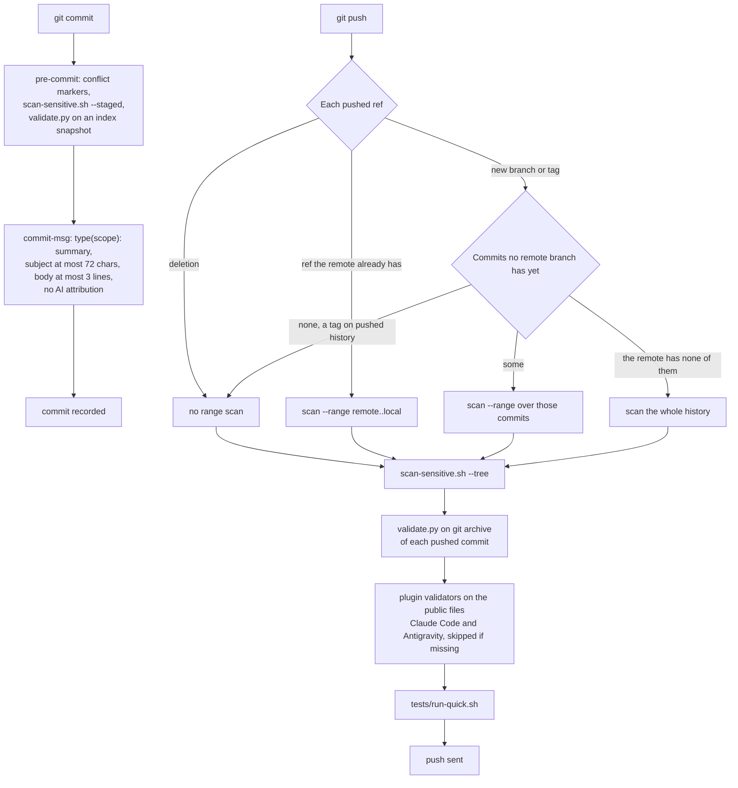

# Review gate

The local gate that every commit and push of this repository passes through. It blocks three things: secrets and
internal names (privacy), structural breakage (validation), and commit messages that break the house style. It runs
entirely on your machine, offline, and never calls a model.

<!-- toc -->

## Contents

- [Enable it once per clone](#enable-it-once-per-clone)
- [What runs when](#what-runs-when)
  - [pre-commit (`.githooks/pre-commit`)](#pre-commit-githookspre-commit)
  - [commit-msg (`.githooks/commit-msg`)](#commit-msg-githookscommit-msg)
  - [pre-push (`.githooks/pre-push`)](#pre-push-githookspre-push)
- [The privacy scanner: `scripts/scan-sensitive.sh`](#the-privacy-scanner-scriptsscan-sensitivesh)
  - [gitleaks rules](#gitleaks-rules)
  - [The private denylist](#the-private-denylist)
  - [The hostname rule](#the-hostname-rule)
  - [Reviewed false positives: `.gitleaksignore`](#reviewed-false-positives-gitleaksignore)
- [What `tests/validate.py` checks](#what-testsvalidatepy-checks)
- [Offline self-tests](#offline-self-tests)
- [Plugin evals](#plugin-evals)
- [Release checklist](#release-checklist)
- [Updating an installed copy](#updating-an-installed-copy)
- [References](#references)

<!-- /toc -->

## Enable it once per clone

```bash
git config core.hooksPath .githooks
```

| Requirement | Used by |
|---|---|
| `bash`, `git` | every hook |
| `python3` | `tests/validate.py`, the hostname rule, report formatting |
| `gitleaks` | `scripts/scan-sensitive.sh`; `.gitleaks.toml` targets gitleaks 8.16 or later, and the scanner supports both the older `detect`/`protect` and the newer `git`/`dir` subcommands |
| `jq` | `scripts/build-antigravity-rule.sh` (run by `validate`), `tests/hooks/test-session-start.sh`, `tests/hooks/test-harness-manifests.sh` |
| `rsync` | required: `scan-sensitive.sh --tree` and `--full` mirror the tree with it, so every push needs it; without it those modes print `scan: rsync is required for --tree (fails closed)` (or `--full`) and exit 2 |
| private denylist | the gitleaks private rule (see below) |
| `node` (optional) | `tests/hooks/test-opencode-plugin.sh` and `tests/scripts/test-visual-companion.sh`; without it those suites print `SKIPPED` and pass |

A missing tool or a missing denylist fails closed: the scan exits 2 and the hook blocks. Fix the cause; do not bypass
the hooks (AGENTS.md golden rule 2). In a fresh clone, create the denylist ([below](#the-private-denylist)) with at
least one term of your own, a name you never want published, before you enable the hooks.

## What runs when

### pre-commit (`.githooks/pre-commit`)

1. Rejects leftover conflict markers in the staged changes (`git diff --cached --check`).
2. Runs `scripts/scan-sensitive.sh --staged`.
3. Exports the index to a temporary directory (`git checkout-index -a`) and runs `python3 -I <snapshot>/tests/validate.py`
   there, so it validates exactly what will be committed, not your working tree.

### commit-msg (`.githooks/commit-msg`)

Comment lines and blank lines are dropped first. Then:

- the subject must match `type(scope): summary`, with type one of `feat fix docs chore refactor test ci build perf
  style revert`, an optional lowercase scope, an optional `!`, and a summary that does not start with a space;
- the subject is at most 72 characters;
- the body has at most 3 non-blank lines;
- no AI (artificial intelligence) attribution: the message must not contain `co-authored-by:`, `generated with`,
  `noreply@anthropic.com` (all case-insensitive) or the robot-face emoji (U+1F916).

### pre-push (`.githooks/pre-push`)

1. For each pushed ref (deletions skipped) runs `scan-sensitive.sh --range`: the range `<remote>..<local>`, or for a
   new ref (branch or tag) only the commits no `<remote>/*` branch has yet: none means no range scan (a tag on pushed
   history), and a remote that has none of them means the whole history.
2. Runs `scan-sensitive.sh --tree` on the working tree.
3. For each pushed commit, exports `git archive <pushed sha>` and runs `validate.py` on that snapshot, so it
   validates exactly what is pushed, whichever ref that is.
4. For each pushed commit, runs `scripts/check-harness-validators.sh` on its public files (the snapshot without
   `private/` and the publish workflow): `claude plugin validate` must exit 0, and `agy plugin validate`'s findings must
   match `tests/known-validator-findings.txt` exactly. A validator that is not installed is skipped with a notice.
5. Runs `tests/run-quick.sh`.

It never calls a model and never runs evals. The Claude Code validator runs with non-essential traffic off and still
opens one HTTPS connection to Anthropic; it sees only the public files.



*The two gated paths; any failing step, a missing tool or a missing denylist (exit 2) blocks the commit or the push.*

## The privacy scanner: `scripts/scan-sensitive.sh`

| Mode | Scans | gitleaks | Hostname rule |
|---|---|---|---|
| `--staged` | the index | `git --pre-commit --staged` | added lines of `git diff --cached` |
| `--range A..B` | commits in a range | `git --log-opts=A..B` | added lines of every commit's patch (`git log -p A..B`), so a host added and removed again inside the range is still caught |
| `--tree` | the working tree: tracked plus untracked files not ignored by git | `dir` on a temporary mirror | every line of those files |
| `--full` | the whole history, then the working tree | `git` over the repository, then as `--tree` | as `--tree` |

Exit status: `0` clean, `1` findings (or gitleaks failed to run), `2` a missing tool, a denylist problem or a usage
error. gitleaks always runs with `--redact`, so secret values never reach the terminal or the JSON (JavaScript
Object Notation) reports; findings print as `path:line rule-id`. Reports go to `$SCAN_REPORT_DIR` when set, and
stay there. Otherwise they go to a new temporary directory that is kept only when the scan fails (exit 1), named in
the `scan: FAILED (reports: <dir>)` line, and removed after a clean run or an exit-2 abort.

**Public scan mode.** With `SCAN_PUBLIC=1` in the environment, every mode runs gitleaks with `.gitleaks.toml` alone
(gitleaks' default rules plus the repository rules below) and the hostname rule, and needs no private denylist. It
is the mode for a release export and for CI (continuous integration), where the denylist does not exist:

```bash
SCAN_PUBLIC=1 bash scripts/scan-sensitive.sh --tree
```

### gitleaks rules

Each run generates a private config (mode 600 in `$TMPDIR`, deleted on exit) with `scripts/gen-private-gitleaks.sh`.
It extends the repository's `.gitleaks.toml`, which in turn extends gitleaks' default rules and adds:

| Rule | Catches |
|---|---|
| `chat-incoming-webhook` | a chat incoming-webhook URL (Uniform Resource Locator) with a token in its path |
| `private-ipv4-host` | a bare private or CGNAT (carrier-grade network address translation, `100.64.0.0/10`) host address, also when written with a prefix length; only the CIDR (Classless Inter-Domain Routing) network form ending in `.0/<prefix>`, such as `10.0.0.0/16`, is allowed |
| `literal-credential-assignment` | `password`/`secret`/`token`/`api_key` followed by `:` or `=` and a literal of 8+ characters with enough entropy |
| `private-denylist` | any term from your private denylist, case-insensitive, whole word (generated) |

The global `[allowlist]` in `.gitleaks.toml` drops a finding whose detected secret contains `example`, `redacted`,
`changeme` or `placeholder` (any case), for teaching placeholders. It sets no `regexTarget`, so gitleaks matches
these regexes against the detected secret, its default for a global allowlist (gitleaks v8 README), not against the
whole line. That is the safer choice: a real token, private address or denylisted name is still reported when the
same line also says "example". Do not add `regexTarget = "line"` there; it would let any line that mentions one of
those words carry a real secret past every rule. Use RFC (Request for Comments) 2606 names, RFC 5737 addresses
(`192.0.2.0/24`, `198.51.100.0/24`, `203.0.113.0/24`) and `<placeholders>` in content.

The `private-denylist` rule allows a line that carries this clone's own `origin` URL, its `<host>/<path>` form, and,
for an SSH (Secure Shell) alias origin, the `Host <alias>` and `HostName <real host>` lines of an SSH config block, so
a clone's own remote never trips its owner's denylist. Which files may name the repository host is enforced by the
hostname rule.

### The private denylist

- Path: `${XDG_CONFIG_HOME:-~/.config}/devops-mutant-powers/denylist.txt`. `NSD_CONFIG_DIR` overrides the
  directory and `NSD_DENYLIST` the file.
- Content: one term per line (internal hostnames and domains, client, project, person and tunnel names, real
  addresses). Lines starting with `#` and blank lines are ignored; trailing whitespace is trimmed; regex
  metacharacters are escaped for you.
- Keep it mode 600 in a mode 700 directory and never commit it. The scripts do not enforce the mode.
- Fail-closed behaviour of `scripts/gen-private-gitleaks.sh`:
  - file missing or zero bytes: prints `scan: private denylist missing or empty: <path>` and
    `scan: create it (one internal term per line, mode 600)`, exits 2;
  - file holding only comments or blank lines: prints `scan: private denylist has no terms (only comments/blank
    lines): <path>`, exits 2.

  In both cases `scan-sensitive.sh` exits 2, so pre-commit and pre-push block, and `tests/scan/test-gitleaks.sh`
  (part of `run-quick.sh`) fails because it plants the denylist's first term and expects it to be caught.

### The hostname rule

`scripts/lib/check_hostnames.py` finds hostnames ending in one of a fixed set of top-level domains (`com net org io
dev gr eu cloud app ai uk de fr nl local internal lan corp arpa gov edu google us co cy`; others are not checked) and
allows only:

- reserved names: `*.example`, `*.test`, `*.invalid`, `*.localhost`, `example.com`, `example.net`, `example.org`,
  `localhost`, `cluster.local` and `*.svc.cluster.local`;
- public documentation domains listed in `scripts/scan-allowed-domains.txt` (suffix match);
- this repository's own identity, but only in `README.md`, `package.json` and `.claude-plugin/marketplace.json`
  (elsewhere it reports `repo host outside allowed files` or `repo SSH alias outside allowed files`). The identity is
  the host and path from `package.json` (`repository`, `homepage`) and from `origin`, so an HTTPS or local-path clone
  resolves it too; the SSH alias of a `git@<alias>:<path>` URL for that path, whether it comes from `origin` or
  appears in `README.md`; the host each alias resolves to (`ssh -G`); and any `url.<base>.insteadOf` rewrite. An
  allowlisted public host such as `github.com` is never treated as the repository's own host, so links to it stay
  allowed everywhere.

`scripts/scan-allowed-domains.txt`, `.gitleaksignore` and files under `private/` (material that is never published)
are not scanned by it. A line that contains the token `scan-allow` immediately followed by a colon is waived and
counted. Write the token as a trailing comment followed by the reason (the `SECOND_LEVEL` line in
`scripts/lib/check_hostnames.py` is an example) and use it sparingly. Add only public documentation domains to the
allowlist, in their own `build(scan): …` commit; never internal, client or employer domains.

### Reviewed false positives: `.gitleaksignore`

One gitleaks fingerprint per line (`<commit>:<path>:<rule-id>:<line>`), each preceded by a one-line reason comment.
Only for findings that were reviewed and are not secrets.

## What `tests/validate.py` checks

Run it with `bash tests/validate.sh`. Each failure has a stable id (shown first below).

| Id | Check |
|---|---|
| `frontmatter`, `frontmatter-name`, `desc-len` | every `skills/<dir>/SKILL.md` exists with `name` and `description`; `name` equals the directory; description 40-500 characters (routing lives there; the Agent Skills spec caps it at 1,024) |
| `desc-yaml` | an unquoted description holds no `': '` or `' #'`, which make the frontmatter invalid YAML (harnesses may then drop the description or the skill) |
| `skill-size` | every `skills/<dir>/SKILL.md` is under 20,000 bytes: after a compaction Claude Code keeps only the first 5,000 tokens (about 20,000 characters) of each invoked skill, so content needed only sometimes goes into `references/` |
| `bootstrap`, `bootstrap-size` | exactly one `using-devops-mutant-powers` bootstrap skill, at most 120 lines |
| `trigger` | every skill the bootstrap routes to on a `→` line exists (there is no trigger table; descriptions route) |
| `private-link` | no Markdown file outside `private/` links to a path under `private/`, which is never published |
| `link` | relative Markdown links and file-like backticked paths resolve, in `skills/`, `docs/`, `commands/`, `agents/`, `README.md`, `AGENTS.md`, `CLAUDE.md`, `UPSTREAM.md`, `CHANGELOG.md` (fenced code is skipped, as is any line containing `validate:ignore-links`) |
| `xref` | `devops-mutant-powers:<name>` names an existing skill or command |
| `oldname`, `gemini` | outside history files: no bare `superpowers-devops` (the tspry predecessor) and no "Gemini" except on lines that name `~/.gemini` paths; and, in every file, none of the spellings of the pre-2.0 plugin name (hyphenated, underscore, CamelCase, title case, upper case) |
| `conflict` | no conflict-marker lines in any text file |
| `json` | every `.json` file parses |
| `version-parity` | every manifest in `VERSIONED_MANIFESTS` that exists and carries a version matches `.claude-plugin/plugin.json`: `.claude-plugin/marketplace.json` and `.agents/plugins/marketplace.json` (per `plugins[].version`), the root `plugin.json`, `package.json`, `.cursor-plugin/plugin.json`, `.codex-plugin/plugin.json`; so does any `version: "…"` literal in `.opencode/plugins/*.js` (none today) |
| `mode` | executable (git mode 100755) for `hooks/session-start`, `hooks/run-hook.cmd`, `.githooks/*`, `scripts/*.sh`, `skills/*/scripts/*`, `tests/**/*.sh`, `tooling/**/*.sh` |
| `syntax` | `bash -n` (or `sh -n`) on shell scripts except the polyglot wrapper; Python files compile |
| `wrong-claim` | no match for the regexes in `tests/known-wrong-claims.txt` under `skills/`, `docs/`, `tooling/`, `commands/`, `agents/` |
| `placeholder` | no unescaped `$` followed by a digit in a `SKILL.md` or command file: Claude Code replaces `$0`, `$1`, … with invocation arguments, even inside code blocks |
| `tool-markup` | no Markdown file holds a line that is only an agent tool call's closing markup, left behind by a write through a tool |
| `agy-rule-build`, `agy-rule-drift`, `agy-rule-trigger` | the Antigravity rule regenerates cleanly, matches the committed file, and starts with `trigger: always_on` |
| `mermaid-view-plugin`, `mermaid-view-version` | `mermaid-view.sh`'s `PLUGIN` equals the manifest `name` (its folders follow a rename) and its `VERSION` equals the manifest `version` (so `doctor` and `show` can report a stale copy on `PATH`) |
| `mermaid`, `mermaid:helper`, `mermaid:script` | every Mermaid block in a Markdown file (outside `evals/` and `tests/`) follows the diagram style checked by `scripts/docs/check-mermaid.py`: no `%%{init}%%` directive or `config:` front matter (GitHub's defaults), no em or en dashes, no HTML escapes or raw `<word>` placeholders, blank lines around the fence ([agent-briefs/diagrams.md](agent-briefs/diagrams.md)); `:helper` means the script exited with an error before reporting (it did not finish), `:script` that it is missing |
| `contents`, `contents:helper`, `contents:script` | every page in `docs/` with two or more `##` sections opens with a current Contents block, as `scripts/docs/toc.py --check` sees it; refresh one with `python3 -I scripts/docs/toc.py --write` and the file; `:helper` and `:script` as for `mermaid` |
| `internal-marker` | the begin and end internal markers come in pairs, never nested or left open, in every file outside `private/`; the release export removes each marked block with everything inside it, and the export check fails if a marker survives |
| `heading-anchor`, `heading-anchor:helper`, `heading-anchor:script` | no heading in `README.md` or `docs/` gets a GitHub anchor that starts or ends with a hyphen (a space beside inline HTML, such as a badge image), as `scripts/docs/toc.py --anchors` sees it; `:helper` and `:script` as for `mermaid` |
| `agent-tools` | in `agents/*.md` front matter, `tools` and `disallowedTools` are YAML lists: one `- Tool` per line, or a one-line `[A, B]` list, with a trailing `#` comment allowed; Claude Code also takes a comma-separated string, but Antigravity skips an agent that uses one |
| `encoding` | every public file except known binary types (`.png`, `.jpg`, `.jpeg`, `.gif`, `.ico`, `.webp`, `.pdf`, `.zip`, `.gz`, `.jar`, `.woff`, `.woff2`) decodes as UTF-8; the other checks skip a file they cannot read, so this one names it |
| `suite-doc` | every offline suite `tests/run-quick.sh` runs from the public tree (`tests/scan/`, `tests/hooks/`, `tests/scripts/`, `tooling/*/*/`) is named in the suite table of [../testing.md](../testing.md) |

History files, where the bare predecessor name and Gemini are allowed, are `README.md`, `LICENSE`, `CHANGELOG.md`,
`UPSTREAM.md` and everything under `docs/maintenance/`. Files under `private/`, material that is never published,
are skipped by every check except `private-link`. The script also supports an optional known-failures list in
`tests/` (reported as KNOWN; an entry that stops failing is STALE and fails the run); none is in use.

## Offline self-tests

`bash tests/run-quick.sh` runs every `tests/scan/test-*.sh`, `tests/hooks/test-*.sh`, `tests/scripts/test-*.sh` and
`tooling/*/*/test-*.sh`. What each covers: [../testing.md](../testing.md).

## Plugin evals

Evals run real model sessions, so the hooks never run them. The suite lives in `evals/` and runs with
`claude plugin eval .`. Requires Claude Code v2.1.269 or later.

```bash
claude plugin eval <clone> --ablation with-without --runs 3 --threshold 0.85 \
  --judge-model sonnet -j 4 --no-publish --trust-plugin --output-dir <directory outside the clone>
```

| Option | Why |
|---|---|
| `--ablation with-without` | runs every case with and without the plugin (the baseline), so the report shows what the plugin adds: Δ (delta) = with − without |
| `--runs 3` | three runs per case in each arm; one run is too noisy to trust |
| `--threshold 0.85` | exit 1 if any case scores below 0.85 (the default threshold is 1.0); cases score the fraction of per-behaviour graders passed |
| `--judge-model sonnet` | the model for `llm` graders; the default is haiku. [evals/RESULTS.md](../../evals/RESULTS.md) was measured with a sonnet judge, so use the same judge to compare with it |
| `-j 4` | four agent sessions at once (1 to 8 allowed); they share one rate limit |
| `--no-publish` | **mandatory.** Without it, an account that supports artifacts publishes the HTML (HyperText Markup Language) report to claude.ai as a private artifact |
| `--trust-plugin` | skips the first-run trust prompt; pass it only because this is your own code. Without it a non-interactive run is refused (exit 1), and answering yes to the prompt inside a git repository trusts the whole repository, for interactive sessions too |
| `--output-dir` | the default is `evals/results/<timestamp>/`, which `.gitignore` excludes; keep runs in `tests/test_runs/<version>/<date>_<run>/`, also git-ignored and so outside the privacy scan. Not in `/tmp`: on a tmpfs it is wiped at reboot |

Every run is already bounded by the cases' `max_turns` and `timeout_seconds`. On a pay-per-token account you can add
`--max-cost-usd <usd>` as a hard ceiling: it stops before the next run once spend reaches it, exits 2 and reports
partial results. It is optional, not part of the standard command.

To iterate on part of the suite, filter with `--case '<glob>'` or `--tag <tag>` (put the target before `--tag`).
Exit codes: `0` every case meets the threshold, `1` a failing case, a load error or an untrusted directory, `2` a
partial run.

To run a long suite in pieces, call `claude plugin eval` once per case with `--case <name>`; after a usage limit,
re-run only the cases without a complete result.

## Release checklist

1. Gates green on `main` of the source repository: `bash tests/validate.sh`, `bash scripts/scan-sensitive.sh --tree`,
   `bash tests/run-quick.sh`. Also run `claude plugin validate <clone>`: it must pass with exactly one warning, that
   `CLAUDE.md` at the plugin root is not loaded as project context. That is intended: the root `CLAUDE.md` is the
   one-line `@AGENTS.md` import for contributors, not plugin context.
2. Write the release's curated `## [<x.y.z>]` section in `CHANGELOG.md`: the export gate requires it, and the release
   workflow turns it into the GitHub release notes. The detailed record of every change goes into the development
   changelog, which stays with the unpublished material.
3. Bump the version in every manifest that `validate` compares (`VERSIONED_MANIFESTS` in `tests/validate.py`):
   - `.claude-plugin/plugin.json`, the reference (also the Claude Code build marker);
   - `.claude-plugin/marketplace.json` (`plugins[].version`);
   - `plugin.json` at the root (Antigravity);
   - `package.json` (OpenCode, whose module reads its marker version from this file, so the module itself needs no
     bump);
   - `.cursor-plugin/plugin.json` (Cursor);
   - `.codex-plugin/plugin.json` (Codex);
   - the `VERSION` line in `tooling/visual/mermaid-view/mermaid-view.sh` (`mermaid-view-version`: `doctor` and
     `show` compare it with the copy on `PATH` to report a stale install).

   `.agents/plugins/marketplace.json` is compared too, but its entry carries no `version` today, so there is nothing
   to bump; the same holds for `version` literals in `.opencode/plugins/*.js`.
4. Regenerate the Antigravity rule, which embeds the version: `bash scripts/build-antigravity-rule.sh`.
5. Run `bash tests/validate.sh` again (version parity and rule drift).
6. Commit, for example `chore(release): v<x.y.z>`, and push `main`; the pre-push gate runs.
7. Tag the release commit in the source repository and push the tag:

   ```bash
   git tag -a v<x.y.z> -m "devops-mutant-powers v<x.y.z>"
   git push origin v<x.y.z>
   ```

   The pre-push gate scans only the commits the remote does not have yet, so a tag on a pushed commit passes. Never
   move or delete a pushed tag: the export, every install pinned to it and every rollback to it depend on it staying
   put.
8. Publish: export the tag to this repository as a pull request, dry run first; review it and merge it. Merging runs
   `.github/workflows/release.yml`, which tags `v<x.y.z>` on the merge commit and creates the GitHub release
   ([how-its-built.md](../how-its-built.md#how-a-release-reaches-this-repository)).
9. Upgrade the installed copies (next section). An install that follows `main` gets the release at its next update;
   a pinned install moves only when its pin does.
10. Tidy the workspace: put the main clone back on `main` and fast-forward it to `origin/main`; remove worktrees and
    local branches whose commits are on `main` (`git cherry main <branch>` shows `-` for each already-applied commit;
    keep untracked archives such as `tests/test_runs/` before removing a worktree); point any notes or global
    instructions that name a clone path at the clone actually used. A release built in a linked worktree otherwise
    leaves the main folder on an old branch.

## Updating an installed copy

**Claude Code, the standard install** (`claude plugin marketplace add nikospavlopoulos/devops-mutant-powers`, see the
[README](../../README.md)). Claude Code clones the repository's default branch, `main`, into
`~/.claude/plugins/marketplaces/devops-mutant-powers/` and loads a copy from
`~/.claude/plugins/cache/devops-mutant-powers/devops-mutant-powers/<version>/`. `main` changes only when a release
pull request is merged. Auto-update is off for this marketplace unless you turn it on, so upgrade by hand:

```bash
claude plugin marketplace update devops-mutant-powers
claude plugin update devops-mutant-powers@devops-mutant-powers
```

The manifest `version` gates the update: while `main` carries the version you have, `plugin update` reports
`already at the latest version`; a new version installs a new copy.

**Claude Code, pinned to a tag** (`claude plugin marketplace add "nikospavlopoulos/devops-mutant-powers#v<x.y.z>"`).
Claude Code clones the repository at the tag. A tag never moves, so `claude plugin update` (it reports
`already at the latest version`) leaves the install unchanged. To upgrade, or to roll back either kind of install,
move the pin:

```bash
claude plugin marketplace remove devops-mutant-powers     # also uninstalls the plugin; clones are untouched
claude plugin marketplace add "nikospavlopoulos/devops-mutant-powers#v<x.y.z>"
claude plugin install devops-mutant-powers@devops-mutant-powers
```

- Adding a marketplace that already exists keeps its old pin, so remove it first. Removal also deletes the plugin's
  saved options and data directory; this plugin stores none.
- After either kind of upgrade, start a new session, or run `/reload-plugins`; open sessions keep the version they
  loaded.
- Check: `claude plugin list --json` shows the new `version` and an `installPath` ending in `/<version>`, with no
  `readFromFolder`; a new session's marker reads `You have devops-mutant-powers v<x.y.z>.` (no commit id: the
  copy has no `.git`); `gitCommitSha` for the plugin in `~/.claude/plugins/installed_plugins.json` equals
  `git rev-parse 'v<x.y.z>^{commit}'`.
- The previous version's cache directory gets an `.orphaned_at` marker and is deleted 14 days later; a rollback
  fetches it from git again.

**Claude Code, trying a clone** (`claude --plugin-dir <clone>`). For that session only, the clone loads in place
instead of the installed release, uncommitted edits included, and the marker carries the clone's short SHA. Use it to
try a branch before releasing it; `claude plugin eval` takes the clone path directly.

**Claude Code, installed from a local path** (`claude plugin marketplace add <clone>`). The marketplace is a
`directory` source, so the plugin loads in place from the clone: `claude plugin list --json` shows the clone as
`readFromFolder`, and `claude plugin update` prints `… is read from its folder, <clone>: nothing to update`. Every new
session then loads the clone's working tree as it is, uncommitted edits and the checked-out branch included; avoid it
where sessions must stay on a known-good build.

**Antigravity CLI** (command-line interface) stages a copy at install: after pulling, run `agy plugin install <clone>`
again and start a new session.

## References

- <https://git-scm.com/docs/githooks> — `commit-msg` receives the message file; `pre-push` reads `<local-ref> <local-object-name> <remote-ref> <remote-object-name>` lines on stdin, all-zero names for deletions and new remote refs; `core.hooksPath` moves the hooks directory
- <https://github.com/gitleaks/gitleaks> — `[extend]` with `useDefault` or `path`, `--redact`, `--exit-code`, `detect`/`protect` deprecated in v8.19.0 in favour of `git`/`dir`, `.gitleaksignore` fingerprints (the `<commit>:<path>:<rule-id>:<line>` form is as used in this repository's file); a global allowlist's `regexTarget` defaults to the detected secret, with `match` and `line` as the alternatives
- `scripts/scan-sensitive.sh` and `scripts/lib/check_hostnames.py` (this repository) — rsync check for `--tree`/`--full`, report-directory cleanup, per-commit patches for `--range`, repository identity from `package.json`, `origin` and the documented alias
- <https://www.conventionalcommits.org/en/v1.0.0/> — conventional commit subject format
- <https://www.rfc-editor.org/rfc/rfc2606> and <https://www.rfc-editor.org/rfc/rfc5737> — reserved names and documentation addresses
- <https://code.claude.com/docs/en/plugins/cli-reference> — `plugin eval` options (`--ablation`, `--runs`, `--threshold`, `--judge-model`, `-j` 1 to 8, `--trust-plugin`, `--no-publish`, optional `--max-cost-usd`) and exit codes, `plugin update` (`already at the latest version`; loads at the next session or `/reload-plugins`), `plugin marketplace update`, `plugin list --json` field `readFromFolder` (v2.1.289 or later); `claude plugin eval --help` (v2.1.291) confirms the haiku default judge and `--case <glob>`
- <https://code.claude.com/docs/en/plugin-evals> — default publishing as a private artifact, default `results/<timestamp>/` output, `--output-dir`, trust prompt (trusting inside a git repository trusts the whole repository), v2.1.269 requirement
- <https://code.claude.com/docs/en/plugins/loading> — git-marketplace plugins are copied into `cache/<marketplace>/<plugin>/<version>/` and loaded from there; `--plugin-dir` and relative-path plugins of local-path marketplaces load in place; the manifest `version` decides whether `plugin update` copies anything; orphaned versions are deleted after 14 days
- <https://code.claude.com/docs/en/plugins/host-marketplace> — `#<ref>` on the add command holds a machine on a branch or tag; private repositories rely on the machine's own non-interactive git credentials; auto-update is off for this marketplace unless turned on
- The Claude Code CLI's own messages quoted above: `already at the latest version` from `claude plugin update`, the "read from its folder" line for a local-path marketplace, and the single `CLAUDE.md` warning of `claude plugin validate`
- <https://antigravity.google/docs/plugins?tab=cli> — `agy plugin install` stages the plugin
