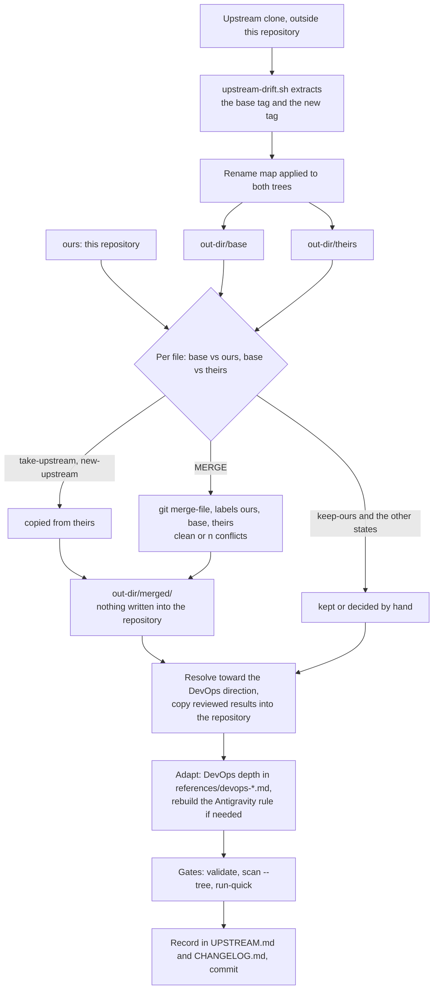

# Upstream sync

How to pull a new obra/superpowers release into this fork without losing the DevOps direction. The lineage and the
current base are recorded in [UPSTREAM.md](../../UPSTREAM.md); this page is the procedure behind it.

<!-- toc -->

## Contents

- [Model: a 3-way merge per file](#model-a-3-way-merge-per-file)
- [The rename map](#the-rename-map)
- [Why DevOps depth lives in `references/devops-*.md`](#why-devops-depth-lives-in-referencesdevops-md)
- [Procedure](#procedure)
- [References](#references)

<!-- /toc -->

## Model: a 3-way merge per file

The fork shares 15 skills with obra/superpowers (the workflow skills and the bootstrap). Each shared file has three
versions:

| Name | What it is |
|---|---|
| **ours** | the file in this repository (the fork) |
| **base** | the file at the last synced upstream tag, the *upstream base* recorded in UPSTREAM.md |
| **theirs** | the file at the new upstream tag |

Comparing ours and theirs directly would report every DevOps edit as a conflict. Comparing both against the base
separates "we changed it", "they changed it" and "both changed it", and `git merge-file` can then combine the two
change sets mechanically.

UPSTREAM.md records tspry/superpowers-devops v1.2.0 as the version taken; this procedure syncs obra/superpowers only.

## The rename map

Upstream and the fork name things differently. `scripts/lib/upstream_drift.py` applies the rename map to *both*
extracted upstream trees before comparing, so renames never show up as differences:

- the directory `skills/using-superpowers` becomes `skills/using-devops-mutant-powers`;
- the skill namespace `superpowers:` becomes `devops-mutant-powers:` (not when preceded by a letter, digit, `_`,
  `.`, `/` or `-`, so `obra/superpowers`, `diagnosing-superpowers`, `.superpowers/` and `~/.config/superpowers` stay);
- the word `using-superpowers` becomes `using-devops-mutant-powers`.

Anything else that differs in naming (prose that says "Superpowers", harness files for harnesses this fork does not
support such as Gemini CLI (command-line interface), Kimi or Pi) shows up as a normal difference and is resolved by
hand.

## Why DevOps depth lives in `references/devops-*.md`

For a shared skill, every line of DevOps text added to `SKILL.md` is a line that can collide with an upstream edit.
So shared skills keep their upstream `SKILL.md` almost unchanged and carry the DevOps depth in a separate file with a
one-line pointer, for example:

- `skills/verification-before-completion/references/devops-proof-table.md`
- `skills/systematic-debugging/references/devops-debugging-heuristics.md`

Upstream never touches those files, so they never conflict, and the `SKILL.md` merge stays mechanical. AGENTS.md
golden rule 5 makes this mandatory.

## Procedure

Prerequisites: `git`, `python3` with tarfile extraction filters (`python3 -c 'import tarfile; print(hasattr(tarfile, "data_filter"))'`
must print `True`), and a clone of obra/superpowers **outside** this repository.



*The 3-way sync: the script only writes to the out-dir, and every result reaches the repository by hand, through the gates.*

1. **Fetch both tags** in the upstream clone:

   ```bash
   git clone https://github.com/obra/superpowers.git <upstream-clone>   # once
   git -C <upstream-clone> fetch --tags
   ```

2. **Produce the drift report.** The base tag is the one in UPSTREAM.md; `<out-dir>` must be outside this
   repository, because the script deletes and recreates `<out-dir>/base` and `<out-dir>/theirs` on every run.

   ```bash
   bash scripts/upstream-drift.sh <upstream-clone> <base-tag> <new-tag> <out-dir>
   bash scripts/upstream-drift.sh <upstream-clone> <base-tag> <new-tag> <out-dir> --paths skills,hooks,docs
   ```

   By default it compares `skills` and `hooks`; `--paths` takes a comma-separated list of directories relative to
   the repository root. It prints one line per file: path, a two-letter state, and an action. The first letter
   compares base with ours, the second base with theirs (`=` unchanged, `M` modified, `D` deleted, `A` added,
   `.` absent):

   | State | Action printed | Meaning and what to do |
   |---|---|---|
   | `=M` | `take-upstream` | only upstream changed: take theirs |
   | `M=` | `keep-ours` | only we changed: keep ours |
   | `MM` | `MERGE` | both changed: 3-way merge |
   | `=D` | `upstream-deleted` | upstream deleted a file we never touched: usually delete it |
   | `MD` | `CONFLICT-ours-edited-upstream-deleted` | decide by hand; move DevOps content elsewhere if the file goes |
   | `DM` | `decide-ours-deleted-upstream-changed` | we removed it on purpose; check whether the upstream change matters |
   | `D=` | `keep-deleted` | stays deleted |
   | `.A` | `new-upstream` | new upstream file: adopt, adapt or skip case by case |
   | `A.` | `ours-only` | fork-only file (DevOps references, our scripts) |
   | `AA`, `DD` | `both-added`, `both-deleted` | review by hand |

   Unchanged files (`==`) are not printed.

3. **Merge.** Add `--merge`:

   ```bash
   bash scripts/upstream-drift.sh <upstream-clone> <base-tag> <new-tag> <out-dir> --merge
   ```

   Results go to `<out-dir>/merged/<path>`; nothing is written into this repository. For each `MERGE` file the
   script copies ours there and runs `git merge-file -L ours -L base -L theirs <merged copy> <base> <theirs>`, which
   folds the base-to-theirs changes into ours and marks conflicts with `ours`/`base`/`theirs` labels. The line says
   `clean` or `<n> conflict(s)`, and a final line totals the conflict hunks. `take-upstream` and `new-upstream` files
   are copied from theirs. `git merge-file` caps the count at 127, so a file reporting 255 means the merge itself
   failed.

4. **Resolve.** Edit the merged files: resolve conflicts toward the DevOps direction, take upstream-only changes as
   they are, and decide new upstream files one by one. Copy the reviewed results into the repository. No conflict
   markers may remain: the pre-commit hook and `tests/validate.py` both reject them.

5. **Adapt.** Keep shared `SKILL.md` files close to upstream; put new DevOps depth into `references/devops-*.md`.
   Cross-skill references use `devops-mutant-powers:<skill>`. If the bootstrap skill or its Antigravity tool
   mapping changed, regenerate the Antigravity rule: `bash scripts/build-antigravity-rule.sh`.

6. **Re-run the gates** (details in [review-gate.md](review-gate.md)):

   ```bash
   bash tests/validate.sh
   bash scripts/scan-sensitive.sh --tree
   bash tests/run-quick.sh
   ```

   `validate` catches the leftovers a sync typically brings: the old `superpowers:` prefix, mentions of Gemini
   outside Antigravity's `~/.gemini` paths, broken relative links, bootstrap size over 120 lines, descriptions outside
   40-500 characters, routing examples that name a missing skill.

7. **Record the sync.** In UPSTREAM.md, advance the "Current base" line to the new tag and its short commit id, and
   add a `### <date> sync (<old tag> → <new tag>)` section listing what was 3-way merged, rebuilt, adopted, skipped and
   kept ours. Add a matching entry to the development changelog, which stays with the unpublished material, and
   summarise the sync in the next release's curated `CHANGELOG.md` section.

8. **Commit** through the hooks with a one-line conventional subject, for example
   `feat(workflow): sync shared skills to <new tag>`.

## References

- <https://git-scm.com/docs/git-merge-file> — argument order `<current> <base> <other>`, `-L` labels, result written over `<current>`, exit status = number of conflicts (capped at 127), negative on error
- <https://docs.python.org/3/library/tarfile.html> — extraction filters added in 3.12, possibly backported; check with `hasattr(tarfile, 'data_filter')`
- <https://github.com/obra/superpowers> — upstream repository and tags
