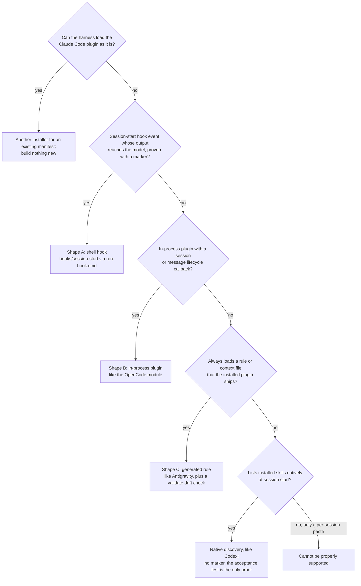

# Porting to a new harness

How to make this plugin's skills trigger automatically in another agent runtime: an IDE (integrated development
environment), a CLI (command-line interface) or an agent runner. Adapted from upstream obra/superpowers'
porting guide, trimmed to this fork's harnesses and real files. Parts 1–3 explain how the system works and how
to tell whether a harness can be supported; Parts 4–6 are the procedure. When this guide and the code disagree, the
code wins; fix the guide.

Supported today: Claude Code, Antigravity CLI, Codex, Cursor and OpenCode; the Cursor, Codex and OpenCode wiring
follows upstream v6.4.2. A new harness joins that list once it meets the definition of done in Part 3.

<!-- toc -->

## Contents

- [Part 1: How the plugin works across harnesses](#part-1-how-the-plugin-works-across-harnesses)
- [Part 2: Can the harness be supported?](#part-2-can-the-harness-be-supported)
- [Part 3: Definition of done](#part-3-definition-of-done)
- [Part 4: Choose an integration shape](#part-4-choose-an-integration-shape)
- [Part 5: Procedure](#part-5-procedure)
- [Part 6: Windows](#part-6-windows)
- [Appendix A: Integrations in this fork](#appendix-a-integrations-in-this-fork)
- [Appendix B: Gotchas](#appendix-b-gotchas)
- [Appendix C: Validator output you can expect](#appendix-c-validator-output-you-can-expect)
- [References](#references)

<!-- /toc -->

## Part 1: How the plugin works across harnesses

The content is the same everywhere; only a thin delivery layer changes per harness. Three components:

1. **Skills (harness-agnostic).** `skills/` is shared verbatim. Skills describe *actions* ("load a skill", "read a
   file", "dispatch a subagent", "create a todo") and never name a harness's tool.
2. **Tool mapping (per harness).** Translates those actions into real tool names:
   `skills/using-devops-mutant-powers/references/<harness>-tools.md` (today: `claude-code-tools.md`,
   `antigravity-tools.md`, `codex-tools.md`). The OpenCode mapping is inline in its module instead.
3. **Bootstrap (per harness).** At the start of every session the bootstrap skill
   `skills/using-devops-mutant-powers/SKILL.md` must reach the model, wrapped in `<EXTREMELY_IMPORTANT>` and
   carrying the build marker `You have devops-mutant-powers v<version>`. **The bootstrap is the whole
   integration**: without it the skills are inert files. How it reaches today's harnesses:
   [session-activation.md](session-activation.md).

Two rules:

- **Skills name actions, not tools.** A port adds a tool mapping and a bootstrap delivery; it never edits skill
  bodies to fit a harness. The one allowed `SKILL.md` edit is a pointer line in the bootstrap's "Platform
  Adaptation" list.
- **Ship through the harness's own install mechanism; never edit the user's files.** The bootstrap, skills and
  mapping arrive as part of what the harness installs (a plugin, an extension, a rule shipped inside the plugin). A
  port must not write into a user's global config. If the install mechanism cannot carry the bootstrap, say so
  instead of working around it. Adding the plugin to a harness's own plugin list (OpenCode's `opencode.json`
  `plugin` entry) is that harness's install step, not a config edit; pasting the bootstrap into the user's
  instruction files is. Codex follows the rule: `codex plugin marketplace add <clone>` adds the repository's own
  Codex marketplace and the plugin is installed from it ([.codex/INSTALL.md](../.codex/INSTALL.md)).

## Part 2: Can the harness be supported?

**Hard requirement: automatic session-start injection**, every session, with no per-session opt-in. It can be:

- a hook that runs a shell command at session start and feeds its output to the model (Claude Code, Cursor, Copilot
  CLI);
- an in-process plugin with a session or message lifecycle callback (OpenCode);
- an always-loaded instructions file or rule that *the installed plugin ships* (Antigravity's plugin rules);
- as the softest form, native skill discovery: the harness lists each installed skill's name and description at
  session start, and the bootstrap skill's own description ("Use at session start…") makes the model load it
  (Codex). There is no wrapper, no marker and no guaranteed load, so the acceptance test is the only proof.

If the only path is "the user pastes a prompt each session", the harness cannot be properly supported.

| Capability | Needed for | If absent |
|---|---|---|
| Skill loading | everything | Fall back to reading the skill's `SKILL.md` with the file-read tool (Part 5, step 5). No skill tool *and* no file read: unsupported |
| File read / write / edit | nearly every skill | Unsupported |
| Shell commands | TDD (test-driven development), verification, git workflows, every DevOps skill | Unsupported |
| Subagent dispatch | `subagent-driven-development`, `dispatching-parallel-agents` | Degradable: `executing-plans` runs the plan inline; never invent a dispatch |
| Todo tracking | multi-step skills | Degradable: a checklist file or artifact (Antigravity uses a task artifact) |
| Web fetch / search | verification against official docs | Degradable |

A "new harness" may also just be another installer for an existing manifest. Check whether it can load the Claude
Code plugin as it is before building anything.

## Part 3: Definition of done

1. The bootstrap loads at session start, every session, with no opt-in, and a fresh session can quote the marker
   line with the current version.
2. A tool mapping exists in `skills/using-devops-mutant-powers/references/<harness>-tools.md`, and the bootstrap's
   Platform Adaptation list points to it.
3. Skills are invocable, natively or by reading `SKILL.md`, and the model follows them.
4. **Acceptance tests pass** in a clean session, before any code or command runs:
   - `Let's make a react todo list` triggers `brainstorming`;
   - `This service keeps crashing after the last deploy` triggers `systematic-debugging` (or `error-reading` when an
     error is pasted).
   Keep the transcript.
5. Automated tests cover the wiring (step 6) and `bash tests/run-quick.sh` passes.
6. A real user installs it with the harness's own install command, and its manifest carries the plugin version
   (step 8).

## Part 4: Choose an integration shape

Learn the harness's actual mechanism first: search its official docs, read a working third-party plugin, and prove
every assumption with a **unique-marker test** (inject a nonsense token, start a fresh session, ask the model to
quote it). A harness derived from another one does not inherit its parent's behaviour; verify, do not assume.

| Shape | The harness… | Reference in this repo |
|---|---|---|
| A: shell hook | runs a command at session start and reads its stdout | `hooks/hooks.json` (Claude Code), `.cursor-plugin/plugin.json` + `hooks/hooks-cursor.json` (Cursor), `hooks/session-start`, `hooks/run-hook.cmd` |
| B: in-process plugin | loads a JS/TS (JavaScript/TypeScript) module with lifecycle callbacks | `.opencode/plugins/devops-mutant-powers.js` via `package.json` `main` (ported from upstream) |
| C: shipped instructions | always loads a rule or context file that the installed plugin ships | `rules/devops-mutant-powers.md`, generated by `scripts/build-antigravity-rule.sh` (Antigravity) |
| Native discovery | lists installed skills itself; no injection | `.codex-plugin/plugin.json` with `"skills": "./skills/"` and `"hooks": {}` (Codex) |

*Choosing the bootstrap delivery, in the order Part 2 lists the mechanisms; a hook system without a proven session-start event falls through to the next shape.*

Shapes compose: skill discovery and bootstrap delivery can use different mechanisms, as long as both ride the
install mechanism. A hook *system* is not a session-start *event*: confirm that the specific event exists and that
its output reaches the model. Antigravity is the example: its documented hook events do not include session start,
so this fork uses Shape C there (details in [session-activation.md](session-activation.md#why-a-rule-and-not-a-hook)).

## Part 5: Procedure

1. **Study the closest reference** from the table above, end to end.
2. **Create the manifest** the harness recognises, with `name`, `version`, `description`. Shape A also needs the
   harness's hook file and a manifest field pointing at it (`.cursor-plugin/plugin.json` declares `skills` and
   `hooks`); Shape B its module plus whatever package metadata the harness reads (this repo's root `package.json`
   points `main` at the OpenCode module and sets `"type": "module"`); Shape C the rule or context file.
   - **Check the harness's fallbacks.** Cursor and Codex both auto-discover `hooks/hooks.json`, Claude Code's hook
     file, when their manifest declares no hooks. Declare the harness's own file (Cursor), or `"hooks": {}` where
     the harness should run none (Codex; an absent field, `[]` or an empty list fall back to discovery).
   - **Check which manifest wins.** Several harnesses read a root `plugin.json` (Antigravity; Codex and Cursor for
     the Agent Plugins format), and Codex also falls back to `.claude-plugin/plugin.json`. Codex skips a root
     `plugin.json` whose `$schema` is not an Agent Plugins schema, which is why Antigravity's does not shadow
     `.codex-plugin/plugin.json`; Cursor's precedence is undocumented.
3. **Wire the bootstrap.**
   - *Shape A*: `hooks/session-start` picks one JSON (JavaScript Object Notation) shape from environment variables:
     `additional_context` when `CURSOR_PLUGIN_ROOT` is set, `hookSpecificOutput.additionalContext` when
     `CLAUDE_PLUGIN_ROOT` is set without `COPILOT_CLI`, top-level `additionalContext` otherwise. Find the exact
     field, nesting, matcher values and plugin-root variable your harness uses, then add a branch *before* any
     branch whose variable your harness also sets (or a separate `hooks/session-start-<harness>` script). Emit one
     field only: a harness that reads two fields injects twice. The hook-file schema itself differs per harness;
     do not assume Claude Code's nested schema is universal. Cursor's is `{"version": 1, "hooks": {"sessionStart":
     [{"command": "./hooks/run-hook.cmd session-start"}]}}`: lowercase event, no matcher, a command relative to
     the plugin root.
   - *Shape B*: read `SKILL.md`, strip the frontmatter, wrap it with the marker and a note that the skill is already
     loaded, append the tool mapping, and inject it. Inject it as a user message rather than a system message
     (upstream found repeated system messages bloat tokens and break some models), guard against duplicate
     injection, cache the content, skip subagent (child) sessions, and re-inject after compaction if the harness
     compacts. The OpenCode module does all of this and reads the marker version from `package.json`, so it holds
     no version literal of its own.
   - *Shape C*: generate the file from the bootstrap and the tool mapping, never hand-edit it, and add a drift check
     to `tests/validate.py` the way `check_antigravity_rule` does. Check the harness's rule-size limits.
4. **Write the tool mapping** in `skills/using-devops-mutant-powers/references/<harness>-tools.md`: file read,
   write and edit, shell, search, web fetch, subagent dispatch (with any config flag needed), todos, and skill
   loading. Get tool names from the harness itself (ask a live session to list its exact tool names), never from
   memory. Add the pointer line to the bootstrap's Platform Adaptation list; the bootstrap must stay within the
   120-line budget `validate` enforces.
5. **No native Skill tool?** Tell the model, in the mapping and the bootstrap delivery, that reading
   `skills/<name>/SKILL.md` with the file-read tool *is* the sanctioned way to load a skill on this harness, as the
   Antigravity rule does. If the harness has no skill discovery at all, the index is the skill descriptions:
   point the model at the `description` lines of `skills/*/SKILL.md` (the bootstrap carries no table).
6. **Add tests.** Shape A: extend `tests/hooks/test-session-start.sh` with the new output shape (it asserts that each
   shape has exactly one top-level key) and the registered command. Shape B: a test that fakes the plugin API
   (application programming interface) and asserts single injection, as `tests/hooks/test-opencode-plugin.sh` does
   for OpenCode V1 and V2. Shape C: the generator drift check in `validate`. Manifest wiring (paths, `hooks`
   fields, marketplace entries): `tests/hooks/test-harness-manifests.sh`. Tests must be offline and named
   `test-*.sh` so `tests/run-quick.sh` picks them up ([testing.md](testing.md)).
7. **Install locally and drive a live session.** Install from your clone with the harness's install-from-path
   command, restart, and run the marker test and both acceptance prompts. Interactive harnesses can be driven from
   a detached `tmux` session (`send-keys` the prompt and `Enter` separately, poll `capture-pane`); clear first-run,
   trust and permission prompts first or the session waits silently.
8. **Distribute and version.** Document the install command (an `INSTALL.md` in the harness directory). Add the new manifest to `VERSIONED_MANIFESTS` in
   `tests/validate.py` (`check_json_and_versions` compares every listed manifest that exists and carries a version)
   and to the release lists in [AGENTS.md](../AGENTS.md#versioning) and
   [maintenance/review-gate.md](maintenance/review-gate.md#release-checklist). Packagers can strip executable bits,
   so every script invocation in skills and hook configs goes through its interpreter (`bash <script>`), as
   `hooks/hooks.json` does. The one exception is Cursor's hook file, which runs `hooks/run-hook.cmd` by its
   relative path, not through `bash`, as upstream does, so that Windows reaches the wrapper's batch half; it relies
   on the wrapper's git mode 100755.

## Part 6: Windows

Only relevant to Shape A. One extensionless Bash script plus the polyglot wrapper covers Windows, macOS and Linux;
do not write per-OS (operating system) variants. See [windows/polyglot-hooks.md](windows/polyglot-hooks.md).

## Appendix A: Integrations in this fork

| Harness | Entry point | Bootstrap | Tool mapping | Tests |
|---|---|---|---|---|
| Claude Code | `.claude-plugin/plugin.json`, `.claude-plugin/marketplace.json`, `hooks/hooks.json` | SessionStart hook, `hookSpecificOutput.additionalContext` | `claude-code-tools.md` (native Skill tool) | `tests/hooks/test-session-start.sh` |
| Antigravity CLI | root `plugin.json`, `rules/` | always-on plugin rule (generated) | `antigravity-tools.md`, inlined into the rule | `validate` drift and trigger checks |
| Cursor | `.cursor-plugin/plugin.json` (`skills`, `hooks`), `hooks/hooks-cursor.json` | `sessionStart` hook, `additional_context` | none (Claude Code–compatible tool surface, per upstream) | `test-session-start.sh` (shape, registered command), `test-harness-manifests.sh` |
| Codex | `.codex-plugin/plugin.json` (`"hooks": {}`), `.agents/plugins/marketplace.json`; [.codex/INSTALL.md](../.codex/INSTALL.md) | native skill discovery, no hook, no marker | `codex-tools.md` | `test-harness-manifests.sh` |
| OpenCode | `.opencode/plugins/devops-mutant-powers.js` via `package.json` `main`; [.opencode/INSTALL.md](../.opencode/INSTALL.md) | in-process user message (V1 transform, V2 context hook) | inline in the module (V1 and V2) | `test-opencode-plugin.sh` (faked APIs) |

The Cursor, Codex and OpenCode rows follow upstream obra/superpowers v6.4.2; what their wiring relies on where a
harness's documentation is silent: [session-activation.md](session-activation.md#cursor-codex-and-opencode). The
hook also keeps upstream's top-level `additionalContext` shape, which Copilot CLI documents, but Copilot CLI has no
manifest or install here. Not ported: upstream's root `index.js` (OpenCode V2 local directory installs), its Codex
packaging and marketplace-sync scripts, and the other harnesses upstream supports and this fork does not (Devin,
Hermes, Kimi, Muse, pi and more).

## Appendix B: Gotchas

- **Opt-in is not a port.** Anything the user must do per session fails Part 2.
- **Wrong JSON field**: silent failure or double injection.
- **Hook-file schema and plugin-root variable differ per harness**; match the harness, not Claude Code.
- **An absent `hooks` field is not "no hooks"**: Cursor and Codex fall back to `hooks/hooks.json`.
- **Several harnesses claim the same manifest file** (root `plugin.json`, `.claude-plugin/plugin.json`); check the
  lookup order of each.
- **A fork of a harness behaves differently from its parent**; prove it with a marker.
- **Hand-edited generated files drift**; regenerate and let `validate` compare.
- **Bare `scripts/x` invocations break** where packagers drop exec bits; call `bash scripts/x`.
- **Editing skills to fit a harness**: never. Fix the tool mapping instead.

## Appendix C: Validator output you can expect

`claude plugin validate .` and `agy plugin validate .` report a few things about this plugin that are correct by design.
Leave them as they are: "fixing" one breaks another harness.

| Harness | Message | Why it is expected |
|---|---|---|
| Antigravity | `AGENTS.md`: never loaded | Antigravity takes the bootstrap from the generated rule in `rules/`; `AGENTS.md` guides agents working on the plugin |
| Antigravity | `commands`: never loaded | Slash commands serve Claude Code and Cursor; Antigravity converts them when the plugin is installed |
| Antigravity | `hooks/hooks.json`: never loaded | Claude Code's hook registration; Antigravity gets the bootstrap from `rules/` |
| Claude Code | `CLAUDE.md` at the plugin root is not loaded as project context | It imports `AGENTS.md` for agents working on the repository; plugin context ships as skills |
| Claude Code | This folder also holds a marketplace manifest | The repository is both the plugin and its own marketplace |

The pre-push check keeps the three Antigravity rows in `tests/known-validator-findings.txt`, so a new finding stands
out.

## References

- <https://github.com/obra/superpowers> — upstream project; this guide adapts its `docs/porting-to-a-new-harness.md` (v6.4.2), including the Codex `"hooks": {}` rationale and the Cursor hook-file schema
- <https://github.com/openai/codex/blob/main/codex-rs/utils/plugins/src/plugin_namespace.rs> — Codex manifest lookup order; a root `plugin.json` counts only with an Agent Plugins `$schema`
- <https://developers.openai.com/plugins/build/plugins> — Codex auto-discovers `hooks/hooks.json` when the manifest defines no `hooks`, an explicit value replaces that discovery; `codex plugin marketplace add` with a local marketplace root; `.codex-plugin/plugin.json` kept as a compatibility fallback
- <https://cursor.com/docs/reference/plugins> — Cursor's two manifest formats (root `plugin.json`, `.cursor-plugin/plugin.json`); a declared `skills` or `hooks` path replaces default folder discovery; no precedence stated when both manifests exist
- <https://cursor.com/docs/hooks> — Cursor's hook-file schema (`"version": 1`, lowercase event names such as `sessionStart`, one `command` per entry) and the `sessionStart` output `additional_context`
- <https://code.claude.com/docs/en/hooks> — Claude Code SessionStart matchers and `additionalContext` output
- <https://antigravity.google/docs/rules> — Antigravity plugin rules are activated automatically; `always_on` trigger; size limits
- <https://antigravity.google/docs/hooks> — Antigravity's documented hook events (no session-start event)
- <https://docs.github.com/en/copilot/reference/copilot-cli-reference/cli-hooks-reference> — Copilot CLI session-start hook with `additionalContext`
