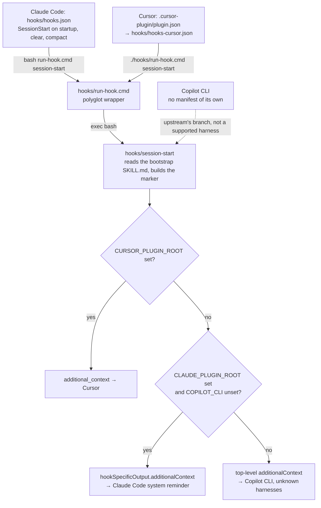

# Session activation

The plugin works only if the bootstrap skill, `skills/using-devops-mutant-powers/SKILL.md`, is in the model's
context when a session starts. It carries The Rule (check for a matching skill before any response or action) and
the skill priority; each skill's description, which every harness lists to the model, says when it applies. Without
the bootstrap the skills are listed but rarely used. This page explains how the bootstrap reaches each harness
and how to troubleshoot it when it does not.

Every injected bootstrap carries a **build marker**, a line that proves which build was loaded. From the shell hook
it also carries the short SHA (Secure Hash Algorithm digest, i.e. the abbreviated commit id) of the plugin's own
clone:

```text
You have devops-mutant-powers v<version>
```

<!-- toc -->

## Contents

- [Overview](#overview)
- [Claude Code](#claude-code)
  - [The chain](#the-chain)
  - [Skill listing budget](#skill-listing-budget)
  - [Marker variants](#marker-variants)
- [Antigravity CLI](#antigravity-cli)
  - [Mechanism: an always-on plugin rule](#mechanism-an-always-on-plugin-rule)
  - [The rule is generated](#the-rule-is-generated)
  - [No Skill tool](#no-skill-tool)
  - [Why a rule and not a hook](#why-a-rule-and-not-a-hook)
  - [Installed as a copy](#installed-as-a-copy)
- [Cursor, Codex and OpenCode](#cursor-codex-and-opencode)
  - [Cursor](#cursor)
  - [Codex](#codex)
  - [OpenCode](#opencode)
  - [The hook's fallback shape](#the-hooks-fallback-shape)
- [Verify activation](#verify-activation)
- [Troubleshooting](#troubleshooting)
- [References](#references)

<!-- /toc -->

## Overview

| Harness | Mechanism | Files | Marker |
|---|---|---|---|
| Claude Code | SessionStart hook | `hooks/hooks.json` → `hooks/run-hook.cmd` → `hooks/session-start` | `v<version>`, plus `(<short SHA>)` when the plugin root is its own git checkout |
| Antigravity CLI (command-line interface) | Always-on plugin rule | `rules/devops-mutant-powers.md`, generated | `v<version>.` |
| Cursor | `sessionStart` hook | `.cursor-plugin/plugin.json` → `hooks/hooks-cursor.json` → `hooks/run-hook.cmd` → `hooks/session-start` | as Claude Code |
| Codex | Native skill discovery, no hook | `.codex-plugin/plugin.json`, `.agents/plugins/marketplace.json` | none |
| OpenCode | In-process plugin, user-message injection | `package.json` `main` → `.opencode/plugins/devops-mutant-powers.js` | `v<version>.` (from `package.json`) |

The Cursor, Codex and OpenCode wiring follows upstream obra/superpowers v6.4.2. Install steps for every harness are
in the [README](../README.md); [Verify activation](#verify-activation) shows how to check each one. The hook also
keeps upstream's Copilot CLI output shape ([below](#the-hooks-fallback-shape)), but Copilot CLI has no manifest or
install here and is not a supported harness.

The shell-hook harnesses share one script, which picks its JSON (JavaScript Object Notation) output shape from
environment variables:



*One script, three registrations, exactly one JSON shape per run; Antigravity, Codex and OpenCode take other paths.*

## Claude Code

### The chain

1. **Hook registration.** Claude Code merges a plugin's `hooks/hooks.json` with the user's hooks. This plugin
   registers one SessionStart hook:

   ```json
   {
     "matcher": "startup|clear|compact",
     "hooks": [{
       "type": "command",
       "command": "bash \"${CLAUDE_PLUGIN_ROOT}/hooks/run-hook.cmd\" session-start",
       "shell": "bash",
       "async": false
     }]
   }
   ```

   - `matcher`: fires on a new session (`startup`), after `/clear` (`clear`) and after auto or manual compaction
     (`compact`). It does not match `resume` or `fork`; those continue an existing conversation, whose transcript
     should already hold the context injected when it started.
   - `command` starts with `bash`, so neither the wrapper nor the script needs an executable bit. Some packagers
     strip file modes; `tests/hooks/test-session-start.sh` proves the hook still works with exec bits removed.
   - `"shell": "bash"` makes Claude Code run the command through Bash on every OS (operating system); on Windows
     that means Git Bash. Without it, Windows machines without Git Bash default to PowerShell.
   - `"async": false` makes Claude Code wait for the hook, so the context exists before the first prompt.
   - `${CLAUDE_PLUGIN_ROOT}` is the plugin's directory:
     `~/.claude/plugins/cache/<marketplace>/<plugin>/<version>/` for the standard install (a release from the
     GitHub repository, copied into the cache), or your clone for a session started with
     `claude --plugin-dir <clone>` (see [concepts.md](concepts.md#plugin-mechanics)).

2. **Wrapper.** `hooks/run-hook.cmd` is a Windows-batch/Bash polyglot. Under Bash its batch half is a no-op heredoc
   and it runs `exec bash "<hooks dir>/<script name>" "$@"`. Details: [windows/polyglot-hooks.md](windows/polyglot-hooks.md).

3. **Script.** `hooks/session-start`:
   - reads the whole bootstrap `SKILL.md`, frontmatter included;
   - escapes it for JSON with Bash parameter expansion (no `jq` needed);
   - builds the marker: the version from `.claude-plugin/plugin.json`, plus `git -C <plugin root> rev-parse --short HEAD`
     only when the plugin root is the top of its own git checkout;
   - wraps everything in `<EXTREMELY_IMPORTANT>`, starting with `You have devops-mutant-powers v<version> (<sha>).`
     and telling the agent to use the Skill tool for every other skill;
   - prints exactly one JSON shape, picked from environment variables:

   | Condition | Output | Consumer |
   |---|---|---|
   | `CURSOR_PLUGIN_ROOT` set (checked first: Cursor may also set `CLAUDE_PLUGIN_ROOT`) | `{"additional_context": "…"}` | Cursor |
   | `CLAUDE_PLUGIN_ROOT` set and `COPILOT_CLI` unset | `{"hookSpecificOutput": {"hookEventName": "SessionStart", "additionalContext": "…"}}` | Claude Code |
   | anything else | `{"additionalContext": "…"}` | Copilot CLI and unknown harnesses |

   Emitting a single shape matters: upstream found that Claude Code reads both `additional_context` and
   `hookSpecificOutput` without de-duplicating, so two fields inject the bootstrap twice. The JSON is printed with
   `printf`, not a heredoc, because heredocs can hang under bash 5.3 and later (upstream issue 571).

4. **Injection.** Claude Code adds `additionalContext` to the conversation as a system reminder before the first
   prompt; it does not show up as a chat message.

**Context cost.** The injected bootstrap is about 6.6k characters, roughly 2.4k tokens, in every session;
`tests/hooks/test-session-start.sh` keeps it under a 9,800-character budget. Routing lives in the skill descriptions
(45 skills), which Claude Code keeps in context whenever the plugin is enabled; `claude plugin details` estimates
them at about 6,000 tokens. The slash commands add none, because `disable-model-invocation: true` keeps their
descriptions out of context.

### Skill listing budget

Claude Code gives the whole skill list (every plugin's skills plus your own) a budget of 1% of the model's context
window. When the list overflows, every skill name stays, but the descriptions of the skills used least are dropped,
and with them the triggers that route to them
([skills docs](https://code.claude.com/docs/en/skills#skill-descriptions-are-cut-short)). The descriptions of this
plugin's 45 skills alone come to about 12,000 characters. That fits the default budget of a 1M-token model, but not
the roughly 8,000 characters a 200k-token model gets. To check your own setup, run
`SLASH_COMMAND_TOOL_CHAR_BUDGET=8000 claude -p --debug-file <log> "Reply OK"` and look for `Skill listing over budget`
in the log.

On a model with a small context window, raise the budget in your own settings: `skillListingBudgetFraction` (for
example `0.02` for 2%) or the `SLASH_COMMAND_TOOL_CHAR_BUDGET` environment variable; `/doctor` estimates the list's
cost, and `/skill-doctor` shows which skills you could turn off. The plugin never changes these settings for you.

### Marker variants

- `v<version> (<sha>)`: loaded from the plugin's own git checkout, normally a clone loaded with `--plugin-dir`.
- `v<version>` with no SHA: loaded from a copied install, which is the standard install (it follows `main`; pinning
  a release tag is optional); the cache directory has no `.git`. Claude Code records the copied commit as
  `gitCommitSha` in `~/.claude/plugins/installed_plugins.json`.
- `v<version>` with no SHA also when the plugin root sits inside some *other* git repository (a vendored copy): the
  hook takes the SHA only when `git rev-parse --show-toplevel` is the plugin root itself, so an enclosing
  repository's HEAD never appears. `tests/hooks/test-session-start.sh` covers all three cases.

## Antigravity CLI

### Mechanism: an always-on plugin rule

Antigravity's rules page documents that it "automatically activates rules packaged inside installed plugins", and
that a rule whose frontmatter says `trigger: always_on` has its full content injected into the system prompt on every
turn. This plugin ships one such rule, `rules/devops-mutant-powers.md`:

```markdown
---
trigger: always_on
description: Bootstrap for the devops-mutant-powers plugin. GENERATED by scripts/build-antigravity-rule.sh, do not edit.
---

<EXTREMELY_IMPORTANT>
You have devops-mutant-powers v<version>.
…
```

Also documented: `trigger` is mandatory (`always_on`, `model_decision`, `glob` or `manual`), and a rule with missing
frontmatter or an unrecognised `trigger` value is silently discarded. A rule file over 24 KB (24,000 bytes) is
truncated; when all active global and always-on rules together exceed 20,000 tokens, Antigravity demotes the largest
rule files to one-line pointers (`- <path>: <description>`) that the agent reads on demand. The generated rule is
about 8 KB, well under the truncation limit; it counts toward that token budget.

### The rule is generated

`scripts/build-antigravity-rule.sh` writes the rule from three inputs: the version in `.claude-plugin/plugin.json`
(read with `jq`), the bootstrap `SKILL.md` with its frontmatter stripped, and
`skills/using-devops-mutant-powers/references/antigravity-tools.md` (the tool mapping). Regenerate it whenever
any of those change, including every version bump:

```bash
bash scripts/build-antigravity-rule.sh            # writes rules/devops-mutant-powers.md
```

`tests/validate.py` rebuilds the rule into a temporary file and fails with `agy-rule-drift` when the committed rule
differs, and with `agy-rule-trigger` when it does not start with the `trigger: always_on` frontmatter. The pre-commit
and pre-push hooks run that validation, so a stale rule cannot be committed.

### No Skill tool

Antigravity has no Skill tool. The rule tells the agent to load a skill by reading its `SKILL.md` with the file-read
tool, and the tool mapping translates the rest (subagents via `invoke_subagent`, todo lists as a task artifact).

### Why a rule and not a hook

- Antigravity's hooks page documents `PreToolUse`, `PostToolUse`, `PreInvocation`, `PostInvocation` and `Stop`. It
  does not document a SessionStart event, nor whether hook output reaches the model.
- Undocumented, and so liable to change: Antigravity CLI 1.3.0 runs SessionStart hooks only in the flat schema
  `{"hooks":{"SessionStart":[{"type":"command","command":"…"}]}}` and silently ignores the nested Claude Code schema.
  The hook's working directory is the staged plugin root, and its environment has `ANTIGRAVITY_CONVERSATION_ID` but
  no plugin-root variable.
- Plugin rules, in contrast, are documented as activated automatically. A documented path wins over an undocumented
  one.

Antigravity looks for a plugin's hooks in `hooks.json` at the plugin root. This repository has none there
(`hooks/hooks.json` is Claude Code's), so Antigravity loads no hook from it.

### Installed as a copy

`agy plugin install <clone>` stages a copy of the whole directory, `rules/` and `.git` included. The plugins and
rules pages name `~/.gemini/antigravity-cli/plugins/<plugin_name>/` for CLI installs; agy 1.3.0 stages under
`~/.gemini/config/plugins/devops-mutant-powers/` instead (the documented global location for plugin folders placed
by hand); check both if unsure. Changes in your clone, including a regenerated rule, reach Antigravity only
after you run `agy plugin install <clone>` again.

## Cursor, Codex and OpenCode

All three follow upstream obra/superpowers v6.4.2.

### Cursor

- **Manifest.** `.cursor-plugin/plugin.json` declares `"skills": "./skills/"` and
  `"hooks": "./hooks/hooks-cursor.json"`. A declared component path replaces Cursor's default discovery for that
  component, so Cursor does not read Claude Code's `hooks/hooks.json`. `commands/`, `agents/` and `rules/` are not
  declared and are discovered from their default folders.
- **Hook file.** `hooks/hooks-cursor.json` uses Cursor's schema, not Claude Code's: `"version": 1`, a lowercase
  `sessionStart` key, no matcher, and the command `./hooks/run-hook.cmd session-start`, relative to the plugin root.
  The wrapper is run directly, so on Windows its batch half finds Git Bash, and on macOS and Linux it needs its exec
  bit (git mode 100755, enforced by `validate`); `session-start` itself is run through `bash` and needs none.
- **Output.** With `CURSOR_PLUGIN_ROOT` set, `session-start` prints `{"additional_context": "…"}`, which Cursor's
  hooks reference describes as context added to the conversation's initial system context.
- **What the wiring relies on**, where Cursor's documentation is silent:
  - Cursor documents expanding `${CURSOR_PLUGIN_ROOT}` in a plugin's MCP server `command`, `args`, `env` and `cwd`,
    but its list of hook environment variables does not include `CURSOR_PLUGIN_ROOT`; upstream relies on Cursor
    setting it. Without it the hook prints top-level `additionalContext`, which Cursor's `sessionStart` output does
    not list.
  - Cursor documents hook working directories for project, user, enterprise and team hooks only; the relative
    command assumes plugin hooks run from the plugin root.
  - Cursor runs `sessionStart` fire-and-forget (the agent loop does not wait for it), so the bootstrap may not be in
    context before the first prompt is answered.
  - Cursor also loads plugins with a root `plugin.json` (the Agent Plugins format); which manifest wins when the
    root `plugin.json` (Antigravity's) and `.cursor-plugin/plugin.json` both exist is not documented.
  - Default `rules/` discovery also sees `rules/devops-mutant-powers.md`, the generated Antigravity rule; Cursor
    documents `description`, `alwaysApply` and `globs` for rule frontmatter, not its `trigger: always_on`.
- **Install:** the plugin is not in Cursor's marketplace, so clone it into Cursor's local plugin folder,
  `git clone https://github.com/nikospavlopoulos/devops-mutant-powers.git ~/.cursor/plugins/local/devops-mutant-powers`
  (a real folder: Cursor skips a symlink that points outside `~/.cursor/plugins/local`). Restart Cursor or run
  **Developer: Reload Window**, then check in **Customize** that the plugin's skills, commands and rules are listed. On
  Teams and Enterprise plans an admin must first turn on **Allow Local Plugin Imports** (Dashboard → Settings →
  Security & Identity → Marketplace and Plugins). Update with
  `git -C ~/.cursor/plugins/local/devops-mutant-powers pull`, then reload. Source:
  [Cursor's plugin docs](https://cursor.com/docs/plugins), section "Test plugins locally".

### Codex

- **Marketplace.** `.agents/plugins/marketplace.json` makes the repository a Codex marketplace with the same name as
  the Claude Code one, `devops-mutant-powers`; its single entry installs the repository root with
  `"source": {"source": "url", "url": "./"}`, as upstream does. OpenAI's build guide describes `url` as a Git-backed
  source for a plugin at the repository root and shows `"source": "local"` with a `path` for local plugins.
- **Manifest.** Codex looks for `plugin.json` at the root only when its `$schema` is an Agent Plugins schema (the
  root `plugin.json` here is Antigravity's), then for `.codex-plugin/plugin.json`, `.claude-plugin/plugin.json` and
  `.cursor-plugin/plugin.json`, in that order. `.codex-plugin/plugin.json` therefore wins; it sets
  `"skills": "./skills/"` and `"hooks": {}`. OpenAI's build guide now calls a root `plugin.json` with the Agent
  Plugins `$schema` the portable entry point and keeps `.codex-plugin/plugin.json` as a supported compatibility
  fallback.
- **Why `"hooks": {}`.** Without a `hooks` field Codex auto-discovers `hooks/hooks.json`, Claude Code's SessionStart
  hook, and holds it for the user to review and trust. An explicit value replaces that discovery; an empty object is
  read as "no hooks", while an absent field or an empty list (`[]`) falls back to discovery (upstream v6.1.1 release
  notes and its Codex manifest test).
- **Bootstrap.** Nothing is injected and there is no marker. Codex lists installed skills natively, and the
  description of `using-devops-mutant-powers` ("Use at session start…") is what makes the model load it. Upstream
  dropped its Codex SessionStart hook because Codex triggered skills reliably without it.
- **Install:** `codex plugin marketplace add <clone>`, then install the plugin from `/plugins` in the Codex CLI (or
  **Plugins** in the app) and restart. Details and verification: [.codex/INSTALL.md](../.codex/INSTALL.md). Subagent
  setup for skills that dispatch: `skills/using-devops-mutant-powers/references/codex-tools.md`.

### OpenCode

- **Entry point.** `package.json` names the module in `main` and sets `"type": "module"`, because the module is ESM
  (ECMAScript modules). Install: [.opencode/INSTALL.md](../.opencode/INSTALL.md).
- **V1** (`opencode` 1.x) loads the named export `DevopsMutantPowersPlugin`: its `config` hook adds `skills/` to
  the live config, and `experimental.chat.messages.transform` puts the bootstrap into the first user message.
- **V2** (`opencode` 2.0.4+) loads the default export `{ id, setup }`: `setup()` registers every skill through
  `ctx.skill.transform()` and injects the bootstrap through `ctx.session.hook("context")`.
- **The injected text** is the bootstrap without frontmatter, wrapped in `<EXTREMELY_IMPORTANT>`, starting with
  `You have devops-mutant-powers v<version>.` (version read from `package.json`, no SHA) and ending with an
  inline OpenCode tool mapping for the running flavor.
- **Injection rules.** It is a user message, not a system message (repeated system messages bloat tokens and break
  some models); a guard skips messages that already contain `EXTREMELY_IMPORTANT`; the content is cached per module
  load; task subagent (child) sessions, identified by a `parentID`, get no bootstrap; after compaction leaves only a
  checkpoint, V2 appends the bootstrap as a new user message.
- **Not shipped:** upstream's root `index.js` re-export, which OpenCode V2 needs for a local *directory* install.
  Git-spec installs resolve `main` and do not need it.

### The hook's fallback shape

When neither the Cursor nor the Claude Code condition holds (for example when `COPILOT_CLI` is set), `session-start`
prints top-level `additionalContext`, the shape the Copilot CLI hooks reference documents for its session-start hook.
The branch comes from upstream. There is no Copilot CLI manifest or install in this repository.

## Verify activation

**Claude Code**

```bash
claude plugin list                                     # devops-mutant-powers@… must be enabled
jq -r '.plugins["devops-mutant-powers@devops-mutant-powers"][0].gitCommitSha' \
  ~/.claude/plugins/installed_plugins.json              # the installed release's commit
CLAUDE_PLUGIN_ROOT=<clone> bash <clone>/hooks/run-hook.cmd session-start \
  | jq -r '.hookSpecificOutput.additionalContext' | head -3   # runs the hook without Claude
claude --debug-file /tmp/claude-hooks.log --init-only  # runs SessionStart hooks, no conversation, no model call, no sign-in
grep -n SessionStart /tmp/claude-hooks.log
grep -o 'You have devops-mutant-powers v[0-9.]*' /tmp/claude-hooks.log   # the marker, from the hook output
claude -p --verbose --include-hook-events --output-format stream-json "hi" \
  | grep -o 'You have devops-mutant-powers v[0-9.]*'   # one model call
```

In `stream-json` output SessionStart hook events are always included; `--include-hook-events` adds the other hook
events. The last command assumes the hook event carries the hook's output; if it prints nothing, use the debug log.
Interactively: start a new session and ask the agent to quote the line of its context that begins with
`You have devops-mutant-powers`. `/hooks` opens a read-only browser that shows the plugin's hook and where it is
defined.

**Antigravity CLI**

```bash
agy plugin list            # the plugin must be listed and enabled
```

Start a new session and ask it to quote the line that begins with `You have devops-mutant-powers`. The answer
must carry the version of your clone's `.claude-plugin/plugin.json`.

**Cursor, Codex and OpenCode**

The offline checks of their wiring:

```bash
bash tests/hooks/test-session-start.sh      # every output shape, both hook files, build-marker scoping
bash tests/hooks/test-harness-manifests.sh  # Cursor and Codex manifests, Codex "hooks": {}, package.json main and type
bash tests/hooks/test-opencode-plugin.sh    # OpenCode V1 and V2 APIs faked: one injection, child sessions skipped
cd <clone> && CURSOR_PLUGIN_ROOT="$PWD" ./hooks/run-hook.cmd session-start \
  | jq -r .additional_context | head -3     # the registered Cursor command, run by hand
```

In a live Cursor or OpenCode session, ask it to quote the line that begins with
`You have devops-mutant-powers`. Codex has no marker; run the acceptance prompts from
[porting-to-a-new-harness.md](porting-to-a-new-harness.md#part-3-definition-of-done) instead.

## Troubleshooting

| Symptom | Likely cause | Fix |
|---|---|---|
| Claude Code: no marker | Plugin not installed or disabled | `claude plugin list`; install or `claude plugin enable devops-mutant-powers@devops-mutant-powers` |
| Claude Code: two bootstraps, or skills from an older DevOps plugin | The predecessor plugin is still enabled | Disable it: [maintenance/global-context.md](maintenance/global-context.md#migrating-from-the-predecessor-plugin) |
| Claude Code: no marker, plugin enabled | Hook failed or did not run | `/hooks`; the `--init-only` debug log above; run the hook by hand; on Windows check that Git Bash is installed |
| Claude Code: old version in the marker | The marketplace was not updated, the install is pinned to an older tag, or the session predates the upgrade | Update, or move the pin: [maintenance/review-gate.md](maintenance/review-gate.md#updating-an-installed-copy); then a new session |
| Claude Code: edits in the clone not visible | The standard install is a cached copy of a tag, which clone edits never reach | Try them with `claude --plugin-dir <clone>`; ship them as a release and upgrade |
| Antigravity: no marker | Plugin missing or disabled | `agy plugin list`; `agy plugin install <clone>` or `agy plugin enable devops-mutant-powers` |
| Antigravity: old version in the marker | The staged copy predates your pull | `agy plugin install <clone>` again, then a new session |
| Antigravity: rule ignored | Frontmatter broken (Antigravity discards such rules silently), or other global and always-on rules push the total past the 20,000-token budget, so the largest rule files are demoted to pointers | `bash tests/validate.sh`; trim other always-on rules |
| `validate` reports `agy-rule-drift` | The bootstrap, the Antigravity tool mapping or the version changed | `bash scripts/build-antigravity-rule.sh` and commit the result |
| Cursor: no bootstrap | Hook did not run from the plugin root, lost its exec bit, or `CURSOR_PLUGIN_ROOT` was not set (the hook then prints the wrong field) | Run the Cursor command by hand (above); `bash tests/hooks/test-session-start.sh` |
| Codex: install asks to trust a SessionStart hook | `.codex-plugin/plugin.json` is missing or its `hooks` is not exactly `{}`, so Codex fell back to `hooks/hooks.json` | `bash tests/hooks/test-harness-manifests.sh` |
| OpenCode: no marker | Plugin not loaded, or a cached older install | `opencode run --print-logs "hello" 2>&1 \| grep -i devops-mutant-powers` (V2: add `--standalone`); [.opencode/INSTALL.md](../.opencode/INSTALL.md#updating) |

## References

- <https://code.claude.com/docs/en/hooks> — SessionStart matcher values (`startup`, `resume`, `clear`, `compact`, `fork`); `hookSpecificOutput.additionalContext` is added as a system reminder; the `shell` field (`bash` default, PowerShell on Windows without Git Bash); `async`; `${CLAUDE_PLUGIN_ROOT}`; `/hooks` browser and `--debug-file … --init-only`
- <https://code.claude.com/docs/en/cli-reference> — `--include-hook-events` (SessionStart events always included, requires `stream-json`), `--init-only`, `--debug-file`, `-p`, `--verbose`
- <https://code.claude.com/docs/en/plugins/components> — plugin hooks live in `hooks/hooks.json`; hook processes receive `CLAUDE_PLUGIN_ROOT`
- <https://code.claude.com/docs/en/skills> — skill descriptions are always in context unless the skill or command sets `disable-model-invocation: true`
- <https://code.claude.com/docs/en/plugins/loading> — copied plugins (git marketplaces, the cache path) versus in-place ones (`--plugin-dir`, local-path marketplaces), `/reload-plugins`
- <https://code.claude.com/docs/en/plugins/cli-reference> — `claude plugin list --json` fields including `readFromFolder`; `claude plugin enable`
- <https://antigravity.google/docs/rules> — mandatory `trigger` and its values, silent discard of invalid frontmatter, plugin rules activated automatically from `~/.gemini/antigravity-cli/plugins/<plugin_name>/rules/`, `always_on` injects the full content every turn, 24,000-byte truncation, 20,000-token budget with demotion of the largest rule files to pointers
- <https://antigravity.google/docs/hooks> — documented hook events (no SessionStart); output handling not documented; plugin hooks in the plugin's `hooks.json`
- <https://antigravity.google/docs/plugins?tab=cli> — plugin layout (`plugin.json`, `hooks.json`, `skills/`, `rules/`), `agy plugin install/list/enable/disable/uninstall`, staging on install
- <https://docs.github.com/en/copilot/reference/copilot-cli-reference/cli-hooks-reference> — Copilot CLI session-start hook output with `additionalContext`
- <https://github.com/obra/superpowers> — upstream v6.4.2 sources of the Cursor, Codex and OpenCode wiring (`.codex-plugin/plugin.json`, `.agents/plugins/marketplace.json`, `.cursor-plugin/plugin.json`, `hooks/hooks-cursor.json`, `hooks/session-start`, `.opencode/plugins/superpowers.js`, `.opencode/INSTALL.md`); its v6.1.1 release notes for why Codex needs `"hooks": {}`
- <https://github.com/openai/codex/blob/main/codex-rs/utils/plugins/src/plugin_namespace.rs> — Codex manifest lookup: root `plugin.json` only with an Agent Plugins `$schema`, then the ordered discoverable manifest paths
- <https://github.com/openai/codex/blob/main/codex-rs/core-plugins/src/manifest.rs> — `.codex-plugin/plugin.json` ahead of `.claude-plugin/plugin.json`; `hooks` accepts a path, a list of paths, an inline object or a list of objects
- <https://developers.openai.com/plugins/build/plugins> — Codex discovers `hooks/hooks.json` when the manifest defines no `hooks`, and an explicit value replaces that discovery; bundled hooks wait for the user to trust them; `codex plugin marketplace add` with a local marketplace root; `"source": "url"` for a plugin at the repository root, `"source": "local"` with `path` for local plugins; plugin hooks receive `PLUGIN_ROOT` and `CLAUDE_PLUGIN_ROOT`; `.codex-plugin/plugin.json` is a compatibility fallback to the root Agent Plugins manifest
- <https://cursor.com/docs/hooks> — `hooks.json` needs `"version": 1`; `sessionStart` is fire-and-forget and its `additional_context` is added to the conversation's initial system context; the hook environment variables (no `CURSOR_PLUGIN_ROOT`); working directories for project, user, enterprise and team hooks
- <https://cursor.com/docs/reference/plugins> — Agent Plugins (root `plugin.json`) and Cursor Plugins (`.cursor-plugin/plugin.json`) formats; manifest `skills` and `hooks` paths replace default discovery; default folders (`skills/`, `rules/`, `agents/`, `commands/`, `hooks/hooks.json`); rule frontmatter `description`, `alwaysApply`, `globs`; `${CURSOR_PLUGIN_ROOT}` and `${CLAUDE_PLUGIN_ROOT}` expansion in MCP server `command`, `args`, `env` and `cwd`
- <https://opencode.ai/docs/plugins/> — plugins load from `.opencode/plugins/` and from the `plugin` list in `opencode.json` (npm packages installed with Bun); a plugin is an exported async function returning hooks
