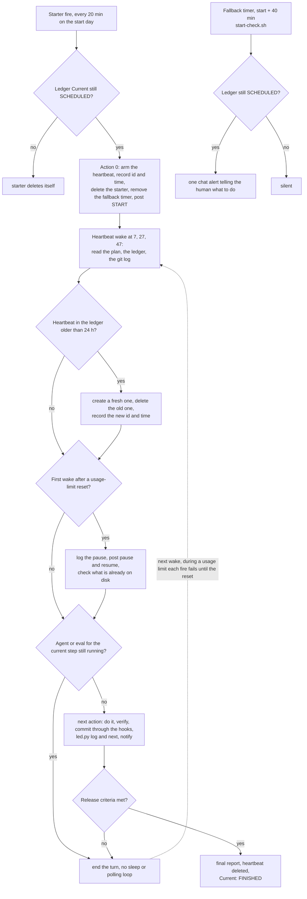

# Unattended runs

How to let one Claude Code session work through an approved plan for hours or days while nobody watches. The run
pauses on usage limits and continues after the reset, survives context compaction, and needs one human action to
recover from a closed session. The scripts and their per-file reference are in
[tooling/automation/unattended-runs/](../tooling/automation/unattended-runs/README.md). The
[`unattended-runs` skill](../skills/unattended-runs/SKILL.md) walks an agent through setting up, resuming and auditing a
run. This page explains the strategy end to end.

<!-- toc -->

## Contents

- [The problem](#the-problem)
- [Building blocks](#building-blocks)
  - [Plan with authorizations](#plan-with-authorizations)
  - [Ledger](#ledger)
  - [Starter job](#starter-job)
  - [Heartbeat and the 24-hour expiry guard](#heartbeat-and-the-24-hour-expiry-guard)
  - [Fallback alert](#fallback-alert)
  - [Notify](#notify)
  - [Notification channels](#notification-channels)
  - [Resumable steps](#resumable-steps)
- [Lifecycle](#lifecycle)
- [The prompts](#the-prompts)
- [Failure modes](#failure-modes)
- [Replicate it in another project](#replicate-it-in-another-project)
- [While it runs](#while-it-runs)
- [Stop or roll back](#stop-or-roll-back)
- [Limits of the method](#limits-of-the-method)
- [References](#references)

<!-- /toc -->

## The problem

A long agent job usually ends early for one of four reasons:

- **Usage limits.** On a Pro or Max plan, Claude and Claude Code share one five-hour session limit and one weekly limit.
  When a window is used up, every request fails with a message such as `You've hit your session limit · resets 10:40pm`
  until the reset. The turn in flight is lost. Background subagents and eval sessions on the same account fail too.
  Files they already wrote stay on disk.
- **Context loss.** As the conversation nears the context window, Claude Code compacts it: the history is replaced by a
  structured summary. Anything that existed only in the chat (what is done, what comes next, why a choice was made)
  can be summarised away.
- **Closed sessions.** Scheduled tasks are session-scoped. They fire only while Claude Code is running and idle.
  Closing the terminal, exiting, rebooting or suspending the machine stops them.
- **Nobody to ask.** A permission prompt or a question waits for an answer that does not come.

Claude Code covers part of the first one on its own. Since v2.1.234, an interactive session signed in with a claude.ai
subscription waits at a usage limit and continues the interrupted task after the reset ("automatic continue"). It
re-arms at most twice in a row, does not start on its own when the reset is more than 24 hours away (a weekly limit),
does not restart after you exit and resume, and the continued task still stops on permission prompts. The method below
works alongside it but does not depend on it.

The core idea: **the disk is the memory, not the chat.** The plan, a ledger file and the git history say where the run
is and what to do next. A recurring scheduled prompt, the heartbeat, wakes the session every 20 minutes and makes it
re-read them. A wake after a limit, after compaction or in a brand-new session behaves the same way.

## Building blocks

| Block | What it is | Where it lives |
|---|---|---|
| Plan | scope, numbered authorizations, execution rules, release criteria | a file; its path is in the ledger |
| Ledger | current state, one next action, log, decisions, blocked items | `~/.local/state/<project>/<run>/ledger.md`, outside the repository |
| Starter job | recurring scheduled task on the start day; starts the run, then deletes itself | the run's Claude Code session |
| Heartbeat | recurring scheduled task every 20 minutes until the final report | the run's Claude Code session |
| Fallback alert | one-shot systemd user timer that runs `start-check.sh` | the machine |
| Notify | `notify.sh`, one line to a chat webhook | the machine |
| Resumable steps | steps that are safe to run again: each checks what is already done and stops on a bad result | the repository; for an eval suite, one `claude plugin eval --case <name>` call per case, so only cases without a complete result run again |

### Plan with authorizations

The plan is written and approved before the run. Besides scope and tasks it holds what makes unattended decisions
traceable:

- **Authorizations**, numbered A1, A2 and so on, each scoped: which paths may change, which commands may run, where
  commits and pushes go, which scheduled tasks the run may create and delete, which channel it may post to.
- **Not authorized**: an explicit list, for example cluster or cloud CLIs (command-line interfaces), force pushes,
  settings changes, deleting branches.
- **Execution rules**: batch sizes, commit and push rhythm, what to do on a failure, what to do instead of asking.
- **Release criteria**: the checks that define "finished".
- **Your side**: what the human does before leaving and while the run goes.

Every later decision traces back to the plan. When the plan leaves something open, the run takes the plan's default
and logs the choice under Decisions. It does not ask: nobody is there to answer.

### Ledger

One Markdown file made from [ledger-template.md](../tooling/automation/unattended-runs/ledger-template.md). It lives
outside the repository, so no checkout, reset or branch switch can touch it.

| Section | Holds |
|---|---|
| header | plan path, repositories and worktrees, the kit directory (`led.py`, `notify.sh`) |
| `## State` | `- Current:` (`SCHEDULED …` until the start, then the phase), starter job id, fallback timer, heartbeat id **and creation time**, last commit and last push |
| `## Next action` | one concrete, self-contained instruction: what to run, what "done" looks like, what to do if it fails. A fresh session with no chat history must be able to act on it |
| `## HEARTBEAT PROMPT` | the heartbeat prompt, verbatim, so any session can re-arm it |
| `## Log` | timestamped lines with commit SHAs (Secure Hash Algorithm commit ids), numbers and file paths |
| `## Decisions` | choices the plan left open, the option taken, and why |
| `## Blocked` | items safe-stopped after two failed fixes, with the evidence |

The run updates the ledger after every step through `led.py`. It writes the new content to a temporary file and renames
it over the ledger, so a crash never leaves half a ledger. Timestamps carry the UTC (Coordinated Universal Time)
offset, so they compare cleanly with commit times afterwards.

### Starter job

For a run that starts later, a recurring scheduled task created in the session that will do the work. Schedule:
`5,25,45 10-23 <day> <month> *`, every 20 minutes from 10:05 to 23:45 on the start day. Its prompt reads the ledger.
If `Current:` no longer says SCHEDULED, the starter deletes itself and does nothing else. Otherwise it starts the
plan's first phase with action 0: arm the heartbeat. It is recurring, not one-shot, because a fire that lands inside a
usage limit does nothing; the first fire after the reset starts the run.

Recurring tasks expire seven days after they are created, so create the starter less than seven days before the start.

### Heartbeat and the 24-hour expiry guard

A recurring scheduled task, `7,27,47 * * * *`, with a plain, self-contained prompt. Each wake reads the plan, the
ledger and the git log. If a background agent or eval for the current step is still running, it ends its turn and
waits for the next wake. Otherwise it continues from the ledger's next action. The heartbeat is armed as **action 0**,
before any other work, so a limit or a crash one minute after the start is still recoverable.

Recurring tasks expire seven days after creation: the task fires one final time, then deletes itself. The heartbeat
prompt therefore carries an **expiry guard**: when the heartbeat recorded in the ledger is older than 24 hours, the
wake creates a fresh one with the same prompt, deletes the old one and records the new id and time. A long pause can
never outlive the heartbeat. After the final report is posted, the heartbeat deletes itself.

Two properties matter more than the schedule:

- **Idempotent wakes.** Every wake runs the same prompt, possibly twice for one step or after a crash in the middle
  of one. A step is recorded as done only after its commit exists, and the next action says how to check whether it
  already happened.
- **No wait loops.** A scheduled prompt fires only between turns. A `sleep` or polling loop inside a turn keeps the
  session busy, so the heartbeat cannot fire, and it spends usage. Long work runs in the background and the turn ends.

Timing: a recurring task starts each run late by up to half the gap to its next run, and by at most 30 minutes. For a
20-minute schedule that is 0 to 10 minutes, the same offset every time, whichever minutes it uses. Only one-shot tasks
care about `:00` and `:30`: there they run up to 90 seconds early. The kit puts the starter (`:05/:25/:45`) and the
heartbeat (`:07/:27/:47`) on different minutes so the two are easy to tell apart in the task list.

### Fallback alert

A one-shot systemd user timer, set about 40 minutes after the planned start, runs `start-check.sh`. If the ledger still
says SCHEDULED, it posts one chat alert telling the human what to do: if the session is still open, the starter keeps
retrying; if it was closed, open Claude Code and ask it to resume the run from the ledger. It only notifies. It never
starts Claude Code and never changes anything. The run's first actions remove the timer. Forty minutes leaves room for
the starter's first fire, its delay, and one retry.

### Notify

`notify.sh` posts one line to Telegram, Discord, Slack or Mattermost (JSON is JavaScript Object Notation). Secrets
reach curl on standard input, never on the command line. Setting up each channel is in
[Notification channels](#notification-channels). The run posts at these points:

| Marker | When |
|---|---|
| START | the run began and the heartbeat is armed |
| phase start and end | each phase, with counts |
| commit, push | commit SHAs and the pushed branch |
| ⚠️ then 🔧 then ✅ | a problem, the fix being tried, the fix confirmed |
| 🛑 | an item safe-stopped after two failed fixes |
| ⏸ and ▶ | a usage-limit pause with its reset time, and the resume |
| final report | release-criteria results and what is still open |

Messages carry no secrets, personal names, addresses or internal hostnames. A failed post is logged in the ledger and
does not stop the run: the ledger, not the channel, is the state.

### Notification channels

Pick one channel. The config folder is `${NOTIFY_CONFIG_DIR:-~/.config/unattended-runs}`. It holds a `webhook` file
(one URL, for Discord, Slack or Mattermost) and a `telegram.env` file (for Telegram). Both must be mode 600. The mode
is checked on the target of a symbolic link. Treat every token and URL as a secret: anyone who has it can post to your
channel.

How `notify.sh` picks the channel with `--channel auto`, the default:

- An explicit `NOTIFY_WEBHOOK_URL` in the environment wins over `telegram.env`.
- Otherwise it uses Telegram when `telegram.env` exists.
- Otherwise the host of the webhook URL decides: `hooks.slack.com` is Slack, `discord.com` and `discordapp.com` are
  Discord, any other host is Mattermost.

`--channel telegram|discord|slack|mattermost` forces one. Any 2xx HTTP (Hypertext Transfer Protocol) status counts as
sent, because Discord answers 204 No Content while Telegram, Slack and Mattermost answer 200. Exit codes: `0` sent,
`1` HTTP failure, `2` config missing or not mode 600.

**Telegram.**

1. In Telegram, open the bot `@BotFather` and send `/newbot`. Give it a name, then a
   username: 5 to 32 Latin letters, digits or underscores, ending in `bot`. BotFather replies with the bot token.
2. Open your new bot in Telegram and send it any first message. A bot cannot message you before you write to it.
3. Read the chat ID from `getUpdates`, with the token on standard input so it stays out of the process list:

   ```bash
   read -rs -p 'Bot token: ' TELEGRAM_BOT_TOKEN; echo
   printf 'url = "https://api.telegram.org/bot%s/getUpdates"\n' "$TELEGRAM_BOT_TOKEN" | curl -sS -K -
   ```

   Find `"chat":{"id":<chat-id>` in the output.
4. Write the file. Replace `<chat-id>` with the number you found in step 3:

   ```bash
   install -d -m 700 ~/.config/unattended-runs
   install -m 600 /dev/null ~/.config/unattended-runs/telegram.env
   printf 'TELEGRAM_BOT_TOKEN=%s\nTELEGRAM_CHAT_ID=%s\n' "$TELEGRAM_BOT_TOKEN" '<chat-id>' > ~/.config/unattended-runs/telegram.env
   unset TELEGRAM_BOT_TOKEN
   ```

Links: [BotFather and `/newbot`](https://core.telegram.org/bots/features#botfather),
[`getUpdates`](https://core.telegram.org/bots/api#getupdates),
[`sendMessage`](https://core.telegram.org/bots/api#sendmessage).

**Discord.** Open the channel's settings, then Integrations, then Webhooks, then New Webhook. Copy the webhook URL
(`https://discord.com/api/webhooks/<...>`) and store it as in the webhook step below. A successful post returns
204 No Content. Link: [Execute Webhook](https://discord.com/developers/docs/resources/webhook#execute-webhook).

**Slack.** Create a Slack app, turn on Incoming Webhooks, add a webhook to your workspace and pick the channel. Copy
the URL (`https://hooks.slack.com/services/<...>`) and store it as in the webhook step below. Link:
[Sending messages using incoming webhooks](https://docs.slack.dev/messaging/sending-messages-using-incoming-webhooks/).

**Mattermost.** Open Integrations, then Incoming Webhooks, then Add Incoming Webhook, and pick the channel. Copy the
URL (`https://<your-server>/hooks/<...>`) and store it as in the webhook step below. An administrator must have
enabled incoming webhooks. Links: [incoming webhooks](https://docs.mattermost.com/integrations-guide/incoming-webhooks.html),
[developer reference](https://developers.mattermost.com/integrate/webhooks/incoming/).

**Store a webhook URL** (Discord, Slack or Mattermost) without echoing it or leaving it in shell history:

```bash
install -d -m 700 ~/.config/unattended-runs
install -m 600 /dev/null ~/.config/unattended-runs/webhook
read -rs -p 'Incoming webhook URL: ' u && printf '%s\n' "$u" > ~/.config/unattended-runs/webhook; unset u; echo
```

**Test the channel.** `--test` sends a fixed line, `notify test: unattended-runs can reach this channel`. Expect
`notify http=200` (or `204` for Discord) and the post in the channel:

```bash
"$KIT/notify.sh" --test
"$KIT/notify.sh" --channel slack --test     # force a channel
"$KIT/notify.sh" --dry-run "unattended run: test"   # payload only, no network
```

### Resumable steps

Any step that can outlast one usage window must be safe to run again. Run
an eval suite as one `claude plugin eval --case <name>` invocation per case, with the results kept per case. After
a usage limit resets, re-run only the cases without a complete result.

"Complete" has to check more than a flag. In practice, a usage-limit hit produced result files that were not marked
partial but in which every run carried an error (`You've hit your session limit · resets …`), and those runs scored
0.00. Count a result as complete only when it is not partial **and** no run carries an `error`.
An interrupted measurement is run again as a whole, never stitched together with results from after the reset.

## Lifecycle

```text
Day before     SET UP   plan approved, ledger "Current: SCHEDULED", notify test posted, starter job created,
                        fallback timer enabled, unused plugins and MCP servers off, /compact, session left idle
Start 10:05    START    starter fires (0-10 min late), ledger still SCHEDULED, so action 0: arm the heartbeat,
                        record its id and time, delete the starter, remove the fallback timer, post START
Start +40 min  CHECK    fallback timer runs start-check.sh; ledger no longer SCHEDULED, so it stays silent
                        (still SCHEDULED: one alert that tells the human what to do)
:07 :27 :47    RUN      heartbeat wakes: read plan, ledger, git log. Agent or eval still running? End the turn.
                        Otherwise: next action, verify, commit, led.py log + next, notify
13:10          PAUSE    usage limit: the turn and background agents stop; their files stay on disk
13:27 ...               heartbeat keeps firing; each fire fails within seconds
18:00          RESET    the limit resets (automatic continue may pick the task up first)
next wake      RESUME   log the pause, post ⏸ and ▶, check what is already on disk, continue from the next action
every 24 h     GUARD    heartbeat older than 24 h: create a fresh one, delete the old one, update the ledger
End            FINISH   release criteria met, final report posted, heartbeat deleted, "Current: FINISHED"
```

The times are an example; MCP is the Model Context Protocol.

1. **Set up** (the day before, or right before a start "now"). Follow [Replicate it in another
   project](#replicate-it-in-another-project). Check every piece once: the ledger has no `<…>` fields left, a test post
   arrived, the starter shows in the session's task list, the timer shows in `systemctl --user list-timers`.
2. **Start.** Action 0 is always the same order: arm the heartbeat, record its id and creation time, delete the starter,
   remove the fallback timer, post START. Arming first means every later failure is recoverable.
3. **Run.** One unit of work per step: do it, verify it, commit it through the repository's hooks (one commit per unit),
   then `led.py log` with the SHA, `led.py next` with the following step, and a notify line. Push after each batch.
4. **Pause on limits.** Nothing to do. Work is never cancelled because of a limit; the heartbeat keeps firing and
   failing until the reset.
5. **Resume.** The first wake after the reset logs the pause, posts ⏸ with the times and ▶, inspects what interrupted
   agents already wrote, continues or relaunches them, and runs any interrupted measurement again from the start.
6. **Finish.** When the release criteria pass: final report, heartbeat deleted, `Current: FINISHED`, the ledger and
   results archived.

What each scheduled fire decides:



*The starter, the fallback timer and the heartbeat all key on the ledger, so a wake after a limit, a compaction or a new session takes the same path.*

Execution rules that held up in practice:

- Batches of at most five writer agents plus their reviewers. Each brief says exactly what the agent may touch, that
  it must not commit, and which commands are forbidden (for infrastructure work: no cluster or cloud CLIs, and
  `KUBECONFIG=/nonexistent` in every shell).
- No evals while heavy agents run: everything on the account shares one usage limit, and the results get noisy.
- Two failed fixes on one item: safe-stop it, log it under Blocked, post 🛑, continue with independent work.
- No questions while the human is away: take the plan's default and log the decision.
- Keep measurement independent of content: briefs for agents that write content never paraphrase the eval cases.

## The prompts

All four prompts are in [prompts.md](../tooling/automation/unattended-runs/prompts.md): the starter, the heartbeat, the
resume prompt for a closed session (new or resumed), and the header for every subagent brief. Fill every `<…>` field;
a scheduled prompt arrives without the conversation that created it.

Keep them plain text. A scheduled fire runs only skills that Claude may invoke on its own; a skill with
`disable-model-invocation: true` reaches Claude as plain text instead of running. The same holds for the
`/unattended-run` command, so it sets a run up but never serves as a scheduled prompt.

The heartbeat prompt, as it stands in the ledger template:

```text
Heartbeat for <run name>: read <ledger path>, check git log in <worktree> and <remote branch>, and continue from the
ledger's next action. If a background eval script or subagent for the current step is still running, end this turn
without a sleep or polling loop; the next wake checks again. Expiry guard: if the heartbeat in the ledger is older
than 24 h, create a fresh one with this same prompt, delete the old one, update the ledger. When the final report is
posted, delete this heartbeat.
```

| Job | Schedule | Created | Deleted |
|---|---|---|---|
| Starter | `5,25,45 10-23 <day> <month> *` | at set-up, less than 7 days before the start | by itself, in action 0 |
| Heartbeat | `7,27,47 * * * *` | in action 0 (or at once, for a start "now") | after the final report; replaced every 24 h |

## Failure modes

| Failure | What you see | How it is handled |
|---|---|---|
| Usage limit mid-step | a gap in the Log, then ⏸ and ▶ | the turn and background agents stop; heartbeat fires fail until the reset; the first wake after it reads the ledger, checks the files on disk and continues. Automatic continue may pick the task up first, from the conversation; the next heartbeat wake re-reads the ledger either way |
| Errored eval results | a run that hit a usage limit scores 0 with an error on every run, and `claude plugin eval` exits non-zero | after the reset, the next wake re-runs only those cases with `--case <name>` |
| Compaction | "Conversation compacted" in the session | nothing depends on chat history. Background commands and subagents keep running (documented); the scheduled tasks were kept (observed) |
| Closed session | silence in the channel; before the start, the fallback alert | open Claude Code in the run's worktree, with `claude --resume`/`--continue` or as a new session, and paste the resume prompt. A resume restores scheduled tasks that have not expired, so the prompt lists them first, keeps exactly one heartbeat and re-arms only when none matches the ledger |
| Expired job | none, if the guard works | the heartbeat replaces itself every 24 h; the starter is created less than 7 days ahead |
| Blocked item | 🛑 and a Blocked entry | safe-stopped after two failed fixes; independent work continues; the human decides later |
| Gate failure | a refused commit and the hook's output | read the output, fix the cause, never bypass the hooks; a refused commit counts as a fix attempt |
| Permission stop | silence; a dialog open in the session | prevent it with precise authorizations and allow rules; only a human can clear an open dialog |
| Silent fallback timer | no alert although the start failed | test the alert path once at set-up (step 6 below) |
| Machine suspended | a gap with no heartbeat lines | nothing fires while the machine sleeps; disable suspend for the run |

Notes on the less obvious rows:

- **Permission stop.** In `auto` mode, when the classifier blocks actions 3 times in a row or 20 times in total, auto
  mode pauses and Claude Code goes back to prompting. An open prompt keeps the turn open, and scheduled prompts fire
  only between turns, so the run stalls without any message.
- **Closed session.** A wait that automatic continue started does not restart when you resume, but restored scheduled
  tasks come back and fire. After `--resume`, check the task list before re-arming anything.
- **Fallback timer misconfigured.** `start-check.sh` exits 2 (the systemd unit shows as failed) when it cannot read the
  ledger, and the service also fails when no webhook is configured; check `systemctl --user status` after installing
  it. A systemd user manager runs only while you are logged in, unless lingering is enabled for your user.
- **Gate failures** seen in practice:
  - Git exports `GIT_DIR`, `GIT_WORK_TREE` and similar variables to hooks. A test that builds a temporary repository
    while a hook runs must clear the variables `git rev-parse --local-env-vars` lists, or it writes into the real
    repository.
  - A commit-message hook that caps the subject (72 characters in this repository) refuses the commit, and the files
    stay staged. Check `git status` before the next commit, or the next unit's commit sweeps them in.
  - Filtering `grep -r` output by a path prefix breaks when the prefix changes with how grep was called. Exclude
    directories with `--exclude-dir` instead.

## Replicate it in another project

Run the shell commands in bash and replace every `<…>` field. Step 5 and parts of steps 7 to 10 happen inside the
Claude Code session that will do the work.

1. Install the kit and run its self-test:

   ```bash
   KIT=~/.local/share/unattended-runs
   mkdir -p "$KIT"
   cp -r <clone>/tooling/automation/unattended-runs/. "$KIT"/
   bash "$KIT/test-unattended-kit.sh"            # expect: unattended kit: ALL OK
   ```

2. Write the plan (scope, authorizations A1…, not authorized, execution rules, release criteria, your side) and get it
   approved. Create the run directory:

   ```bash
   RUN=~/.local/state/<project>/<run>
   mkdir -p "$RUN"
   ```

3. Create the ledger and fill every `<…>` field, including the kit directory and the HEARTBEAT PROMPT section (the
   job ids come in step 5):

   ```bash
   cp "$KIT/ledger-template.md" "$RUN/ledger.md"
   "${EDITOR:-vi}" "$RUN/ledger.md"
   export LEDGER="$RUN/ledger.md"
   python3 "$KIT/led.py" next "<first step: what to run, what done looks like, what to do if it fails>"
   python3 "$KIT/led.py" show
   ```

4. Set up one notification channel and test it: see [Notification channels](#notification-channels). For a webhook:

   ```bash
   install -d -m 700 ~/.config/unattended-runs
   install -m 600 /dev/null ~/.config/unattended-runs/webhook
   read -rs -p 'Incoming webhook URL: ' u && printf '%s\n' "$u" > ~/.config/unattended-runs/webhook; unset u; echo
   "$KIT/notify.sh" --dry-run "unattended run: test"      # prints the JSON payload, sends nothing
   "$KIT/notify.sh" --test                                 # expect: notify http=200 (204 on Discord), and the post
   ```

5. Create the jobs in the session that will do the work. Start Claude Code in the run's worktree in a permission mode
   that does not stop on the run's commands: `auto`, or `dontAsk` with allow rules for exactly those commands
   (`claude --permission-mode dontAsk`). `bypassPermissions` belongs only in an isolated container or VM (virtual
   machine). Then either run the plugin's command, `/unattended-run set up <plan path>`, which loads the
   `unattended-runs` skill and walks through the jobs, or ask Claude directly:

   ```text
   Create a recurring scheduled task with cron "5,25,45 10-23 <day> <month> *" and exactly the starter prompt below.
   Then record it: python3 <kit>/led.py --ledger <ledger> state "Starter cron id" "<id> (5,25,45 10-23 <day> <month> *)"
   and list my scheduled tasks.

   <starter prompt from prompts.md, every field filled in>
   ```

   For a start right now, skip the starter and the timer: ask Claude to create the heartbeat (`7,27,47 * * * *`, the
   prompt from the ledger), record `Heartbeat cron id` as `<id> created <time>`, and begin the plan with action 0.

6. For a scheduled start, install the fallback timer about 40 minutes after the planned start:

   ```bash
   mkdir -p ~/.config/systemd/user
   cp "$KIT"/systemd/unattended-start-check.{service,timer} ~/.config/systemd/user/
   sed -i -e 's|%h/path/to/unattended-runs|%h/.local/share/unattended-runs|' \
     -e 's|%h/path/to/run|%h/.local/state/<project>/<run>|' ~/.config/systemd/user/unattended-start-check.service
   sed -i 's|^OnCalendar=.*|OnCalendar=<YYYY-MM-DD HH:MM:SS>|' ~/.config/systemd/user/unattended-start-check.timer
   systemd-analyze calendar '<YYYY-MM-DD HH:MM:SS>'                  # next elapse = planned start + ~40 min
   systemctl --user daemon-reload
   systemctl --user enable --now unattended-start-check.timer
   systemctl --user list-timers unattended-start-check.timer
   loginctl show-user "$USER" -p Linger                            # no = runs only while you are logged in
   ```

   Test the alert path end to end once. While the ledger says SCHEDULED this posts one real alert:

   ```bash
   systemctl --user start unattended-start-check.service
   journalctl --user -u unattended-start-check.service -n 5 --no-pager   # expect: notify http=200
   ```

7. Trim the session before you leave. Each scheduled fire sends the whole context again.
   - Disable plugins the run does not need (`claude plugin disable <plugin>`) before you open the session, or run
     `/reload-plugins` after; turn off unused MCP servers with `/mcp`.
   - If the session is already long, run `/compact` with a focus on the run.
   - Disable machine suspend for the run's duration.

8. Leave the session open and idle: empty prompt box, no dialog open. Do other work in another terminal.

9. If the session was closed, open Claude Code in the worktree (`claude --resume`/`--continue`, or a new session)
   and paste the resume prompt from prompts.md. It lists the session's scheduled tasks first, because a resume
   restores the unexpired ones, keeps exactly one heartbeat and re-arms only when none matches the ledger.

10. After the final report, confirm the heartbeat is gone (ask for the task list), the timer is removed, and the
    ledger and results are archived.

## While it runs

You must:

- Keep the machine on, awake and online, and the terminal open.
- Watch the channel. Outside a ⏸, silence longer than one heartbeat interval plus its delay means: look at the session.
- Steer, if you must, with one complete message in the session, or by editing the plan. A message sent during a pause
  stays in the conversation and the next turn picks it up.

You must not:

- Leave text in the run's prompt box or a permission dialog open. A half-typed message blocked every fire in practice;
  an open dialog keeps the turn from ending.
- Run `/clear`, `/rewind`, `/login` or `/resume` (another session) in the run's session, or exit it.
- Commit, rebase or switch branches in the run's worktree.
- Edit the ledger by hand while the run is active. Use `led.py`, and only while the run is paused or stopped.
- Start heavy Claude work on the same account elsewhere. It draws from the same limits and brings the next pause
  forward.

## Stop or roll back

1. **Interrupt the current turn**: press `Esc` in the run's session.
2. **Stop the background work**: `Ctrl+X Ctrl+K` stops all running background subagents (press twice within 3
   seconds). Ask Claude to stop its background commands, such as an eval run. Later, re-run each case that has no
   complete result with `--case <name>`; an interrupted case starts again from the beginning.
3. **Delete the jobs**: ask "what scheduled tasks do I have?", then "cancel `<id>`" for the heartbeat and any starter.
   Exiting Claude Code also stops them, but `--resume` restores them. To inspect a resumed session with no task
   firing, start it with `CLAUDE_CODE_DISABLE_CRON=1 claude --resume`.
4. **Remove the fallback timer**, if it is still installed:

   ```bash
   systemctl --user disable --now unattended-start-check.timer
   rm ~/.config/systemd/user/unattended-start-check.{service,timer}
   systemctl --user daemon-reload
   ```

5. **Record it**: `python3 "$KIT/led.py" --ledger "$RUN/ledger.md" state Current "STOPPED <reason>"`,
   `python3 "$KIT/led.py" --ledger "$RUN/ledger.md" log "stopped by hand: <reason>"`, and one notify line.
6. **Roll back**: every unit is one commit, and the ledger Log lists the SHAs. Undo a pushed unit with
   `git revert <sha>` on the run's branch. For work that was never pushed or merged, discard the run's branch or
   worktree. Do not rewrite history others may have pulled. Run the repository's gates after any rollback.

To continue later, set `Current:` back to the phase, write the next action, and paste the resume prompt: it re-arms
the heartbeat only if no matching one is left.

## Limits of the method

- The session must stay open on a running, awake machine. Claude Code documents durable alternatives that need no open
  session: Routines (in the cloud, on a fresh clone without your local files, at least one hour apart), Desktop
  scheduled tasks (on your machine) and GitHub Actions schedules.
- The kit alerts only on a missed start. A stall later in the run (a permission prompt, a suspended machine) shows up
  only as silence in the channel.
- Usage pauses cost wall-clock time, not correctness: plan the calendar time with the reset windows in mind.

## References

- <https://core.telegram.org/bots/features#botfather> — BotFather, `/newbot`, the username rule
- <https://core.telegram.org/bots/api#getupdates> — reading the chat ID after a first message
- <https://core.telegram.org/bots/api#sendmessage> — `chat_id` and `text` of the post
- <https://discord.com/developers/docs/resources/webhook#execute-webhook> — posting to a webhook; success is 204 No Content
- <https://docs.slack.dev/messaging/sending-messages-using-incoming-webhooks/> — Slack app with Incoming Webhooks
- <https://docs.mattermost.com/integrations-guide/incoming-webhooks.html> — creating a Mattermost incoming webhook
- <https://developers.mattermost.com/integrate/webhooks/incoming/> — payload fields of a Mattermost incoming webhook
- <https://code.claude.com/docs/en/scheduled-tasks> — `CronCreate`/`CronList`/`CronDelete`; tasks are session-scoped,
  fire only while Claude Code runs and is idle, between turns; no catch-up; jitter of up to half the gap (at most
  30 minutes) for recurring tasks and early fires for one-shots on `:00`/`:30`; seven-day expiry with one final fire;
  `--resume`/`--continue` restore unexpired tasks; `CLAUDE_CODE_DISABLE_CRON=1`; skills with
  `disable-model-invocation: true` reach a scheduled fire as plain text; Routines, Desktop tasks and GitHub Actions as
  durable alternatives
- <https://code.claude.com/docs/en/skills> — `disable-model-invocation: true` also stops a skill from running when a
  scheduled task fires with it as the prompt
- <https://code.claude.com/docs/en/interactive-mode> — automatic continue at a usage limit (v2.1.234 or later): at most
  two re-arms in a row, not for resets more than 24 hours away, not restarted after exit and resume, ended by
  `/clear`, `/rewind`, `/login` or `/resume`; permissions still prompt; a prompt sent during the wait stays in the
  conversation; `Ctrl+X Ctrl+K` stops background subagents
- <https://code.claude.com/docs/en/context-window> — compaction replaces the conversation with a structured summary;
  background commands and subagents keep running
- <https://code.claude.com/docs/en/costs> — the "You've hit your session limit" message; scheduled tasks send the full
  context at every fire; `/compact` with a focus; `/mcp` to disable unused servers
- <https://code.claude.com/docs/en/permission-modes> — `auto`, `dontAsk` (denies anything not pre-approved, never waits)
  and `bypassPermissions` (isolated containers and VMs only); auto mode falls back to prompting after 3 blocks in a row
  or 20 in total
- <https://code.claude.com/docs/en/plugins/cli-reference> — `claude plugin disable`; enable state applies after
  `/reload-plugins` or in the next session
- <https://support.claude.com/en/articles/11145838-use-claude-code-with-your-pro-or-max-plan> — Claude and Claude Code
  share the same usage limits; Pro and Max have a five-hour session limit and a weekly limit
- <https://github.com/systemd/systemd/blob/main/man/systemd.timer.xml> — `OnCalendar=`; a timer starts the service of
  the same name; `Persistent=` defaults to false (no catch-up of runs missed while powered down)
- <https://github.com/systemd/systemd/blob/main/man/systemd-analyze.xml> — `systemd-analyze calendar` parses an
  `OnCalendar=` expression and prints when it elapses next
- <https://github.com/systemd/systemd/blob/main/man/journalctl.xml> — `--user` reads the journal of your user services
- <https://github.com/systemd/systemd/blob/main/man/loginctl.xml> — lingering starts a user manager at boot and keeps it
  after logout
- <https://git-scm.com/docs/githooks> — hooks get `GIT_DIR`, `GIT_WORK_TREE` and similar variables exported
- <https://git-scm.com/docs/git-rev-parse> — `--local-env-vars` lists the repository-local `GIT_*` variables
- <https://www.gnu.org/software/grep/manual/grep.html> — `--exclude-dir=GLOB` skips matching directories when recursing
- Seen in multi-day runs, not documented: scheduled tasks survived an automatic compaction; heartbeat fires during a
  usage limit each failed within about a second; a half-typed message in the prompt box blocked every fire; a
  usage-limit hit left eval result files not marked partial with an error on every run
