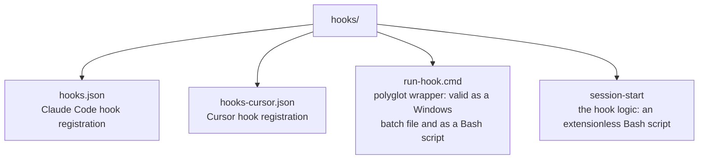
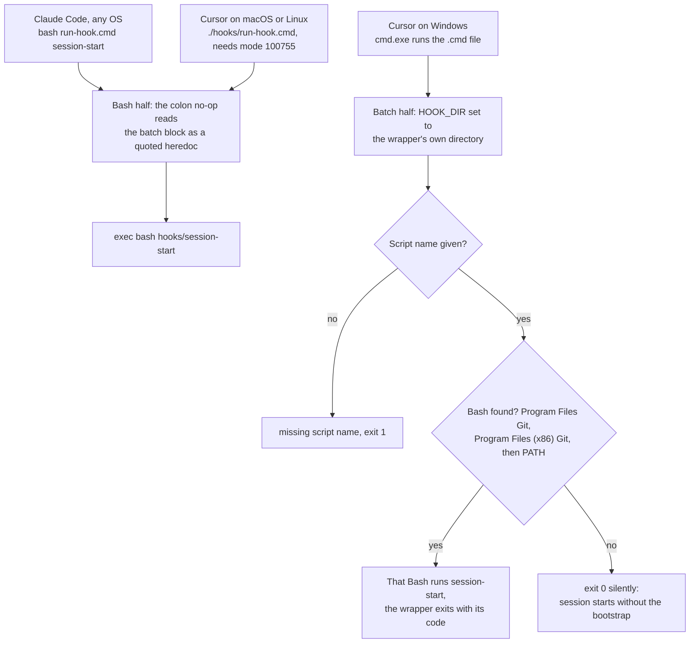

# Polyglot hook wrapper (Windows, macOS, Linux)

The session-start hook has to run on Windows, macOS and Linux. This page explains the wrapper that makes one hook
configuration work on all three, as it exists in this repository. Adapted from upstream obra/superpowers'
`docs/windows/polyglot-hooks.md`.

> **Authoritative source:** [hooks/run-hook.cmd](../../hooks/run-hook.cmd). When this page and the file disagree,
> trust the file.

<!-- toc -->

## Contents

- [The problem](#the-problem)
- [How this repository solves it](#how-this-repository-solves-it)
- [How `run-hook.cmd` works](#how-run-hookcmd-works)
  - [Under Bash (macOS, Linux, Git Bash on Windows)](#under-bash-macos-linux-git-bash-on-windows)
  - [Under `cmd.exe`](#under-cmdexe)
- [Design decisions](#design-decisions)
- [Writing a cross-platform hook script](#writing-a-cross-platform-hook-script)
- [Testing](#testing)
- [Troubleshooting](#troubleshooting)
- [References](#references)

<!-- /toc -->

## The problem

Claude Code runs a hook's command through a shell: Bash on macOS and Linux, and on Windows Git Bash when it is
installed, otherwise PowerShell. A Bash-style command line does not parse in PowerShell or in CMD (the Windows
Command Prompt, `cmd.exe`), and Windows cannot execute an extensionless Bash script directly.

## How this repository solves it

Three pieces, in `hooks/`:



*The files in `hooks/`: one registration per harness, the polyglot wrapper, and the hook logic it runs.*

The Claude Code registration (`hooks/hooks.json`):

```json
{
  "type": "command",
  "command": "bash \"${CLAUDE_PLUGIN_ROOT}/hooks/run-hook.cmd\" session-start",
  "shell": "bash",
  "async": false
}
```

This differs from upstream in one deliberate way: upstream's command starts with the quoted wrapper path, while this
fork's starts with `bash`. Consequences:

- `"shell": "bash"` makes Claude Code use Bash (Git Bash on Windows) instead of falling back to PowerShell.
- The leading `bash` runs the wrapper as a Bash script on every OS (operating system). Neither `run-hook.cmd` nor
  `session-start` needs an executable bit, which matters because some packagers strip file modes.
- The path is quoted because `${CLAUDE_PLUGIN_ROOT}` can contain spaces.
- With this registration the batch half of `run-hook.cmd` never runs under Claude Code.

Cursor's registration (`hooks/hooks-cursor.json`, the file `.cursor-plugin/plugin.json` points at) follows upstream
instead and names the wrapper directly, by a path relative to the plugin root:

```json
{
  "version": 1,
  "hooks": {
    "sessionStart": [
      { "command": "./hooks/run-hook.cmd session-start" }
    ]
  }
}
```

- On Windows, where `cmd.exe` can execute the `.cmd` file, this is the path that reaches the wrapper's batch half,
  which then finds Git Bash.
- On macOS and Linux the wrapper runs as a script by itself, so it needs its executable bit (git mode 100755,
  enforced by `validate`); `session-start` is still started through `bash` and needs none.
- The relative path assumes Cursor runs plugin hooks from the plugin root; Cursor's hooks reference documents the
  working directory only for project, user, enterprise and team hooks, so this rests on upstream's port.

## How `run-hook.cmd` works

The file starts with `: << 'CMDBLOCK'` and the batch code sits between that line and a line reading `CMDBLOCK`.

### Under Bash (macOS, Linux, Git Bash on Windows)

1. `:` is the no-op builtin and `<< 'CMDBLOCK'` feeds it a quoted heredoc, so the whole batch section is read and
   ignored.
2. After the `CMDBLOCK` terminator, the script resolves its own directory, takes the first argument as the script
   name, shifts it off, and runs `exec bash "<hooks dir>/<script name>" "$@"`.

### Under `cmd.exe`

1. The first line is a label-like line `cmd.exe` skips; `@echo off` silences echoing.
2. With no script-name argument it prints `run-hook.cmd: missing script name` and exits 1.
3. It sets `HOOK_DIR` to the wrapper's own directory (`%~dp0`).
4. It looks for Bash, in order: `C:\Program Files\Git\bin\bash.exe`, `C:\Program Files (x86)\Git\bin\bash.exe`, then
   `bash` on `PATH` (found with `where bash`). The first Bash found runs `"%HOOK_DIR%<script name>"` with up to eight
   further arguments (`%2`–`%9`), and the wrapper exits with Bash's exit code.
5. With no Bash anywhere it exits 0 silently: the session starts, but without the bootstrap and without an error.
6. Every branch ends in `exit /b`, so `cmd.exe` never reaches the Bash half.



*Which half of `run-hook.cmd` runs: the Bash half for every Bash caller, the batch half only when `cmd.exe` executes the file.*

## Design decisions

| Decision | Why |
|---|---|
| Extensionless hook scripts (`session-start`, not `session-start.sh`) | Upstream reports that Claude Code on Windows prepends `bash` to commands containing `.sh`, which interferes with the dispatcher; keep new scripts extensionless too |
| One wrapper, one script per hook | No per-OS variants to keep in sync |
| No login shell (`-l`) | Hook scripts must not depend on login-shell `PATH` setup |
| Silent exit when no Bash is found | The harness keeps working; only the context injection is skipped |
| `bash` prefix in the Claude Code command | Works when packagers strip exec bits; covered by a test |
| Wrapper named directly in Cursor's command | Matches upstream, and lets Windows reach the batch half; relies on the exec bit elsewhere |

## Writing a cross-platform hook script

Put the logic in an extensionless Bash script under `hooks/` and call it through the wrapper.

Do:

- use Bash builtins where possible, quote every expansion (`"$VAR"`), use `$(command)` rather than backticks;
- derive paths from the script's own location, as `session-start` does (`SCRIPT_DIR`, `PLUGIN_ROOT`), instead of
  trusting an environment variable;
- print the JSON (JavaScript Object Notation) with `printf`; upstream replaced heredocs in this script after a hang
  with Bash 5.3, and `session-start` keeps the `printf` form.

Avoid:

- tools that may be missing on a fresh machine (`session-start` needs only Bash, `cat` and `sed`, plus `git` when
  it is available);
- a `.sh` extension on hook scripts.

`session-start` escapes the skill text for JSON with parameter expansion, without external tools:

```bash
escape_for_json() {
    local s="$1"
    s="${s//\\/\\\\}"
    s="${s//\"/\\\"}"
    s="${s//$'\n'/\\n}"
    s="${s//$'\r'/\\r}"
    s="${s//$'\t'/\\t}"
    printf '%s' "$s"
}
```

## Testing

```bash
bash tests/hooks/test-session-start.sh
```

It runs the hook directly and through `run-hook.cmd` under Bash, checks every JSON shape, checks that `hooks.json`
uses `shell: bash` and a `bash`-prefixed command, checks that `hooks-cursor.json` registers
`./hooks/run-hook.cmd session-start` and runs that command from the plugin root, and re-runs the Claude Code hook
from a copy of the repository with the exec bits removed. It runs under Bash, so it checks the Bash half of the
wrapper.

## Troubleshooting

| Symptom | Cause | Fix |
|---|---|---|
| Windows: no bootstrap | Git Bash is missing, which the hook needs because it is registered with `"shell": "bash"`; or `cmd.exe` ran the wrapper directly, found no Bash and exited 0 silently | Install Git for Windows in its default location, or put `bash` on `PATH` |
| Windows: a `.sh`-related error or the script opens in an editor | A hook command names a `.sh` file | Keep hook scripts extensionless |
| Hook works on Linux, not under another harness | That harness uses a different hook schema, matcher or plugin-root variable | Check its registration file; see [../session-activation.md](../session-activation.md) |
| `Permission denied` running the hook | A command invokes the wrapper or script directly after exec bits were stripped | Invoke through `bash`, as `hooks/hooks.json` does; Cursor's command calls the wrapper directly, so its installed copy must keep the wrapper executable |

## References

- <https://code.claude.com/docs/en/hooks> — the `shell` field (`bash` or `powershell`; default Bash, or PowerShell on Windows without Git Bash) and `${CLAUDE_PLUGIN_ROOT}`
- <https://code.claude.com/docs/en/plugins/components> — quote `${CLAUDE_PLUGIN_ROOT}` when the command runs through a shell
- <https://github.com/obra/superpowers> — upstream's version of this page (`docs/windows/polyglot-hooks.md`, v6.4.2), including the extensionless-script rationale; its `hooks/hooks-cursor.json`, which this fork's Cursor registration follows
- <https://cursor.com/docs/hooks> — `hooks.json` needs `"version": 1`; a hook `command` can be a relative path; working directories are documented for project, user, enterprise and team hooks only
- <https://cursor.com/docs/reference/plugins> — a plugin's `hooks` manifest field replaces discovery of `hooks/hooks.json`
- <https://github.com/anthropics/claude-code/issues/9758> and <https://github.com/anthropics/claude-code/issues/3417> — the Windows hook issues upstream cites (`.sh` scripts opening in an editor; hooks not working on Windows)
- <https://github.com/git-for-windows/git> — Git for Windows, which provides `bash.exe`
