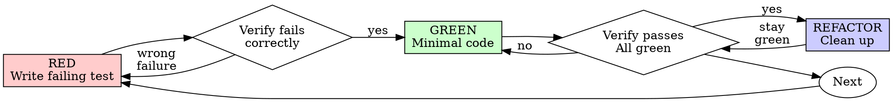

# Test-Driven Development (TDD) for DevOps

## Overview

Write the test first. Watch it fail. Write minimal code to pass.

**Core principle:** If you didn't watch the test fail, you don't know if it tests the right thing.

**This applies to all DevOps artifacts:** Terraform modules, Kubernetes manifests, CI pipeline configs, shell scripts, Ansible playbooks, and monitoring rules.

**Violating the letter of the rules is violating the spirit of the rules.**

## When to Use

**Always:**
- Terraform/Pulumi/Ansible modules — write validation tests first
- Kubernetes manifests — write `kubeconform` (offline) validation first; `kubectl --context <ctx> -n <ns> apply --dry-run=server` only on a cluster you may touch
- CI/CD pipeline changes — write the test job or step first
- Shell scripts and automation — write BATS or shunit2 tests first
- Monitoring/alerting rules — write the query and expected output first
- Any configuration change that affects production behavior

**Exceptions (ask your human partner):**
- Throwaway prototypes or one-shot environment teardowns
- Generated configuration (helm template output, kustomize build output — verify the generator instead)
- Exploratory debugging where you don't yet know the root cause

Thinking "skip TDD just this once"? Stop. That's rationalization.

## The Iron Law

```
NO PRODUCTION CONFIG WITHOUT A FAILING TEST FIRST
```

Write code before the test? Delete it. Start over.

**No exceptions:**
- Don't keep it as "reference"
- Don't "adapt" it while writing tests
- Don't look at it
- Delete means delete

Implement fresh from tests. Period.

## Red-Green-Refactor



### RED — Write Failing Test

Write one minimal test showing what should happen.

**For Terraform modules:**
```hcl
# tests/instance_test.tftest.hcl

run "create_instance_uses_correct_ami" {
  assert {
    condition     = aws_instance.app.ami == "ami-0c55b159cbfafe1f0"
    error_message = "Expected production AMI, got ${aws_instance.app.ami}"
  }
}
```

**For Kubernetes manifests:**
```bash
# Validate manifest against cluster API before applying
kubectl --context <ctx> -n <ns> apply --dry-run=server -f manifests/deployment.yaml
```

**For shell scripts:**
```bash
# bats test
@test "healthcheck fails for unreachable endpoint" {
  run ./healthcheck.sh http://localhost:9999
  [ "$status" -eq 1 ]
  [[ "$output" == *"Connection refused"* ]]
}
```

**For CI pipelines:**
```yaml
# .github/workflows/test.yml
jobs:
  validate:
    runs-on: ubuntu-latest
    steps:
      - uses: actions/checkout@v4
      - name: Run validation
        run: make validate  # This test should fail first
```

**Requirements:**
- One behavior per test
- Clear name describing the expected outcome
- Test against real behavior (schema validation, dry-run, plan output), not mocks

### Verify RED — Watch It Fail

**MANDATORY. Never skip.**

```bash
# Terraform
terraform test

# Kubernetes manifest validation
kubectl --context <ctx> -n <ns> apply --dry-run=server -f manifests/deployment.yaml; echo $?

# Shell scripts
bats tests/healthcheck.bats

# CI config validation
act --job validate --dryrun
```

Confirm:
- Test fails (not errors)
- Failure message is expected
- Fails because the feature/validation is missing (not because of setup issues)

**Test passes?** You're testing existing behavior. Fix the test.

**Test errors?** Fix the test setup, re-run until it fails correctly.

### GREEN — Minimal Code

Write simplest code to pass the test.

**For Terraform:**
```hcl
resource "aws_instance" "app" {
  ami           = var.production_ami
  instance_type = var.instance_type
  # Just enough to pass
}
```

**For Kubernetes:**
```yaml
apiVersion: v1
kind: Service
metadata:
  name: app-service
spec:
  selector:
    app: myapp   # Added to match the test's expectations
  ports:
    - port: 80
```

**For shell scripts:**
```bash
#!/bin/bash
# healthcheck.sh — minimal implementation
if ! curl -sf "${1:?usage: healthcheck.sh <url>}" > /dev/null 2>&1; then
  echo "Connection refused"
  exit 1
fi
echo "OK"
```

Don't add features, refactor other code, or "improve" beyond the test.

### Verify GREEN — Watch It Pass

**MANDATORY.**

```bash
# Rerun the same test
terraform test
# or
bats tests/healthcheck.bats
```

Confirm:
- Test passes
- Other tests still pass
- Output pristine (no errors, warnings)

**Test fails?** Fix config/code, not the test.

**Other existing tests fail?** Fix the gap now.

**"Other tests" means the project's suite, not just your file.** A
green run of the test you wrote is not a green suite. Before you call
the change done, run the project's test command (bare `pytest`,
`npm test`, `terraform test`, `helm unittest` — whatever the repo uses) even when your task
named only one test file. A scope statement in your task bounds the
deliverable, not your verification. Any failure that run shows —
including one you didn't cause — goes in your report by name; a red
test you watched scroll past and didn't mention is a report falsified
by omission.

### REFACTOR — Clean Up

After green only:
- Remove duplication (DRY up Terraform resources, extract common variables)
- Improve names (resource names, variable names, job names)
- Extract helpers (shared Terraform modules, common shell functions, composite GitHub Actions)

Keep tests green. Don't add behavior.

### Repeat

Next failing test for next feature or validation.

## DevOps-Specific Testing Tools

| Category | Tool | Example Test |
|----------|------|-------------|
| **IaC** | `terraform validate` / `terraform test`; `terraform plan` only with approval (live read of real state) | Assert resource attributes, validate outputs |
| **IaC** | `terraform validate` / `tflint` | Syntax and style checks |
| **IaC** | `checkov` / `tfsec` | Security policy compliance |
| **Kubernetes** | `kubeconform` offline; `kubectl --context <ctx> -n <ns> apply --dry-run=server` | Validate against the schema; the server dry-run contacts the cluster and runs admission webhooks |
| **Kubernetes** | `kubeconform` / `kubeval` | Offline manifest validation |
| **Kubernetes** | `conftest` with OPA/Rego | Policy-as-code for manifests |
| **Helm** | `helm lint` / `helm template \| kubeconform` | Chart structure and template output |
| **Shell** | BATS | Unit tests for shell scripts |
| **Shell** | shellcheck / shfmt | Static analysis |
| **Ansible** | `ansible-playbook --syntax-check` / `ansible-lint` | Playbook validation |
| **CI/CD** | `act` (local runner) / `nektos/act` | Run GitHub Actions locally |
| **CI/CD** | `yamllint` / `pre-commit` | Config file validation |
| **Monitoring** | `promtool check rules` | Validate Prometheus rules and alerts |

When writing or changing any test, read [writing-good-tests.md](writing-good-tests.md) for the rules that keep tests honest:
- Name the production change that would make the test fail — before writing it
- Assert on real behavior, never on mock behavior
- Keep test-only code in test utilities, out of production classes
- Understand a dependency's side effects before mocking it

## Common Rationalizations

| Excuse | Reality |
|--------|---------|
| "Too simple to test" | One-line configs cause outages. The test takes seconds. |
| "I'll test after" | Tests written after pass immediately — which proves nothing. They may test the wrong thing, test the implementation instead of the behavior, or miss the edge case you forgot. You never watched it fail, so you never proved it can catch the bug. Test-first forces that failure. |
| "Tests after achieve same goals (spirit not ritual)" | Tests-after answer "what does this do?"; tests-first answer "what should this do?" Tests written after are biased by the code you already wrote — you verify the cases you remembered, not the ones you'd have discovered. Coverage without proof the tests work. |
| "terraform plan is my test" | A plan shows drift, not correctness: it says a resource will change, not that its configuration is right. A test validates intent. |
| "Already manually validated" | Manual validation is ad-hoc: one environment, once, no re-runnable record. `kubectl --context <ctx> -n <ns> apply --dry-run=server` takes seconds and catches API-version mismatches, missing fields and RBAC gaps. |
| "Deleting a configured module is wasteful" | Sunk cost fallacy — that time is spent either way. The real choice: rewrite with TDD (high confidence) vs. bolt tests on after (low confidence, likely gaps). Keeping config you can't trust is the waste. |
| "Keep as reference, write tests first" | You'll adapt it. That's testing after. Delete means delete. |
| "Need to explore the API first" | Fine. Throw away exploration, start with TDD. |
| "Test hard = module design unclear" | Listen to the test. Hard to test = hard to use. |
| "TDD will slow down IaC development" | TDD is the pragmatic path: it catches broken config before commit and prevents incident response. "Pragmatic" shortcuts mean debugging in production — slower, not faster. |
| "kubectl apply already validates" | Only the API schema. Not logic, policies or intent. |
| "IaC doesn't need tests — it's just config" | Config IS code. A missing IAM policy, a wrong firewall rule, a typo in a domain name all cause incidents. TDD catches them at test time, not incident time. |
| "Manual test faster" | Manual doesn't prove edge cases. You'll re-test every change. |
| "Existing infrastructure has no tests" | You're improving it. Write tests before changes. |

## DevOps-Specific Red Flags — STOP and Start Over

- Config or code before test
- Test after implementation
- "I'll just run terraform plan to check"
- "I already manually tested it"
- "kubectl apply --dry-run=client is good enough" (use `=server` for real validation)
- "Tests after achieve the same purpose"
- "This is just config, not code"
- "Keep as reference" or "adapt existing config"
- "Already spent X hours writing it, deleting is wasteful"
- "Testing against production is faster" (never test against production)
- "TDD is for software, not infrastructure"
- "I'll add the test in the next PR"

**All of these mean: Delete config. Start over with TDD.**

## Verification Checklist

Before marking work complete:

- [ ] Every new resource/module/manifest has a validation test
- [ ] Watched each test fail before implementing
- [ ] Each test failed for expected reason (validation missing, not setup error)
- [ ] Wrote minimal config to pass each test
- [ ] All tests pass
- [ ] Output pristine (no errors, warnings)
- [ ] Tests use real validation (terraform validate/test, a schema check, an approved plan or server dry-run) — not custom mocks
- [ ] Edge cases and failure modes covered
- [ ] Rollback validated (undo plan passes)

Can't check all boxes? You skipped TDD. Start over.

## When Stuck

| Problem | Solution |
|---------|----------|
| Don't know how to test an IaC module | Write the `terraform { assert { ... } }` block first. Ask your human partner. |
| Terraform test too complex | Module design too complex. Simplify variables, split resources. |
| Kubernetes validation setup huge | Use `kubeconform` offline. Still complex? Simplify the manifest. |
| Must mock cloud provider | If you need to mock, you're over-testing. Test the config shape, not cloud behavior. |
| Shell script testing hard | Extract logic into small functions. Test each function with BATS. |

## Debugging Integration

Infrastructure bug found? Write a failing test reproducing it. Follow TDD cycle. Test proves fix and prevents regression.

**Never fix broken infrastructure without a test.**

## Final Rule

```
Production config → test exists and failed first
Otherwise → not TDD
```

No exceptions without your human partner's permission.
