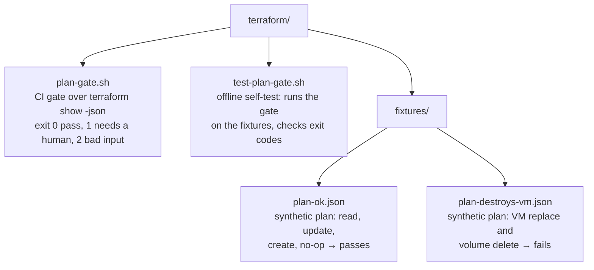

# Terraform Templates

CI plan gate plus module conventions. Skill: `infrastructure-provisioning` (its `terraform-plan-gate` reference).

## Files



*The plan gate, its offline self-test, and the two synthetic plans the test runs it against.*

## Plan gate

```bash
terraform plan -input=false -out=tfplan
terraform show -json tfplan > plan.json
bash tooling/iac/terraform/plan-gate.sh plan.json     # prints a VERDICT/ACTIONS/ADDRESS table and RESULT
bash tooling/iac/terraform/test-plan-gate.sh          # self-test, no Terraform needed
```

| Variable | Default | Effect |
|---|---|---|
| `PROTECTED_TYPES_REGEX` | VMs, clusters, LBs, public IPs, networks, disks/volumes, secrets/keys, DNS zones, buckets/storage, databases | delete/replace/forget of a matching type is `HARD_STOP` (always blocks, even if `ALLOWED_ACTIONS` lists the action) |
| `ALLOWED_ACTIONS` | `no-op read create update` | action sets that pass unreviewed |
| `ALLOW_UNPROTECTED_DELETE` | `false` | `true` lets delete/replace of non-protected types pass (still listed as `REVIEW`) |
| `SHOW_NOOP` | `false` | `true` also lists unchanged resources |

Unknown actions, an errored plan, state JSON instead of plan JSON, or a `format_version` other than `1.x` fail closed.
Apply only the reviewed `tfplan` file from a manual CI job; never re-plan in the apply job.

## Module conventions

- One module per concern; each environment root differs **only in values** (tfvars), never in copied resources.
- Pin `required_version` and providers; commit `.terraform.lock.hcl`.
- Every value a user must edit carries a `# CHANGE:` comment.

```hcl
module "vpc" {
  source = "./aws/vpc"   # CHANGE: module path
  name   = "my-vpc"      # CHANGE: name
  cidr   = "10.0.0.0/16" # CHANGE: non-overlapping private range
}
```

See each module's `variables.tf` for required inputs.
